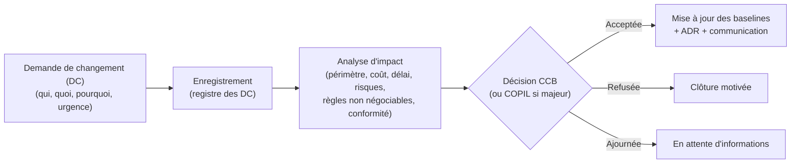
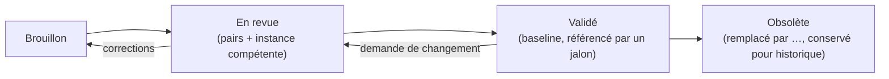

# B.4 Gestion des changements, des versions et documentaire — BuildNote

> **Statut : En revue — Couche 2.** Date : 2026-09-08.

---

## Partie 1 — Gestion des changements

### 1.1 Périmètre
Tout changement affectant une **baseline validée** : périmètre, objectifs, exigences (cahier des
charges gelé en J3), architecture (ADR), modèle canonique, planning, budget.

### 1.2 Processus



### 1.3 Classification

| Classe | Exemple | Décideur | Délai cible |
|---|---|---|---|
| Mineur | Reformulation d'exigence sans impact | Product Manager + SW Architect | 3 j |
| Majeur | Nouvelle exigence, changement d'architecture, dérive planning/budget < seuil | CCB | 10 j |
| Critique | Changement de périmètre, remise en cause d'une règle non négociable, dépassement budget > seuil | COPIL + Sponsor | 15 j |

### 1.4 Règle spéciale
Toute DC touchant une **règle non négociable** (validation humaine OCR, non-recalcul automatique du
Module 2, dashboard à la demande, explicabilité des recommandations, isolation des établissements,
interopérabilité par modèle canonique, bilinguisme FR/EN) est **automatiquement critique** et
instruite par le COPIL avec avis du référent éthique/juridique.

### 1.5 Registre des DC
Champs : ID, date, demandeur, description, justification, classe, analyse d'impact, décision, date
de décision, baselines impactées, ADR associé, statut.

---

## Partie 2 — Gestion des versions

### 2.1 Objets versionnés et schéma

| Objet | Schéma de version | Règle |
|---|---|---|
| **Produit BuildNote** | SemVer `MAJEUR.MINEUR.CORRECTIF` | MAJEUR = rupture de compatibilité (API, données) ; MINEUR = fonctionnalité rétrocompatible ; CORRECTIF = correction |
| **Modèle de données canonique** | `vN` + horodatage | Toute évolution = nouvelle version + script de migration + note de compatibilité des mappings |
| **API publiques** (exposées et consommées) | Préfixe de version `/v1`, `/v2` | Support de N et N-1 en parallèle ; dépréciation annoncée |
| **Fichiers de mapping d'interopérabilité** | Version + référence à la version du canonique cible | Un mapping déclare la version de canonique qu'il vise |
| **Modèles OCR / d'extraction** | `nom-modele vX` + jeu d'éval de référence | Publication conditionnée à la non-régression des métriques |
| **Référentiel stratégique national** | Version datée + version par entrée | Chaque entrée porte sa source et sa date |
| **Documentation** | Version Git + statut (Brouillon / En revue / Validé) + date | Voir Partie 3 |

### 2.2 Politique de compatibilité
- Le cœur BuildNote lit **au moins la version courante et la précédente** du canonique le temps des
  migrations.
- Une migration de schéma est **réversible** ou accompagnée d'une sauvegarde de retour arrière.
- Les mappings sont **testés** contre la nouvelle version du canonique avant publication.

### 2.3 Gestion des releases (Phase 8+)
- Branches : `main` (stable), branches de fonctionnalité, branches de release.
- Chaque release : notes de version (FR/EN), liste des exigences couvertes, migrations, risques
  connus, procédure de retour arrière.
- Étiquetage Git aligné sur la version produit.

### 2.4 Environnements et promotion
Développement → Intégration/Test → Pré-production → Production, par promotion d'artefacts identiques
(pas de recompilation entre pré-prod et prod).

---

## Partie 3 — Gestion documentaire

### 3.1 Source de vérité
Le dossier [`docs/`](../) versionné (Git) est la **source de vérité unique**. Aucune décision
d'ingénierie n'existe si elle n'est pas dans `docs/` (ADR, exigence, dossier d'architecture).

### 3.2 Arborescence et nommage
- Numérotation stable des dossiers (`00-` … `17-`) alignée sur les sections A–Q.
- Fichiers en **kebab-case**, sans espaces ni accents dans le nom.
- Un fichier = un sujet cohérent ; les documents longs sont scindés.
- Les diagrammes sont **intégrés en Mermaid** (pas d'images binaires quand c'est évitable).

### 3.3 En-tête de document
Chaque document porte :
```
> Statut : Brouillon | En revue | Validé — Couche N. Date : AAAA-MM-JJ.
```

### 3.4 Cycle de vie d'un document



### 3.5 Revue
- Toute évolution passe par une revue (au minimum un pair + le chef de file du domaine).
- Les documents pivots (liés à un jalon) sont validés par l'instance de gouvernance compétente
  ([`gouvernance.md`](gouvernance.md) §3).

### 3.6 ADR (Architecture Decision Records)
- Un ADR par décision structurante, dans [`../17-decisions/`](../17-decisions/), nommé
  `ADR-000X-titre.md`, suivant le modèle fourni.
- Un ADR n'est jamais supprimé : il devient « Remplacé par ADR-000Y » ou « Déprécié ».

### 3.7 Registres vivants
- Registre des risques : [`../16-risques/risques.md`](../16-risques/risques.md).
- Journal des décisions : [`../17-decisions/`](../17-decisions/).
- Registre des DC : §1.5 ci-dessus.
- Glossaire : [`../glossaire.md`](../glossaire.md).

### 3.8 Documentation produite pendant le développement (Phase 8+)
- Documentation technique (architecture détaillée par composant, guides de contribution).
- Documentation d'API (générée et versionnée).
- Documentation d'exploitation (runbooks, supervision, sauvegarde/restauration).
- Documentation utilisateur **FR/EN** (guides Module 1, Module 2, interopérabilité, administration).
- Documentation de conformité (DPIA, registre des traitements, plan de conformité).

### 3.9 Archivage
À chaque jalon, une **étiquette Git** fige l'état de `docs/`. Les versions obsolètes restent
accessibles dans l'historique ; les documents remplacés sont marqués « Obsolète » avec un lien vers
le remplaçant.
