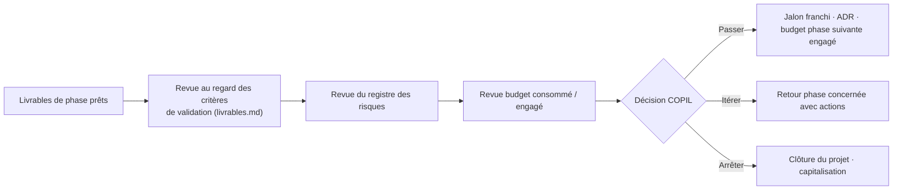

# B.2 Gouvernance — BuildNote

> **Statut : En revue — Couche 2.** Date : 2026-09-08.

## 1. Principes

- **Décision au bon niveau** : stratégique (sponsor), produit (comité produit), technique (revue
  d'architecture), opérationnel (équipe).
- **Portes de décision** formelles à chaque jalon (J0 → J11), tracées en ADR.
- **Transparence** : comptes rendus, registre des risques et journal de décisions accessibles à
  toutes les parties prenantes.
- **Éthique intégrée** : un référent éthique/données participe aux décisions touchant l'orientation
  et les données personnelles.

## 2. Instances

| Instance | Rôle | Composition | Cadence |
|---|---|---|---|
| **Comité de pilotage (COPIL)** | Valide les jalons, engage le budget, arbitre les risques et le périmètre | Sponsor/porteur, Directeur de projet, Product Manager, référent établissement(s), référent éthique/juridique | À chaque jalon + mensuel |
| **Comité produit** | Priorise le backlog, valide les besoins et les parcours, tranche les compromis fonctionnels | Product Manager (pilote), Business Analyst, UX/UI Designer, experts éducation & orientation, représentants utilisateurs | Bi-hebdomadaire |
| **Revue d'architecture (ARB)** | Valide les choix d'architecture et les ADR, contrôle la dette technique et la cohérence | Software Architect (pilote), Data Architect, expert interopérabilité, Cybersecurity Architect, AI/ML + expert OCR | À chaque jalon technique + à la demande |
| **Comité de gestion des changements (CCB)** | Instruit les demandes de changement, évalue l'impact, décide | Directeur de projet, Product Manager, Software Architect, QA | À la demande |
| **Équipe projet** | Réalise les activités de la phase courante | Selon phase (voir §4) | Quotidien (stand-up en phase de dev) |
| **Cellule sécurité & conformité** | Suit le DPIA, le plan de conformité, les incidents | Cybersecurity Architect, référent juridique, DPO/référent données | Mensuel + sur incident |

## 3. Matrice RACI (par livrable pivot)

Légende : **R** Réalise · **A** Approuve (une seule par ligne) · **C** Consulté · **I** Informé.

| Livrable | Sponsor | Dir. projet | Product Mgr | Business Analyst | SW Architect | Data Architect | AI/OCR | Cybersec | UX/UI | QA | DevOps | Experts éduc./orient. |
|---|---|---|---|---|---|---|---|---|---|---|---|---|
| Project Charter (J0) | **A** | R | C | C | C | I | I | C | I | I | I | C |
| Dossier d'analyse métier (J1) | I | A | R | **R** | C | C | I | C | C | C | I | C |
| Étude de faisabilité + décisions (J2) | **A** | R | C | C | R | R | R | R | C | C | C | C |
| Cahier des charges (J3) | I | A | **R** | R | C | C | C | C | C | C | I | C |
| Dossier d'architecture (J4) | I | A | C | C | **R** | R | R | R | C | C | C | I |
| Design system + prototypes (J5) | I | A | C | C | C | I | I | C | **R** | C | I | C |
| Rapports de POC (J6) | I | A | C | I | C | C | **R** | C | I | C | C | C |
| Décision de construction (J7) | **A** | R | C | I | C | C | C | C | I | C | C | I |
| Incréments logiciels (J8.x) | I | A | C | I | **R** | C | C | C | C | R | R | I |
| PV de recette (J9) | **A** | R | C | C | C | C | C | C | C | **R** | C | C |
| Rapport de pilote (J10) | **A** | R | R | C | C | I | I | C | C | C | C | C |
| Plan de généralisation (J11) | **A** | R | R | I | C | I | I | C | I | I | C | C |

## 4. Équipe par phase (rôles mobilisés)

| Phase | Rôles principaux | Rôles en appui |
|---|---|---|
| 0 Cadrage | Dir. projet, Product Manager, Sponsor | Business Analyst, juridique |
| 1 Analyse | Business Analyst, Product Manager, UX | Experts éducation & orientation |
| 2 Faisabilité | Software Architect, Data Architect, expert interop, expert OCR/CV, Cybersecurity, juridique | Dir. projet, AI/ML |
| 3 Spécification | Business Analyst, Product Manager | Software Architect, QA |
| 4 Conception | Software Architect, Data Architect, expert interop, Cybersecurity | AI/ML, expert OCR, UX |
| 5 UX/UI | UX/UI Designer | Product Manager, Business Analyst, utilisateurs |
| 6 POC | Expert OCR/CV, AI/ML, expert interop, Data Architect | QA, Software Architect |
| 7 Décision | Dir. projet, Software Architect, Sponsor | Tous chefs de file |
| 8 Développement | Software Architect, équipe dev, DevOps, QA | Product Manager, Data Architect, AI/OCR |
| 9 Recette | QA, Cybersecurity, expert OCR, expert interop | Utilisateurs métier |
| 10 Pilote | Dir. projet, DevOps, support, Product Manager | Référents établissement |
| 11 Généralisation | Responsable produit, DevOps, support, gestionnaire référentiel | Dir. projet |

## 5. Processus de décision

## 6. Escalade

Niveau 1 : équipe projet → Niveau 2 : comité produit / revue d'architecture → Niveau 3 : COPIL →
Niveau 4 : sponsor. Délai cible de traitement d'un point bloquant : **5 jours ouvrés** par niveau.

## 7. Indicateurs de pilotage projet

- Avancement par phase (livrables terminés / prévus).
- Respect des jalons (écart calendaire).
- Budget consommé vs engagé.
- Risques ouverts par niveau de criticité ; risques survenus.
- Demandes de changement (ouvertes, acceptées, refusées) et impact cumulé.
- Dette technique (Phase 8+).
- Anomalies ouvertes par sévérité (Phase 8+).
