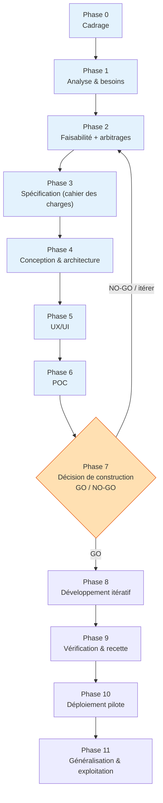
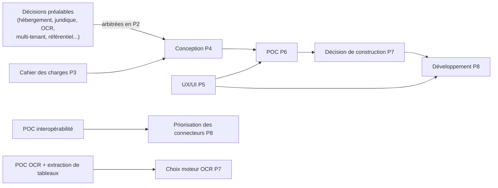

# B. Roadmap — BuildNote

> **Statut : En revue — Couche 1.** Date : 2026-09-08.
> Le reste de la gestion de projet (Project Charter, gouvernance/RACI, méthodologie, gestion des
> changements / versions / documentaire) est produit en Couche 2.

## B.1 Principe de phasage

BuildNote suit un cycle de vie **par phases avec portes de décision** (go / no-go). Les phases 0 à 6
**ne produisent aucun code**. Le développement (phase 8) ne démarre qu'après la **décision de
construction** (phase 7), elle-même conditionnée par les résultats des **POC**.

> **Pas de dates absolues à ce stade.** Les durées ci-dessous sont **indicatives** et seront fixées
> en Phase 0 selon l'équipe mobilisée et le budget. Aucun engagement calendaire n'est pris avant
> l'arbitrage des [décisions préalables](../17-decisions/decisions-prealables.md).

## B.2 Vue d'ensemble

Bandeau bleu = **sans code**. Phase 7 (orange) = **porte majeure**.

## B.3 Phases et jalons

| Phase | Nom | Objet | Jalon de sortie (livrable pivot) | Durée indicative |
|---|---|---|---|---|
| **0** | Cadrage | Établir le pourquoi, le périmètre, la gouvernance, le budget macro | **J0 — Project Charter validé** | 2–4 sem. |
| **1** | Analyse & besoins | Comprendre le métier, les utilisateurs, les processus actuels et cibles | **J1 — Dossier d'analyse métier validé** | 4–6 sem. |
| **2** | Faisabilité | Trancher les décisions structurantes ; vérifier faisabilité technique / juridique / organisationnelle / financière | **J2 — Étude de faisabilité + registre des décisions validés** | 3–5 sem. |
| **3** | Spécification | Figer les exigences (F/NF), critères d'acceptation, KPI | **J3 — Cahier des charges validé + matrice de traçabilité** | 4–6 sem. |
| **4** | Conception & architecture | Concevoir l'architecture fonctionnelle, technique (scénarios comparés), données (MCD/MLD/MPD), interopérabilité, sécurité | **J4 — Dossier d'architecture validé + choix techniques justifiés** | 5–8 sem. |
| **5** | UX/UI | Architecture UX, design system, wireframes, parcours, i18n FR/EN | **J5 — Design system + prototypes de parcours validés** | 4–6 sem. |
| **6** | POC | Prouver les points à risque : OCR, extraction de tableaux, interopérabilité, moteur d'orientation | **J6 — 4 rapports de POC avec résultats vs critères de succès** | 6–10 sem. |
| **7** | Décision de construction | Statuer GO / NO-GO / itérer sur la base des POC, du budget, des risques | **J7 — Décision de construction + plan de réalisation détaillé** | 1–2 sem. |
| **8** | Développement itératif | Construire : socle → Module 1 → Module 2 → interopérabilité → durcissement | **J8.x — Incréments vérifiés** (jalons internes par lot) | itératif |
| **9** | Vérification & recette | Tests unitaires → intégration → système → OCR → données → sécurité → performance → utilisateurs → interopérabilité | **J9 — PV de recette signé** | en continu + phase dédiée |
| **10** | Déploiement pilote | Mettre en service dans **1 établissement**, accompagner, mesurer | **J10 — Rapport d'évaluation du pilote** | 6–12 sem. |
| **11** | Généralisation & exploitation | Déployer par vagues, exploiter, supporter, faire évoluer | **J11 — Plan de déploiement par vagues en exécution** | continu |

## B.4 Dépendances majeures entre phases

- **Aucune conception d'architecture technique définitive avant l'arbitrage des décisions
  préalables** (Phase 2).
- **Aucun choix de moteur OCR avant le POC OCR** (Phase 6).
- **Aucun code produit avant la Phase 8.**

## B.5 Approche de la Phase 8 (développement)

Découpage indicatif en lots livrables et vérifiables :

| Lot | Contenu | Pré-requis |
|---|---|---|
| L0 | Socle : identité & accès multi-tenant, référentiels normalisés, stockage tri-strates, journalisation, i18n FR/EN | J7 |
| L1 | Module 1 — capture, pipeline OCR/CV, formulaire prérempli, **workflow de validation humaine**, écriture Normalized, mode hors-ligne | L0, choix OCR |
| L2 | Interopérabilité — connecteurs prioritaires, moteur de mapping, normalisation, validation, quarantaine, lineage, tableau de bord qualité | L0 |
| L3 | Module 2 — dashboard de situation à la demande, saisies (intérêts, aspirations, avis parents), référentiels offre/métiers/national | L0 (+ données via L1/L2) |
| L4 | Module 2 — moteur de fusion, scoring pondéré, moteur de règles, générateur d'explications, dossier d'orientation FR/EN | L3 |
| L5 | Durcissement — sécurité, performance, sauvegardes/restauration, observabilité, documentation d'exploitation | L1–L4 |

> Les lots suivent la stratégie **« pas de MVP »** (solution de production directe) tempérée par un
> **déploiement pilote** (Phase 10). Voir risque R2 et décision #7.

## B.6 Gouvernance des jalons

À chaque jalon **J0 → J11** :
1. Revue des livrables de la phase au regard des **critères de validation**
   ([`15-livrables-par-phase/livrables.md`](../15-livrables-par-phase/livrables.md)).
2. Revue du **registre des risques** ([`16-risques/risques.md`](../16-risques/risques.md)).
3. Revue du **budget consommé vs engagé**.
4. **Décision formelle** : passer / itérer / arrêter — consignée en ADR
   ([`17-decisions/`](../17-decisions/)).

## B.7 Ce qui vient en Couche 2

- **Project Charter** complet (contexte, objectifs SMART, périmètre in/out, budget, contraintes,
  hypothèses, critères de succès du projet).
- **Plan de gouvernance** : instances (comité de pilotage, comité produit, revue d'architecture),
  cadence, matrice **RACI**.
- **Méthodologie** : cadre hybride (phases à portes pour le cadrage/conception, itératif pour le
  développement), gestion de backlog, définition of ready / of done.
- **Gestion des changements** : processus de demande de changement, analyse d'impact, comité.
- **Gestion des versions** : versioning sémantique du produit, du schéma canonique, des mappings, de
  la documentation.
- **Gestion documentaire** : arborescence, nommage, statuts, revue, archivage, source de vérité.
- **Plan de communication** avec les parties prenantes.
