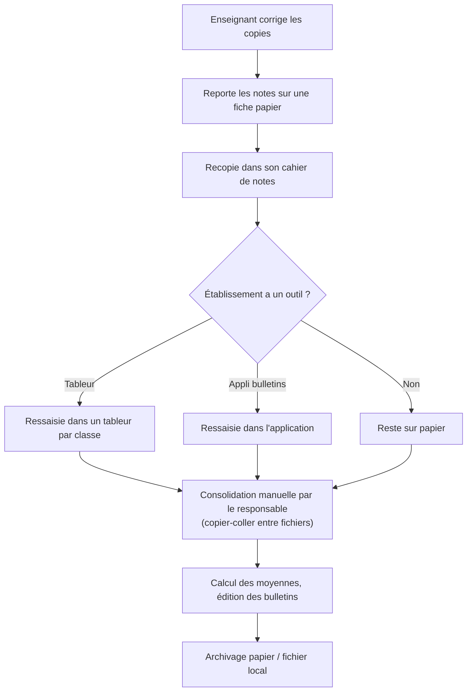
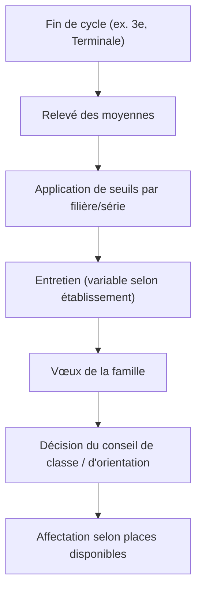
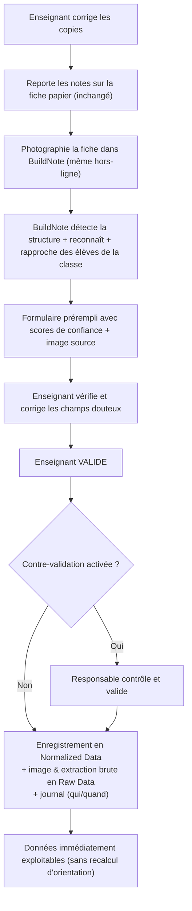
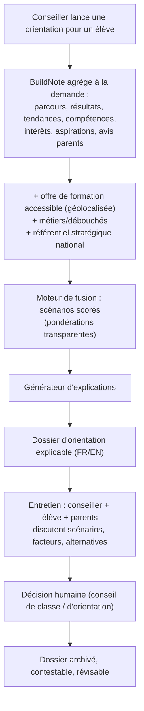
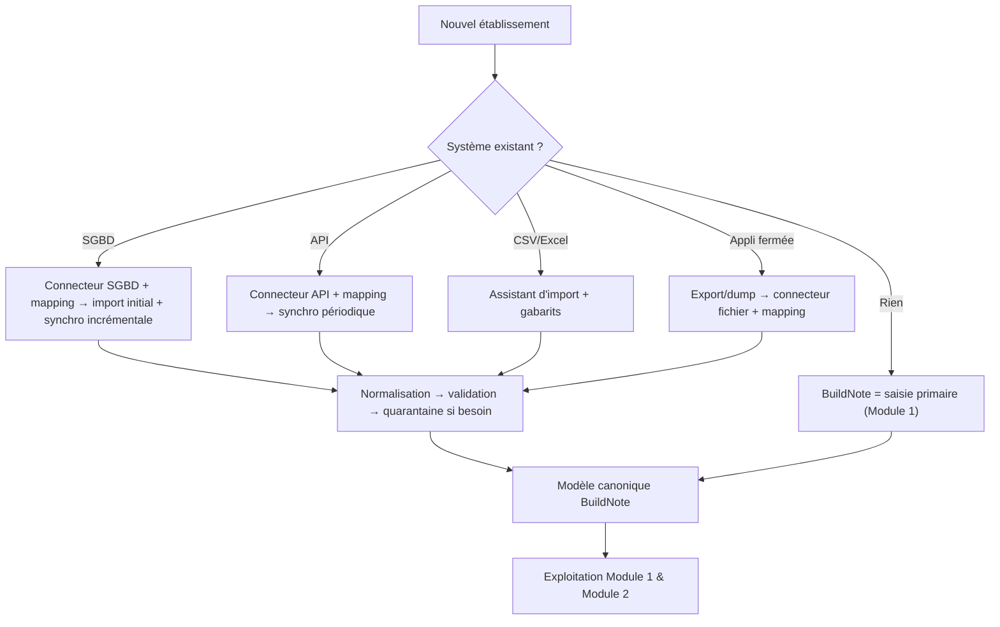

# C. Analyse métier — BuildNote

> **Statut : En revue — Couche 2.** Date : 2026-09-08.
> Voir aussi [`personas.md`](personas.md) et [`cas-usage.md`](cas-usage.md).

## C.1 Problématique

### C.1.1 Constats
1. **La donnée académique naît sur papier.** Compositions, interrogations, relevés : l'enseignant
   note à la main, puis recopie dans un cahier de notes, puis (parfois) dans un tableur ou une
   application. Chaque recopie ajoute du délai et des erreurs.
2. **Les systèmes ne communiquent pas.** Un établissement peut avoir un tableur par enseignant, une
   application de bulletins vieillissante, et rien de partagé. Les établissements entre eux n'ont
   aucune interopérabilité.
3. **La donnée est peu exploitable.** Impossible de répondre simplement à « quelle est l'évolution
   de cette classe en mathématiques sur trois trimestres ? » ou « quels élèves sont réguliers en
   sciences sur deux ans ? ».
4. **L'orientation est appauvrie.** Elle se réduit souvent à un seuil de moyenne pour l'accès à une
   série, sans prise en compte structurée du profil de l'élève, de ses aspirations, de l'avis des
   parents, de l'offre de formation réellement accessible près de chez lui, ni des besoins de
   développement du pays.
5. **Pas de vision agrégée.** Aucun outil ne permet de voir, à l'échelle d'un établissement ou d'un
   territoire, quels profils et quelles compétences se forment.
6. **Contexte contraignant.** Connectivité faible ou intermittente, matériel modeste, ressources
   limitées, pluralité linguistique (FR/EN).

### C.1.2 Conséquences (coûts de la situation actuelle)

| Pour | Coût |
|---|---|
| Enseignant | Temps de recopie, corrections d'erreurs, faible valorisation de son travail d'évaluation |
| Établissement | Données non fiables pour le pilotage, dépendance à des outils fragiles, pas de mémoire institutionnelle exploitable |
| Élève / famille | Orientation subie, décisions mal informées, perte de chances |
| Système éducatif / pays | Inadéquation entre formations et besoins, pas de pilotage par la donnée |

### C.1.3 Énoncé de la problématique
> Comment fiabiliser et structurer la donnée académique **sans faire confiance aveuglément à la
> reconnaissance automatique**, la rendre **interopérable** avec des systèmes hétérogènes, et
> l'exploiter pour une **orientation explicable** qui concilie le profil et les aspirations de
> l'élève, l'avis des parents, l'offre de formation accessible, les débouchés et les **besoins
> stratégiques du Cameroun** — le tout dans un contexte de **faible connectivité** ?

## C.2 Besoins

Hiérarchisation **MoSCoW** (M = must, S = should, C = could, W = won't en V1). Chaque besoin est
rattaché à un ou plusieurs personas ([`personas.md`](personas.md)) et cas d'usage
([`cas-usage.md`](cas-usage.md)).

### C.2.1 Module 1 — Capture & gestion des données académiques

| ID | Besoin | Priorité | Personas |
|---|---|---|---|
| B1-01 | Capturer une fiche de notes par photo/vidéo/fichier et l'importer | M | Enseignant |
| B1-02 | Détecter automatiquement la structure de la fiche (tableau, colonnes, lignes) | M | Enseignant |
| B1-03 | Reconnaître les valeurs (noms, notes, appréciations) avec un **score de confiance** par champ | M | Enseignant |
| B1-04 | Rapprocher automatiquement les lignes reconnues des élèves de la classe | M | Enseignant |
| B1-05 | Afficher un **formulaire prérempli** avec image source consultable | M | Enseignant |
| B1-06 | Corriger manuellement toute valeur | M | Enseignant |
| B1-07 | **Valider** explicitement avant enregistrement (aucun enregistrement automatique) | M | Enseignant, Responsable |
| B1-08 | Contre-validation par un responsable (paramétrable) | S | Responsable |
| B1-09 | Enregistrer les données validées en base normalisée + conserver l'image et l'extraction brute | M | Enseignant, Admin SI |
| B1-10 | Historiser qui a validé/corrigé quoi et quand | M | Responsable, Chef d'étab. |
| B1-11 | Fonctionner **hors-ligne** (capture + validation) et synchroniser ensuite | M | Enseignant |
| B1-12 | Gérer des **gabarits de fiches** par établissement | S | Admin SI, Responsable |
| B1-13 | Traiter un lot de plusieurs pages / plusieurs classes | S | Enseignant |
| B1-14 | Gérer différents barèmes (/20, /10, /100, mentions) | M | Responsable |

### C.2.2 Module 2 — Orientation

| ID | Besoin | Priorité | Personas |
|---|---|---|---|
| B2-01 | Consulter un **dashboard de situation** par classe / niveau / matière / établissement, **rafraîchi à la demande** | M | Responsable, Chef d'étab., Conseiller |
| B2-02 | Répondre à des questions de classement (meilleurs élèves d'une matière, profils remarquables) | M | Responsable, Conseiller |
| B2-03 | Lancer une **orientation individuelle** à la demande | M | Conseiller |
| B2-04 | Agréger l'ensemble des données pertinentes disponibles sur l'élève | M | Conseiller |
| B2-05 | Saisir les **intérêts et préférences** de l'élève | M | Élève, Conseiller |
| B2-06 | Saisir les **aspirations** de l'élève | M | Élève |
| B2-07 | Recueillir l'**avis / l'ambition des parents** | M | Parent, Conseiller |
| B2-08 | Produire des **scénarios d'orientation scorés** (filière → formations → établissements → métiers) | M | Conseiller |
| B2-09 | Fournir des **explications** (facteurs, poids, alternatives, incertitudes, répartition du score) | M | Conseiller, Élève, Parent |
| B2-10 | Prendre en compte l'**offre de formation accessible** (filières + géolocalisation des établissements de référence) | M | Conseiller |
| B2-11 | Intégrer le **référentiel stratégique national** comme critère pondéré et transparent | M | Conseiller, Gestionnaire référentiel |
| B2-12 | Paramétrer les **pondérations** (valeurs par défaut publiées) | S | Chef d'étab., Conseiller |
| B2-13 | **Exporter** le dossier d'orientation en FR ou EN | M | Conseiller, Parent |
| B2-14 | Administrer le référentiel stratégique (entrées, sources, dates, versions) | M | Gestionnaire référentiel |
| B2-15 | Ne **jamais** déclencher de recalcul automatique à l'enregistrement d'une note | M | (règle) |
| B2-16 | Indicateurs non académiques (ex. aptitude sportive) si données disponibles | C | Responsable |

### C.2.3 Socle & interopérabilité

| ID | Besoin | Priorité | Personas |
|---|---|---|---|
| B0-01 | Choisir la langue **FR/EN** dès l'écran d'accueil, choix persistant | M | Tous |
| B0-02 | Gérer comptes et rôles avec **isolation stricte par établissement** | M | Admin BuildNote, Admin SI |
| B0-03 | Authentification robuste (MFA au moins pour les rôles sensibles) | M | Tous |
| B0-04 | Journaliser et auditer les actions sensibles | M | Chef d'étab., Admin BuildNote |
| B0-05 | Importer depuis un SGBD existant (MySQL, PostgreSQL, SQL Server, MariaDB, SQLite, Oracle, …) via connecteur + mapping | M | Admin SI |
| B0-06 | Importer depuis CSV/Excel avec gabarits fournis | M | Admin SI, Responsable |
| B0-07 | Importer depuis une API quand elle existe | S | Admin SI |
| B0-08 | Normaliser, valider, mettre en **quarantaine** les données non conformes | M | Admin SI |
| B0-09 | Gérer les **conflits** (préséance, fusion, revue) | M | Admin SI |
| B0-10 | Tracer le **lineage** de chaque donnée | M | Admin SI, Chef d'étab. |
| B0-11 | **Exporter** tout le patrimoine au format canonique documenté (réversibilité) | M | Chef d'étab., Admin SI |
| B0-12 | Tableau de bord **qualité des données** | S | Admin SI, Responsable |
| B0-13 | Sauvegarde et restauration | M | Admin SI, DevOps |
| B0-14 | Fonctionner sur matériel modeste et réseau dégradé | M | Tous |

## C.3 Processus AS-IS (actuels)

### C.3.1 Saisie et gestion des notes — AS-IS

**Points de douleur** : étapes B→C→E/F = **trois recopies** ; consolidation manuelle H = erreurs et
délais ; J = donnée non exploitable ; aucune trace de qui a fait quoi.

### C.3.2 Orientation — AS-IS

**Points de douleur** : C = réduction au seul critère de moyenne ; peu ou pas de prise en compte
structurée du profil, des aptitudes, des intérêts, de l'avis parental, de l'offre réelle accessible,
des débouchés, des besoins nationaux ; pas d'explication formalisée ; pas de mémoire des
recommandations.

## C.4 Processus TO-BE (avec BuildNote)

### C.4.1 Saisie et gestion des notes — TO-BE (Module 1)

**Gains** : une seule saisie (vérification, pas recopie) ; erreurs de report éliminées à la source ;
donnée fiable, historisée, traçable ; fonctionne hors-ligne.

### C.4.2 Orientation — TO-BE (Module 2)

**Gains** : décision **informée et explicable** ; profil pris en compte au-delà de la moyenne ;
alignement possible avec les besoins nationaux **sans imposition** ; mémoire des recommandations.

### C.4.3 Intégration d'un établissement — TO-BE (interopérabilité)

## C.5 Règles de gestion (extraits, à compléter en Phase 3)

| RG | Énoncé |
|---|---|
| RG-01 | Une note n'entre en Normalized Data qu'après **validation humaine** explicite. |
| RG-02 | L'image source et l'extraction brute sont **conservées** et liées à la note (lineage). |
| RG-03 | Toute donnée académique est rattachée à une **année scolaire**, une **classe**, une **matière**, une **évaluation**. |
| RG-04 | Le Module 2 ne **lit** que des données validées ; il n'écrit jamais dans les notes. |
| RG-05 | Aucun événement « note enregistrée » ne déclenche un calcul du Module 2. |
| RG-06 | Le dashboard recalcule ses classements **au chargement ou sur demande explicite**. |
| RG-07 | Une recommandation d'orientation expose toujours ses **facteurs, poids, alternatives et incertitudes**. |
| RG-08 | Le référentiel stratégique **pondère** le score ; il ne rend **aucune** option impossible. |
| RG-09 | Les données d'un établissement ne sont **jamais** visibles depuis un autre établissement. |
| RG-10 | Toute donnée importée non conforme est **mise en quarantaine**, jamais rejetée silencieusement. |
| RG-11 | Un établissement peut **exporter l'intégralité** de son patrimoine au format canonique. |
| RG-12 | L'interface et les exports sont disponibles en **FR et EN**. |

## C.6 Matrice besoins → cas d'usage (extrait)

| Besoin | Cas d'usage ([`cas-usage.md`](cas-usage.md)) |
|---|---|
| B1-01..B1-09 | UC-01, UC-02 |
| B1-08 | UC-03 |
| B0-05..B0-11 | UC-04, UC-05 |
| B2-01, B2-02 | UC-06, UC-07 |
| B2-03..B2-11, B2-13 | UC-08, UC-11 |
| B2-05, B2-06 | UC-09 |
| B2-07 | UC-10 |
| B2-14 | UC-12 |
| B0-02 | UC-13 |
| B0-01 | UC-14 |
