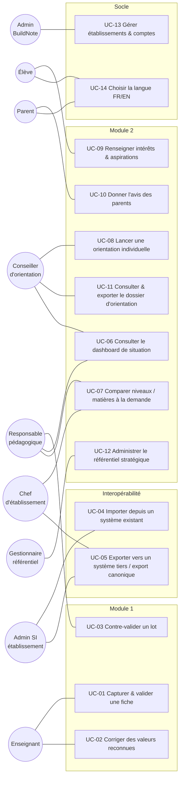

# C. Cas d'utilisation — BuildNote

> **Statut : En revue — Couche 2.** Date : 2026-09-08.
> Fiches détaillées des cas d'usage majeurs. Les cas d'usage secondaires seront ajoutés en Phase 1
> réelle et raffinés en exigences (Phase 3).

## Diagramme d'ensemble

---

## UC-01 — Capturer et valider une fiche de notes

| Champ | Contenu |
|---|---|
| **Acteur principal** | Enseignant |
| **Acteurs secondaires** | Responsable (si contre-validation), pipeline OCR/CV |
| **Objectif** | Transformer une fiche physique en notes validées enregistrées en base normalisée |
| **Préconditions** | L'enseignant est authentifié ; la classe et l'évaluation existent (ou sont créées) ; l'appareil dispose d'un appareil photo |
| **Déclencheur** | L'enseignant choisit « Nouvelle capture » |
| **Postconditions (succès)** | Les notes validées sont en Normalized Data ; l'image + l'extraction brute sont en Raw Data ; le journal enregistre l'auteur, la date, les corrections ; **aucun** calcul du Module 2 n'est déclenché |
| **Scénario nominal** | 1. L'enseignant sélectionne la classe et l'évaluation. 2. Il photographie la/les fiche(s). 3. Le système prétraite (recadrage, redressement), détecte la structure tabulaire, reconnaît les valeurs, calcule un score de confiance par cellule, rapproche les lignes des élèves de la classe. 4. Le système affiche le formulaire prérempli avec l'image source consultable et les champs douteux mis en évidence. 5. L'enseignant vérifie, corrige les champs incorrects, complète les manquants. 6. L'enseignant valide. 7. (Si contre-validation activée) le responsable contrôle et valide → UC-03. 8. Le système enregistre les données validées, conserve le brut, journalise. |
| **Alternatives** | 3a. Structure non reconnue → l'enseignant choisit un gabarit ou saisit manuellement, l'image restant affichée. 3b. Élève non rapproché → sélection manuelle dans la liste de classe. 5a. Barème différent → l'enseignant choisit le barème ; le système revalide les plages. 6a. Mode hors-ligne → validation locale, mise en file de synchronisation. |
| **Exceptions** | E1. Photo inexploitable → message + conseils de prise de vue, nouvelle capture. E2. Échec du pipeline → repli en saisie manuelle assistée. E3. Conflit à la synchronisation (note déjà saisie) → résolution guidée. |
| **Règles** | RG-01, RG-02, RG-03, RG-05, RG-14 (barèmes) |
| **Fréquence** | Élevée (plusieurs fois par semaine par enseignant en période d'évaluation) |
| **Exigences NF associées** | Temps de traitement acceptable ; fonctionnement hors-ligne ; ergonomie de correction |

---

## UC-02 — Corriger des valeurs reconnues

| Champ | Contenu |
|---|---|
| **Acteur principal** | Enseignant |
| **Objectif** | Rectifier rapidement les cellules mal reconnues avant validation |
| **Préconditions** | Un formulaire prérempli est affiché (UC-01 étape 4) |
| **Scénario nominal** | 1. Le système trie/marque les cellules à faible confiance. 2. L'enseignant clique une cellule ; l'image source se zoome sur la zone correspondante. 3. Il corrige (clavier adapté au type). 4. La cellule passe en « corrigée manuellement » (tracée). 5. Il navigue à la cellule douteuse suivante. |
| **Alternatives** | 2a. La cellule n'a pas de zone image (ajout manuel) → saisie simple. 3a. Valeur hors barème → alerte immédiate. |
| **Postconditions** | Toutes les corrections sont horodatées et attribuées ; prêtes pour la validation (UC-01 étape 6) |
| **Règles** | RG-02 (lineage des corrections) |

---

## UC-03 — Contre-valider un lot de notes

| Champ | Contenu |
|---|---|
| **Acteur principal** | Responsable pédagogique |
| **Objectif** | Contrôle qualité par un second regard avant enregistrement définitif |
| **Préconditions** | La contre-validation est activée pour l'établissement ou la classe ; un lot est en attente |
| **Scénario nominal** | 1. Le responsable ouvre la file de lots à contrôler. 2. Il consulte un lot : valeurs validées par l'enseignant, taux de correction, cas signalés. 3. Il approuve, ou renvoie à l'enseignant avec commentaires. 4. À l'approbation, le système enregistre en Normalized Data et journalise les deux validations. |
| **Alternatives** | 3a. Renvoi → l'enseignant reçoit une notification, corrige (UC-02), re-valide. |
| **Règles** | RG-01, RG-10bis (double validation tracée) |

---

## UC-04 — Importer depuis un système existant

| Champ | Contenu |
|---|---|
| **Acteur principal** | Administrateur SI de l'établissement |
| **Acteurs secondaires** | Pipeline d'interopérabilité |
| **Objectif** | Charger l'historique et/ou synchroniser les données depuis le SI de l'établissement vers le modèle canonique |
| **Préconditions** | L'établissement existe dans BuildNote ; l'admin dispose d'un accès en lecture à la source ; un connecteur adapté est disponible |
| **Scénario nominal** | 1. L'admin choisit le type de source et configure le connecteur (accès, périmètre). 2. Il définit ou ajuste le mapping (champs, tables de valeurs). 3. Il lance un import de test sur un échantillon. 4. Le système transforme, normalise, valide ; affiche un rapport (importés, quarantaine, conflits). 5. L'admin traite la quarantaine et les conflits. 6. Il lance l'import complet, puis programme la synchronisation incrémentale. |
| **Alternatives** | 1a. Pas de connecteur dédié → connecteur générique SQL ou export CSV/Excel (UC-04b). 3a. Volume important → import par lots avec reprise. |
| **Exceptions** | E1. Source inaccessible → diagnostic + nouvelle tentative planifiée. E2. Mapping incohérent avec la version du canonique → blocage + message de version. |
| **Postconditions** | Données de l'établissement présentes dans le canonique, avec lineage complet ; synchro planifiée |
| **Règles** | RG-08, RG-09, RG-10, RG-11, RG-13 (idempotence) |

---

## UC-05 — Exporter vers un système tiers / export canonique complet

| Champ | Contenu |
|---|---|
| **Acteur principal** | Chef d'établissement (autorise) / Administrateur SI (exécute) |
| **Objectif** | Fournir des données à un système tiers, ou récupérer l'intégralité du patrimoine au format canonique documenté (réversibilité) |
| **Scénario nominal** | 1. L'admin choisit le périmètre (année, niveau, tout). 2. Il choisit la cible : connecteur de sortie + transformation, ou export de fichiers au format canonique. 3. Le système génère l'export, journalise l'opération. 4. L'admin récupère/transmet l'export. |
| **Postconditions** | Export produit et tracé ; aucune donnée d'un autre établissement incluse |
| **Règles** | RG-09, RG-11 |

---

## UC-06 — Consulter le dashboard de situation

| Champ | Contenu |
|---|---|
| **Acteur principal** | Responsable pédagogique / Conseiller / Chef d'établissement |
| **Objectif** | Obtenir des classements et insights (ex. meilleurs élèves d'une matière, profils remarquables) pour un périmètre donné |
| **Préconditions** | L'utilisateur est authentifié et habilité sur le périmètre demandé |
| **Déclencheur** | Ouverture du dashboard, ou action « Rafraîchir » |
| **Scénario nominal** | 1. L'utilisateur choisit le périmètre (classe, niveau, matière, établissement, groupe). 2. **Le système interroge les bases à l'instant T** et calcule les indicateurs demandés. 3. Il affiche les classements/insights avec la date/heure du calcul et la couverture des données. 4. L'utilisateur affine (filtres, autre matière, autre période). |
| **Alternatives** | 2a. Données non académiques demandées (ex. aptitude sportive) mais absentes → l'indicateur est marqué « non disponible ». 2b. Périmètre multi-établissements → limité aux établissements autorisés. |
| **Postconditions** | Aucune donnée modifiée ; consultation éventuellement journalisée |
| **Règles** | RG-04, RG-05, RG-06, RG-09 |
| **Note** | Le dashboard **ne se met jamais à jour automatiquement** sur enregistrement d'une note. |

---

## UC-07 — Comparer niveaux / matières à la demande

| Champ | Contenu |
|---|---|
| **Acteur principal** | Chef d'établissement / Responsable |
| **Objectif** | Comparer des performances (entre classes d'un même niveau, entre matières, dans le temps) pour le pilotage |
| **Scénario nominal** | 1. L'utilisateur sélectionne les objets à comparer et la période. 2. Le système lit les bases à la demande et produit la comparaison (tableaux, tendances). 3. L'utilisateur exporte si besoin (FR/EN). |
| **Règles** | RG-05, RG-06, RG-09, RG-12 |

---

## UC-08 — Lancer une orientation individuelle

| Champ | Contenu |
|---|---|
| **Acteur principal** | Conseiller d'orientation |
| **Acteurs secondaires** | Moteur de fusion, générateur d'explications, référentiels (offre, métiers, stratégique national) |
| **Objectif** | Produire un dossier d'orientation explicable pour un élève |
| **Préconditions** | L'élève existe ; le conseiller est habilité ; consentement élève/parents recueilli pour l'usage des données du Module 2 |
| **Déclencheur** | Le conseiller ouvre le dossier de l'élève et clique « Générer une orientation » |
| **Scénario nominal** | 1. Le système **agrège à la demande** les données pertinentes disponibles : parcours, résultats, tendances, compétences détectées, intérêts, aspirations, avis des parents. 2. Il récupère l'offre de formation accessible (filières + établissements de référence géolocalisés), les métiers/débouchés associés, et le référentiel stratégique national (versions datées). 3. Le moteur génère des scénarios candidats, applique le scoring pondéré multi-critères et les filtres de faisabilité. 4. Le générateur d'explications produit, pour chaque scénario : facteurs déterminants et poids, données utilisées et fraîcheur, alternatives écartées et pourquoi, zones d'incertitude, répartition du score. 5. Le système affiche le dossier, du scénario le plus au moins recommandé. |
| **Alternatives** | 1a. Intérêts/aspirations/avis parents absents → le moteur continue en signalant l'incertitude accrue et en recommandant de compléter (UC-09, UC-10). 3a. Le conseiller ajuste les pondérations (dans les bornes autorisées) et relance. 2a. Élève éloigné de toute offre pour une filière → l'établissement de référence le plus proche est indiqué avec la distance. |
| **Exceptions** | E1. Données académiques insuffisantes (historique trop court) → dossier produit avec avertissement fort sur la fiabilité. E2. Référentiel national indisponible → le calcul se fait sans ce critère, mention explicite. |
| **Postconditions** | Un dossier d'orientation est enregistré (objet du Module 2), horodaté, contestable, révisable ; **aucune** donnée académique modifiée ; **aucune** affectation réalisée |
| **Règles** | RG-04, RG-07, RG-08, RG-09 |

---

## UC-09 — Renseigner intérêts et aspirations

| Champ | Contenu |
|---|---|
| **Acteur principal** | Élève (assisté au besoin par le conseiller) |
| **Objectif** | Alimenter le moteur d'orientation avec la voix de l'élève |
| **Scénario nominal** | 1. L'élève accède à un questionnaire simple (FR/EN). 2. Il renseigne ses centres d'intérêt, ses matières préférées, ses aspirations (métiers/domaines envisagés), ses contraintes éventuelles. 3. Le système enregistre ces éléments, datés, comme entrées du Module 2. |
| **Postconditions** | Données disponibles pour UC-08 ; l'élève peut les modifier |
| **Règles** | RG-04 ; minimisation des données ; consentement |

---

## UC-10 — Donner l'avis des parents

| Champ | Contenu |
|---|---|
| **Acteur principal** | Parent / tuteur |
| **Objectif** | Recueillir l'avis et l'ambition de la famille comme critère pondéré |
| **Scénario nominal** | 1. Le parent accède à un formulaire simple (FR/EN), via un lien fourni par l'établissement. 2. Il exprime ses souhaits, ses réserves éventuelles, son niveau de priorité. 3. Le système enregistre l'avis, daté, rattaché à l'élève. |
| **Alternatives** | 1a. Parent sans accès numérique → saisie par le conseiller lors de l'entretien. |
| **Postconditions** | Avis disponible pour UC-08 ; modifiable |
| **Règles** | RG-04 ; consentement ; l'avis est un critère **pondéré**, non déterminant à lui seul |

---

## UC-11 — Consulter et exporter le dossier d'orientation

| Champ | Contenu |
|---|---|
| **Acteur principal** | Conseiller (partage avec élève et parents) |
| **Objectif** | Utiliser le dossier lors de l'entretien et le remettre à la famille |
| **Scénario nominal** | 1. Le conseiller ouvre le dossier généré (UC-08). 2. Il parcourt les scénarios, les facteurs, les alternatives, les incertitudes. 3. Il exporte en FR ou EN (format lisible). 4. Il conduit l'entretien avec l'élève et les parents ; la décision finale reste au conseil de classe / d'orientation. |
| **Alternatives** | 2a. Désaccord sur une pondération → ajustement tracé et régénération (UC-08 3a). |
| **Postconditions** | Dossier partagé ; trace de l'export ; dossier restant contestable |
| **Règles** | RG-07, RG-12 |

---

## UC-12 — Administrer le référentiel stratégique national

| Champ | Contenu |
|---|---|
| **Acteur principal** | Gestionnaire du référentiel |
| **Objectif** | Tenir à jour secteurs stratégiques, métiers, compétences, besoins, tendances — avec sources et dates |
| **Scénario nominal** | 1. Le gestionnaire ajoute/modifie une entrée. 2. Il renseigne obligatoirement la **source** (référence, lien, organisme) et la **date**. 3. Il soumet à validation (workflow). 4. Après validation, l'entrée est publiée dans une nouvelle **version** du référentiel. 5. Les orientations générées ensuite citent la version utilisée. |
| **Alternatives** | 1a. Retrait d'une entrée obsolète → archivage tracé, pas suppression. |
| **Postconditions** | Référentiel versionné ; chaque entrée traçable ; historique conservé |
| **Règles** | RG-08 ; toute entrée est sourcée et datée |

---

## UC-13 — Gérer établissements et comptes

| Champ | Contenu |
|---|---|
| **Acteur principal** | Administrateur BuildNote (éditeur) ; Administrateur SI pour son établissement |
| **Objectif** | Créer un établissement isolé, gérer rôles et accès |
| **Scénario nominal** | 1. L'admin BuildNote crée l'établissement (tenant) et le premier compte administrateur local. 2. L'admin local crée les comptes (enseignants, responsables, conseiller, etc.) avec leurs rôles. 3. Les accès sont limités au périmètre de l'établissement. 4. Les actions sensibles sont journalisées. |
| **Exceptions** | E1. Tentative d'accès inter-établissements → refus + alerte de sécurité. |
| **Règles** | RG-09 ; moindre privilège ; MFA pour les rôles sensibles |

---

## UC-14 — Choisir la langue FR/EN

| Champ | Contenu |
|---|---|
| **Acteur principal** | Tout utilisateur (y compris non authentifié, sur l'écran d'accueil) |
| **Objectif** | Utiliser BuildNote en français ou en anglais |
| **Scénario nominal** | 1. Sur l'écran d'accueil, l'utilisateur voit un sélecteur de langue FR/EN. 2. Il choisit une langue ; toute l'interface bascule. 3. Le choix est mémorisé (compte ou appareil). 4. Les exports et les explications d'orientation suivent la langue choisie. |
| **Règles** | RG-12 ; i18n de bout en bout, architecture non limitée à deux langues |

---

## Cas d'usage secondaires à instruire (Phase 1 réelle)

UC-15 gérer les gabarits de fiches · UC-16 gérer les barèmes et coefficients · UC-17 consulter le
tableau de bord qualité des données · UC-18 gérer les sauvegardes / restauration · UC-19 consulter
le journal d'audit · UC-20 gérer le consentement (élève/parents) · UC-21 réviser/contester un
dossier d'orientation · UC-22 gérer les années scolaires et la promotion des classes · UC-23
notifier (contre-validation en attente, synchro en échec, données à compléter).
