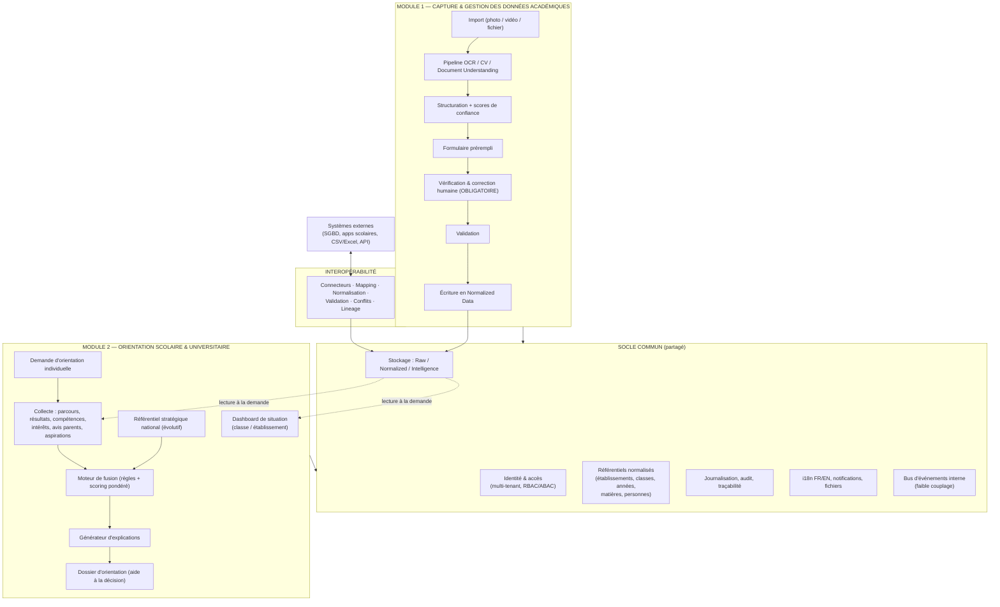
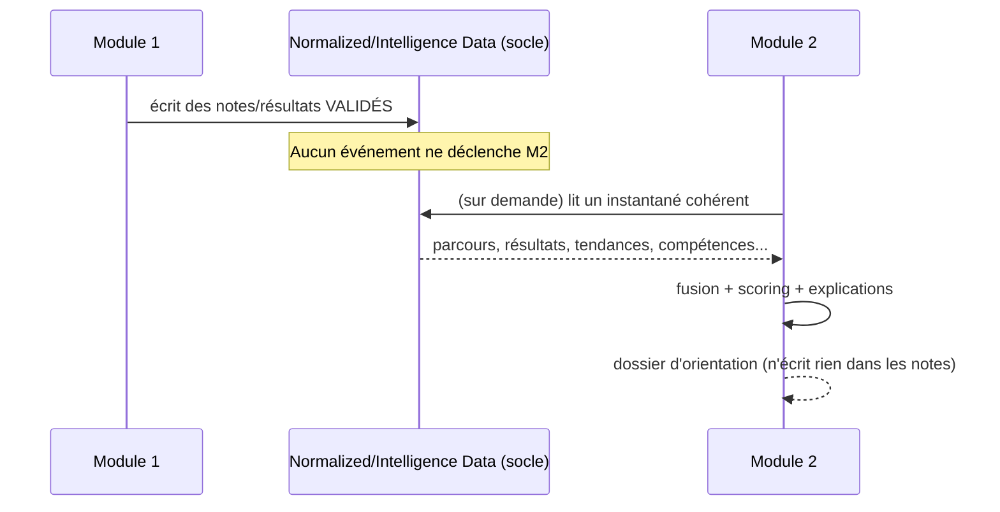

# E. Architecture fonctionnelle — BuildNote

> **Statut : En revue — Couche 1.** Date : 2026-09-08.
> Vue d'ensemble. Le détail par module suit en couches ultérieures.

## E.1 Principe : deux modules, un socle, des contrats

BuildNote est composé de **deux modules fonctionnellement séparés** et d'un **socle commun**. Les
modules ne se connaissent pas directement : ils s'appuient sur le socle et échangent, si nécessaire,
via des **contrats d'API explicites et versionnés**.

## E.2 Règles fonctionnelles non négociables

| # | Règle | Conséquence de conception |
|---|-------|---------------------------|
| RF-1 | L'OCR n'est **jamais** assez fiable pour enregistrer sans revue. | Étape `Vérification & correction humaine` **obligatoire** et non contournable entre extraction et validation. |
| RF-2 | Le Module 2 **ne recalcule rien automatiquement** à chaque note enregistrée. | Aucun déclenchement de calcul d'orientation ou de classement sur l'événement « note écrite ». |
| RF-3 | Le dashboard de situation se met à jour **à la demande**, en **lisant les bases** à l'instant T. | Le dashboard est une **vue calculée à la requête** (ou rafraîchie explicitement), pas un flux temps réel. |
| RF-4 | L'orientation individuelle récupère **l'ensemble des données pertinentes disponibles** au moment de la demande. | Le moteur lit un instantané cohérent des strates Normalized + Intelligence + référentiel national. |
| RF-5 | Les recommandations sont **explicables et justifiables**. | Un générateur d'explications est un composant de premier plan, pas une option. |
| RF-6 | BuildNote est un **outil d'aide à la décision**. | Aucune action irréversible côté élève ; pas d'affectation automatique ; la décision reste humaine. |
| RF-7 | Les données d'un établissement sont **isolées** de celles des autres. | Cloisonnement multi-tenant appliqué au niveau du socle (stockage + accès). |
| RF-8 | Interopérer, pas « rendre compatible avec toutes les bases SQL ». | Passage obligatoire par le **modèle canonique** et la couche d'abstraction. |
| RF-9 | Module 1 utilisable en **connectivité faible**. | Capture et validation possibles hors-ligne ; synchronisation différée. |
| RF-10 | Interface **bilingue FR/EN**, sélecteur dès l'accueil. | i18n de bout en bout (UI, messages, exports, explications d'orientation). |

## E.3 Module 1 — Capture & gestion des données académiques

### E.3.1 Chaîne fonctionnelle (les 13 étapes du besoin)

```mermaid
flowchart LR
    A["1. Capture\n(film / photo d'une fiche)"] --> B["2. Import dans BuildNote"]
    B --> C["3. Analyse du document"]
    C --> D["4. Détection de structure\n(zones, tableau, lignes, colonnes)"]
    D --> E["5. Reconnaissance des informations"]
    E --> F["6. OCR / CV / Document Understanding\n(si nécessaire)"]
    F --> G["7. Extraction des données"]
    G --> H["8. Transformation en données structurées"]
    H --> I["9. Préremplissage du formulaire"]
    I --> J["10. Affichage à l'enseignant"]
    J --> K["11. Vérification des informations"]
    K --> L["12. Modification manuelle des données incorrectes"]
    L --> M["13. Validation"]
    M --> N["14. Enregistrement des données validées"]
    N --> O["15. Stockage en base normalisée"]
```

> Le pipeline technique détaillé (prétraitement, détection, OCR, compréhension du document, scoring,
> boucle de revue) est spécifié en Couche 5 —
> [`08-ocr-computer-vision/`](../08-ocr-computer-vision/).

### E.3.2 Fonctions principales
- Import multi-source : appareil photo, galerie, fichier (PDF/image), lot d'images (plusieurs pages).
- Reconnaissance de la **structure tabulaire** (colonnes : nom, matière, note, coefficient,
  appréciation… selon le gabarit).
- **Gabarits de fiches** paramétrables par établissement (une fiche de composition n'a pas la même
  forme partout).
- **Rapprochement** des lignes reconnues avec les élèves déjà connus de la classe (matching nom ↔
  liste de classe).
- Formulaire de **vérification** : chaque cellule affiche sa valeur reconnue + **score de confiance**
  (code couleur), l'image source zoomable, et permet la correction.
- **Validation** par l'enseignant (et éventuellement contre-validation par un responsable, selon
  paramétrage).
- **Enregistrement** en Normalized Data + conservation de l'image et de l'extraction brute en Raw
  Data (audit, ré-extraction).
- **Historique et corrections** : traçabilité de qui a validé quoi et quand.
- **Mode hors-ligne** : capture + validation locales, synchronisation à la reconnexion.

### E.3.3 Ce que le Module 1 ne fait pas
- Il ne publie pas de bulletin officiel (il peut fournir les données à un système qui le fait).
- Il ne déclenche aucun calcul d'orientation.

## E.4 Module 2 — Orientation scolaire & universitaire

### E.4.1 Deux usages distincts

**Usage A — Dashboard de situation (classe / établissement)**
- Répond à des questions du type : « le meilleur en mathématiques du collège », « l'élève le plus
  athlétique de la classe de 5ᵉ », « les 5 meilleurs en philosophie parmi toutes les terminales du
  lycée de Japoma ».
- **Se met à jour à la demande** : au chargement ou sur action « rafraîchir », il **interroge les
  bases** et recalcule les classements/insights.
- Ne dépend d'aucun déclenchement automatique lié à la saisie des notes.

**Usage B — Orientation individuelle (à la demande)**
- Déclenchée explicitement pour un élève / étudiant.
- Le système **récupère l'ensemble des données pertinentes et disponibles** :

| Donnée analysée | Source |
|---|---|
| Parcours académique, résultats, matières, examens | Normalized Data |
| Évolution des performances (tendances) | Intelligence Data (dérivée) |
| Compétences et aptitudes détectées | Intelligence Data |
| Intérêts et préférences (si disponibles) | Saisie élève / questionnaire |
| Aspirations de l'élève | Saisie élève |
| Avis / ambition des parents | Saisie parent / entretien |
| Profil académique consolidé | Intelligence Data |
| Formations accessibles, filières | Référentiel offre de formation |
| Établissements de référence accessibles (filières disponibles + position géographique) | Référentiel établissements + géodonnées |
| Métiers associés, perspectives professionnelles | Référentiel métiers |
| Besoins stratégiques du Cameroun | Référentiel stratégique national (évolutif, sourcé) |
| Autres informations pertinentes définies par les exigences | Phase 3 |

- Le **moteur de fusion** produit des **scénarios d'orientation scorés**, puis le **générateur
  d'explications** construit un **dossier explicable**.

### E.4.2 Fonctions principales
- Configuration des **questions du dashboard** (indicateurs, périmètres : classe, niveau, matière,
  établissement, groupe d'établissements).
- Déclenchement et historisation des **demandes d'orientation**.
- Saisie des **aspirations** (élève) et **avis** (parents).
- Paramétrage des **pondérations** entre profil, aspirations, avis parental, offre, débouchés,
  besoins nationaux — avec valeurs par défaut transparentes.
- Consultation du **dossier d'orientation** (scénarios, facteurs, alternatives, incertitudes).
- **Export** FR/EN du dossier.
- Administration du **référentiel stratégique national** (entrées, sources, dates, versions).

### E.4.3 Ce que le Module 2 ne fait pas
- Il ne modifie jamais les notes ni les données du Module 1.
- Il n'affecte pas automatiquement un élève à une filière ou un établissement.
- Il ne se met pas à jour « en temps réel » à chaque note.

## E.5 Socle commun

| Service | Rôle | Détail en |
|---|---|---|
| Identité & accès | Comptes, rôles, cloisonnement multi-tenant, sessions, MFA | Couche 6 — [`10-securite/`](../10-securite/) |
| Référentiels normalisés | Modèle canonique : établissements, classes, années scolaires, matières, personnes (élèves, enseignants, parents) | Couche 4 — [`06-architecture-donnees/`](../06-architecture-donnees/) |
| Stockage tri-strates | Raw / Normalized / Intelligence, avec politiques de rétention distinctes | Couche 4 |
| Journalisation & audit | Qui a fait quoi, quand, sur quelle donnée ; lineage des transformations | Couches 4 & 6 |
| Interopérabilité | Connecteurs, mapping, normalisation, validation, conflits | Couche 4 — [`07-interoperabilite/`](../07-interoperabilite/) |
| i18n | FR/EN de bout en bout, sélecteur sur l'écran d'accueil | Couche 6 — [`11-ux-ui/`](../11-ux-ui/) |
| Bus d'événements interne | Découplage des modules, tâches asynchrones (ex. calcul de dashboard) | Couche 3 — [`05-architecture-technique/`](../05-architecture-technique/) |
| Notifications & fichiers | Alertes, gestion des médias (images de fiches), exports | Couches 3 & 5 |

## E.6 Frontière entre modules (contrats)

- **Module 1 → socle** : écriture de données validées uniquement.
- **Module 2 → socle** : lecture seule des données académiques ; écriture limitée à ses propres
  objets (aspirations, avis parents, dossiers d'orientation, paramètres du référentiel).
- **Aucune** dépendance directe Module 1 ↔ Module 2.

## E.7 Cas d'utilisation majeurs (aperçu — détail en Phase 1)

| ID | Acteur | Cas d'utilisation | Module |
|---|---|---|---|
| UC-01 | Enseignant | Capturer et valider une fiche de notes | 1 |
| UC-02 | Enseignant | Corriger des valeurs mal reconnues | 1 |
| UC-03 | Responsable | Contre-valider un lot de notes | 1 |
| UC-04 | Admin établissement | Importer l'historique depuis le SGBD existant | Interop |
| UC-05 | Admin établissement | Exporter des données vers un système tiers | Interop |
| UC-06 | Responsable pédagogique | Consulter le dashboard de situation d'une classe | 2 |
| UC-07 | Chef d'établissement | Comparer des niveaux / matières à la demande | 2 |
| UC-08 | Conseiller d'orientation | Lancer une orientation individuelle | 2 |
| UC-09 | Élève | Renseigner ses aspirations et intérêts | 2 |
| UC-10 | Parent | Donner son avis sur l'orientation | 2 |
| UC-11 | Conseiller | Consulter et exporter le dossier explicable | 2 |
| UC-12 | Gestionnaire référentiel | Mettre à jour un secteur stratégique et sa source | 2 |
| UC-13 | Admin BuildNote | Créer un établissement, gérer les comptes | Socle |
| UC-14 | Tous | Choisir la langue (FR/EN) | Socle |
