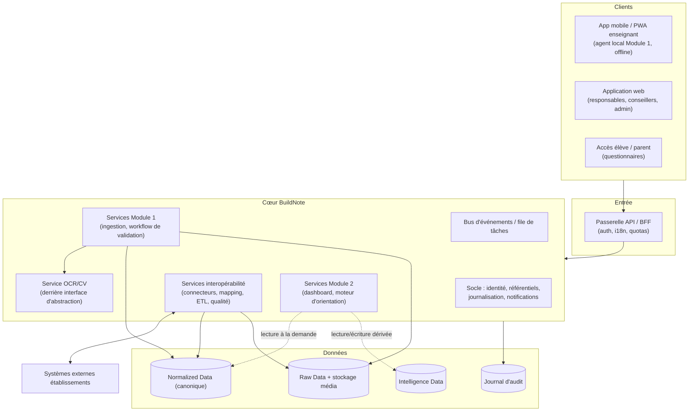

# F. Architecture technique — Scénarios comparés

> **Statut : En revue — Couche 3/4.** Date : 2026-09-08.
> **Aucune technologie n'est imposée.** Ce document compare des **styles d'architecture** et des
> **options de composants** sur : avantages, inconvénients, coûts, complexité, scalabilité. Le choix
> est recommandé ici puis **figé en Phase 7** (après POC), avec un ADR par décision majeure.

## F.1 Invariants d'architecture (indépendants du scénario)

1. **Deux modules séparés + socle**, contrats explicites, aucun couplage direct Module 1 ↔ Module 2.
2. **Modèle canonique** au centre ; le cœur n'accède qu'à lui.
3. **Trois strates de données** séparées (Raw / Normalized / Intelligence).
4. **Agent local** pour le Module 1 (capture + validation **hors-ligne**) synchronisé avec un cœur.
5. **Abstraction du moteur OCR** (interface interne stable, fournisseur remplaçable).
6. **Multi-tenant** avec isolation vérifiable par test.
7. **i18n** de bout en bout.
8. **Couche d'accès aux données** isolant le SGBD du cœur.
9. **Observabilité** intégrée dès le premier lot.

## F.2 Scénario A — Monolithe modulaire

Une seule application déployable, organisée en **modules internes** (socle, Module 1, Module 2,
interopérabilité) avec des frontières de code strictes. Le service OCR et l'agent local restent des
composants séparés.

| Critère | Évaluation |
|---|---|
| **Avantages** | Simplicité de développement, de déploiement et d'exploitation ; transactions simples ; idéal pour on-premise et faible connectivité ; moins d'infrastructure ; démarrage rapide en Phase 8. |
| **Inconvénients** | Montée en charge globale (on scale tout ensemble) ; risque d'érosion des frontières si discipline insuffisante ; une panne applicative affecte tout le cœur (le Module 1 reste couvert par l'agent local). |
| **Coûts** | Build : faible. Run : faible à moyen (une seule pile à héberger). |
| **Complexité** | Faible. |
| **Scalabilité** | Verticale + réplication de l'application ; le service OCR se dimensionne à part. Suffisant pour un déploiement mono ou petit multi-établissements. |
| **Adapté à** | Établissement unique, on-premise, hybride, faible connectivité, phase pilote. |

## F.3 Scénario B — Services séparés (orientés domaines)

Le socle, le Module 1, le Module 2 et l'interopérabilité sont des **services déployables
indépendamment**, communiquant par API et par le bus d'événements. Le service OCR est isolé.

| Critère | Évaluation |
|---|---|
| **Avantages** | Isolation forte des modules (aligné sur l'exigence de séparation) ; montée en charge indépendante (ex. OCR, calculs Module 2) ; déploiements et évolutions découplés ; pannes mieux circonscrites. |
| **Inconvénients** | Exploitation plus lourde (orchestration, observabilité distribuée, cohérence entre services) ; cohérence des données à gérer explicitement ; surcoût pour de petits déploiements ; on-premise plus difficile ; compétences DevOps plus élevées. |
| **Coûts** | Build : moyen à élevé. Run : moyen à élevé (plus de composants, orchestration). |
| **Complexité** | Élevée. |
| **Scalabilité** | Excellente et granulaire ; adaptée à un grand nombre d'établissements et à des pics (périodes de composition, campagnes d'orientation). |
| **Adapté à** | Grand multi-établissements, cloud, forte volumétrie. |

## F.4 Scénario C — Hybride (cœur modulaire + services isolés pour les charges spécifiques)

Cœur en **monolithe modulaire** (socle + Module 1 + Module 2 + interopérabilité), **plus** des
**services séparés** uniquement là où c'est justifié : **service OCR/CV**, **exécuteurs de tâches
lourdes** (ETL d'import, calculs de dashboard/orientation), éventuellement **agent local** packagé
à part.

| Critère | Évaluation |
|---|---|
| **Avantages** | Concilie simplicité d'exploitation du cœur et dimensionnement indépendant des charges coûteuses (OCR, ETL, calculs Module 2) ; le Module 1 (saisie) n'est jamais ralenti par le Module 2 ; migration possible vers B par extraction progressive si la volumétrie l'exige ; reste déployable en hybride/on-premise. |
| **Inconvénients** | Deux modes de communication (in-process + asynchrone) à maîtriser ; frontières internes à tenir par la discipline ; un peu plus d'infra que A. |
| **Coûts** | Build : faible à moyen. Run : moyen (cœur + quelques workers/services). |
| **Complexité** | Moyenne. |
| **Scalabilité** | Bonne : le cœur se réplique, les charges lourdes se dimensionnent séparément ; évolution vers B ouverte. |
| **Adapté à** | Tous les scénarios de déploiement, du pilote au multi-établissements ; couvre la trajectoire de croissance. |

## F.5 Comparaison synthétique

| Axe | A — Monolithe modulaire | B — Services séparés | C — Hybride |
|---|---|---|---|
| Coût de build | ●○○ faible | ●●● élevé | ●●○ moyen |
| Coût de run | ●○○ faible | ●●● élevé | ●●○ moyen |
| Complexité d'exploitation | ●○○ | ●●● | ●●○ |
| Isolation des modules | ●●○ (par le code) | ●●● (par le déploiement) | ●●○ à ●●● (OCR/tâches isolés) |
| Dimensionnement granulaire | ●○○ | ●●● | ●●○ |
| Aptitude on-premise / faible connectivité | ●●● | ●○○ | ●●● |
| Rapidité de démarrage (Phase 8) | ●●● | ●○○ | ●●○ |
| Trajectoire d'évolution | migration vers C/B possible mais tardive | — | vers B par extraction progressive |

## F.6 Recommandation

**Scénario C — Hybride**, pour ces raisons :

1. Il respecte l'exigence de **séparation des deux modules** (frontières de code strictes) tout en
   **isolant physiquement** ce qui pèse (OCR/CV, ETL d'import, calculs du Module 2), donc la
   **saisie du Module 1 n'est jamais impactée** par une campagne d'orientation ou un gros import.
2. Il reste **déployable en hybride et on-premise** (établissement unique, faible connectivité),
   contrairement à B.
3. Son **coût et sa complexité** sont soutenables pour une initiative privée démarrant par un
   pilote, contrairement à B.
4. Il **préserve la trajectoire** : si la volumétrie multi-établissements l'exige, on extrait
   progressivement des services (vers B) sans réécriture.

> À confirmer en **Phase 7** au vu des POC (notamment charge OCR et volumétrie cible fin Phase 0).
> Un ADR `ADR-arch-style` formalisera la décision.

## F.7 Options de composants (à trancher en Phase 4 → 7, un ADR chacune)

| Composant | Options candidates (non exhaustif, aucune imposée) | Éléments de décision |
|---|---|---|
| **Type de client Module 1** | Application mobile native ; PWA installable ; application hybride | Accès caméra fiable, mode hors-ligne robuste, contrainte de distribution (magasins), parc Android bas de gamme |
| **Client web (autres rôles)** | Application web classique rendue serveur ; SPA ; rendu hybride | Faible connectivité, SEO non pertinent, simplicité |
| **Moteur OCR/CV** | Service managé (Google Document AI, Azure AI Document Intelligence, AWS Textract) ; open source auto-hébergé (Tesseract, PaddleOCR, docTR + détection de tableaux) ; mixte | POC 1 & 2, décision #1 (souveraineté), coût au volume, hors-ligne, qualité manuscrit |
| **SGBD du cœur (canonique)** | PostgreSQL ; MySQL/MariaDB ; autre SQL | Maturité, fonctionnalités (JSON, contraintes, partitionnement), compétences, coût, licences, aptitude on-premise |
| **Stockage des médias (Raw)** | Stockage objet (compatible S3) ; système de fichiers ; base | Volumétrie images, chiffrement, cycle de vie, on-premise vs cloud |
| **Bus d'événements / file de tâches** | File managée ; broker open source ; file basée SGBD | Simplicité, garanties de livraison, aptitude on-premise |
| **Recherche / classements dashboard** | Requêtes SGBD + vues matérialisées à la demande ; moteur d'index dédié | Volumétrie, complexité des classements, coût |
| **Moteur d'orientation** | Moteur de règles + scoring additif codé ; moteur de règles dédié ; score-cards paramétrables | Explicabilité (priorité), maintenabilité, gouvernance des pondérations |
| **Orchestration / hébergement** | Conteneurs orchestrés ; VM ; PaaS ; installeur on-premise | Décision #1, compétences d'exploitation, scénarios de déploiement (P) |
| **Gestion des secrets** | Coffre dédié ; service managé du fournisseur | Souveraineté, rotation, on-premise |
| **CI/CD & IaC** | Chaîne gérée ; outils open source | Reproductibilité, coût, compétences |
| **Observabilité** | Suite managée ; pile open source | Coût, souveraineté des logs (données personnelles) |

## F.8 Vues d'architecture à produire en Phase 4 (conception détaillée)

- **Vue logique** : décomposition en composants, interfaces, contrats d'API des deux modules et du
  socle.
- **Vue de déploiement** : par scénario de la section P ([`../14-deploiement/`](../14-deploiement/)).
- **Vue données** : correspondance avec [`../06-architecture-donnees/`](../06-architecture-donnees/).
- **Vue interopérabilité** : correspondance avec [`../07-interoperabilite/`](../07-interoperabilite/).
- **Vue sécurité** : correspondance avec [`../10-securite/`](../10-securite/) (zones de confiance,
  flux, points de contrôle).
- **Vue « offline/sync »** : cycle de vie de l'agent local du Module 1, file, résolution de conflits.
- **Vue « charges »** : dimensionnement OCR, ETL, calculs Module 2.
- **ADR** : style d'architecture, chaque option de composant du §F.7.
