# G. Cycle de vie du stockage

> **Statut : En revue — Couche 4.** Date : 2026-09-09.
> Complète [`modele-conceptuel-logique-physique.md`](modele-conceptuel-logique-physique.md) §G.3
> (MPD) en détaillant le **cycle de vie physique** de chaque catégorie de stockage : création,
> accès, mutation, rétention, purge, archivage, sauvegarde/restauration, chiffrement, coûts.
> Références : `EF-M1-13` (Raw lié à la note), `EF-IOP-08` (lineage), `ENF-SEC-*`, décision #1
> (hébergement/souveraineté), décision #2 (rétention), R4, R12.

---

## G-CV.1 Catégories de stockage

| Catégorie | Contenu | Support | Immuable ? | Volumétrie dominante |
|---|---|---|---|---|
| **Médias Raw** | Images / vidéos de fiches, PDF importés | Stockage objet chiffré (hors base) | **Oui** (append-only) | **Oui** — poste de coût n°1 |
| **Payloads OCR bruts** | Sorties moteur OCR (texte, scores, bbox), par extraction | Base (JSON) si petit, stockage objet au-delà d'un seuil | **Oui** | Moyenne |
| **Enregistrements bruts d'import** | Lignes extraites des sources externes, avant mapping | Base (JSON) + stockage objet pour gros lots | **Oui** | Moyenne à forte (import initial) |
| **Normalized Data** | Modèle canonique : personnes, notes, inscriptions… | Base relationnelle (SGBD du cœur) | Non — mutation **tracée** | Forte (table `note`) |
| **Intelligence Data** | Profils, tendances, indicateurs dérivés | Schéma / espace séparé ; cache | Non — **jetable**, recalculable | Variable, bornée par TTL |
| **Lineage** | Traçabilité des données canoniques issues de l'interop | Base (append-only) | Oui (append) | Proportionnelle aux imports |
| **Journal d'audit** | Événements socle (accès, actions, sécurité) | Table append-only + archivage | Oui (append, chaînage de hash optionnel) | Forte sur la durée |
| **Archives d'export** | Exports de réversibilité générés | Stockage objet chiffré, TTL court | Oui | Ponctuelle |
| **Fichiers de configuration** | Mappings, gabarits de fiches, paramétrages | Base + gestion de versions | Non — versionné | Faible |

---

## G-CV.2 Médias Raw — cycle de vie

```mermaid
flowchart LR
    CAP["Capture (agent local M1)\nou import PDF/CSV"] --> HASH["Calcul empreinte SHA-256\n+ contrôle type/taille/anti-malware"]
    HASH --> UP["Écriture stockage objet\n(clé = préfixe de hash, chiffré)"]
    UP --> META["Métadonnées en base\n(document_source : uri, hash, taille, capture_le, lot_saisie)"]
    META --> LINK["Lien vers la/les Note(s)\naprès validation humaine (EF-M1-13)"]
    LINK --> LIVE["Actif : consultable\n(zone image d'une cellule, audit, ré-extraction)"]
    LIVE --> COLD["Refroidissement\n(après N mois : classe de stockage moins chère)"]
    COLD --> PURGE["Purge\n(fin de rétention légale : décision #2)"]
    PURGE --> TOMB["Pierre tombale\n(document_source conservé sans binaire : hash, date, motif de purge)"]
```

**Règles** :

- Le binaire est **toujours hors base** ; la base ne contient que métadonnées, URI et hash.
- **Déduplication** par hash : deux captures identiques → un seul binaire, deux `document_source`
  (ou un `document_source` référencé deux fois selon le cas), jamais de double stockage.
- **Accès** : uniquement via le cœur (URL signées à durée de vie courte) ; jamais d'URL publique.
- **Refroidissement** : après une période « chaude » (consultation fréquente pendant la validation
  et la contestation), bascule vers une classe de stockage archivage (moins chère, latence de
  restauration acceptable pour l'audit).
- **Purge** : à la fin de la durée de rétention (à fixer décision #2 — ex. année scolaire + délai de
  contestation), le binaire est **détruit** ; une **pierre tombale** garde la preuve qu'il a existé
  (hash, dates, `purge_le`, `purge_motif`) pour l'auditabilité du lineage.
- **Lien Note ↔ média** : `EF-M1-13` impose que l'image et l'extraction brute restent liées à la
  note tant que la note existe et que la rétention court. La purge du média **avant** celle de la
  note est possible seulement si la politique légale l'autorise ; sinon les deux sont alignées.

---

## G-CV.3 Payloads OCR et enregistrements bruts d'import

| Sujet | Règle |
|---|---|
| **Immuabilité** | Aucune modification. Une correction = une **nouvelle** extraction / un **nouvel** import (nouvelle ligne). |
| **Seuil base ↔ objet** | JSON en base sous un seuil (ex. 64 Ko) ; au-delà, stockage objet + URI en base. Seuil à confirmer au POC. |
| **Utilité** | Ré-exécution du mapping / de l'OCR sans re-solliciter la source ; amélioration des modèles ; audit ; rejeu de quarantaine (le brut est relu **tel quel**). |
| **Rétention** | Payloads OCR : alignés sur les médias Raw. Enregistrements bruts d'import : rétention **plus courte** possible (ex. 12–24 mois) une fois l'entité canonique stabilisée et le lineage écrit — à arbitrer décision #2. |
| **Purge** | Après purge d'un brut, le lineage conserve `enregistrement_brut_id` + hash (pierre tombale) : on sait d'où venait la donnée même si le brut n'est plus là. |

---

## G-CV.4 Normalized Data

| Sujet | Règle |
|---|---|
| **Mutation** | Autorisée mais **toujours tracée** : `modifie_le`, `modifie_par`, + entrée d'audit ; pour les corrections post-validation Module 1, valeur avant/après (`EF-M1-14`). |
| **Suppression** | **Logique** (`archive_le`) par défaut pour les entités métier ; suppression physique réservée aux cas légaux (droit à l'effacement) et exécutée par un processus dédié tracé. |
| **Historisation** | Changements de classe / établissement / programme historisés (dimension année scolaire de premier plan, §G.4 du MLD). |
| **Partitionnement** | Table `note` partitionnée par `annee_scolaire` (et éventuellement établissement) si la volumétrie l'exige ; les partitions d'années anciennes peuvent passer en stockage moins coûteux. |
| **Rétention** | Selon les obligations légales de l'établissement (souvent longue pour les résultats) ; la purge d'un élève entraîne une cascade tracée (notes, inscriptions, liens) ou une **pseudonymisation** si l'agrégat statistique doit être préservé (décision Couche 6). |

---

## G-CV.5 Intelligence Data

| Sujet | Règle |
|---|---|
| **Nature** | Entièrement **dérivable** de Normalized (+ référentiels). Jamais une entrée. |
| **Écriture** | Jobs de calcul explicites (à la demande / planifiés) ; jamais déclenchés par l'enregistrement d'une note (`EF-M1-19`, `RG-05`). |
| **TTL** | Les indicateurs de dashboard peuvent être mis en cache avec un **TTL court** ; au-delà, recalcul. L'horodatage du calcul est **toujours affiché** (`EF-M1-19`/`EF-M2-02`). |
| **Purge** | Espace de stockage séparé, **purgeable intégralement** sans risque : reconstruction complète possible à tout moment. Utile pour les migrations et les incidents. |
| **Isolation d'intégrité** | Aucune contrainte de clé étrangère « dure » vers Normalized au-delà des identifiants — pour pouvoir purger/recalculer librement. |

---

## G-CV.6 Journal d'audit

| Sujet | Règle |
|---|---|
| **Écriture** | Append-only ; pas d'`UPDATE`/`DELETE` applicatif. |
| **Intégrité** | Chaînage de hash optionnel (chaque entrée référence l'empreinte de la précédente) pour détecter toute altération. |
| **Contenu sensible** | Les valeurs avant/après sensibles sont **hachées** ou tronquées dans l'audit ; pas de PII en clair superflue. |
| **Archivage** | Export périodique vers un stockage WORM / archivage ; l'audit vif garde une fenêtre glissante (ex. 12–24 mois), l'archive garde le reste selon la politique légale. |
| **Rétention** | Distincte de celle des données métier ; définie en Couche 6 (décision #2). L'export de réversibilité ne l'embarque pas (périmètre séparé — voir [`../07-interoperabilite/export-reversibilite.md`](../07-interoperabilite/export-reversibilite.md) §H-REV.2.2). |

---

## G-CV.7 Matrice de rétention (gabarit — valeurs à figer en Phase 2)

| Catégorie | Rétention « chaude » | Rétention totale (proposition) | Déclencheur de purge | Trace après purge |
|---|---|---|---|---|
| Médias Raw (images de fiches) | Année scolaire en cours | Année scolaire + délai de contestation (ex. +1 an) — **à valider juridiquement** | Fin de rétention + absence de litige ouvert | Pierre tombale (hash, dates, motif) |
| Payloads OCR bruts | 6 mois | Alignée sur les médias | Idem médias | `extraction_ocr` métadonnées conservées |
| Enregistrements bruts d'import | 3 mois | 12–24 mois après stabilisation canonique | Entité canonique stable + lineage écrit | Lineage garde id + hash |
| Normalized (notes, inscriptions) | Illimitée en exploitation | Obligation légale de l'établissement | Demande légale / offboarding | Selon cas : suppression cascade tracée ou pseudonymisation |
| Intelligence Data | TTL court (heures/jours) | Aucune (jetable) | Recalcul / purge de maintenance | Aucune (reconstructible) |
| Lineage | Illimité en exploitation | Alignée sur Normalized | Purge de l'entité liée | Conservé en forme réduite (pierre tombale) |
| Journal d'audit | 12–24 mois vif | Politique légale (souvent longue) | Politique d'archivage | Archive WORM |
| Archives d'export | — | 30 jours côté BuildNote | TTL | Journalisé à l'audit |

> Toutes ces valeurs sont **provisoires**. La matrice définitive est un livrable de la **DPIA
> (Phase 2)** et de la politique de conformité (Couche 6). Renvoi : décision #2.

---

## G-CV.8 Sauvegarde et restauration

| Sujet | Règle |
|---|---|
| **Cohérence base ↔ objet** | Sauvegarde **coordonnée** : le point de reprise de la base et celui du stockage média correspondent (pas de note pointant vers un média absent après restauration). |
| **Fréquence** | Base : sauvegarde continue (journal) + instantanés quotidiens. Stockage objet : versioning + réplication. Valeurs finales : Couche 6 / exploitation. |
| **Test de restauration** | **Mensuel** : restauration d'un établissement de test dans un environnement isolé + contrôle d'intégrité (comptes, sommes de contrôle, médias). |
| **RPO / RTO** | Cibles définies en Couche 6 selon le scénario d'hébergement (décision #1). |
| **Isolation multi-tenant** | La restauration d'un établissement ne doit pas exposer les autres ; procédure de restauration **partielle par tenant** documentée. |
| **Hors-ligne / on-premise** | Dans les scénarios avec serveur local (décision #1), la stratégie de sauvegarde locale + synchronisation centrale est spécifiée au plan de déploiement ([`../14-deploiement/`](../14-deploiement/)). |

---

## G-CV.9 Chiffrement

| Donnée | Au repos | En transit | Notes |
|---|---|---|---|
| Base (Normalized, lineage, audit) | Chiffrement au niveau du volume / du SGBD | TLS | Voir Couche 6 pour la gestion des clés |
| Stockage objet (médias, payloads, archives) | Chiffrement côté serveur (clé gérée) + option clé par tenant | TLS + URL signées éphémères | |
| Secrets de connexion des connecteurs | Chiffrement applicatif + coffre ; jamais journalisés ; rotation | — | `connecteur_config.parametres` |
| Sauvegardes | Chiffrées, clés distinctes de la production | TLS | Testées au restore mensuel |
| Champs très sensibles (`avis_parent.contenu`, opinions) | Envisager un chiffrement applicatif dédié | — | Arbitrage DPIA / Couche 6 |

---

## G-CV.10 Coûts de stockage (méthode de cadrage)

> Objectif : anticiper le poste « stockage » du budget de run (décision #9), dominé par les
> **médias Raw**.

| Poste | Facteur de coût | Levier de maîtrise |
|---|---|---|
| Médias Raw | Nb de fiches × poids moyen d'une image × durée de rétention | Compression à la capture ; refroidissement ; purge en fin de rétention ; pas de vidéo si photo suffit |
| Payloads / bruts | Volume d'import initial × nb d'établissements onboardés | Rétention courte des bruts après stabilisation |
| Normalized | Croissance linéaire avec les notes | Partitionnement + archivage des années anciennes |
| Sauvegardes | Multiple du volume production × rétention des sauvegardes | Politique de rétention des sauvegardes ; déduplication |
| Audit | Croissance continue | Archivage WORM peu coûteux + fenêtre vive limitée |

**Estimation de cadrage médias** (à affiner au pilote) :
`coût_mensuel ≈ (fiches_par_mois × Ko_par_fiche / 1e6) Go × prix_Go_chaud`
`+ (stock_refroidi Go × prix_Go_archive)`.
Exemple d'ordre de grandeur : 1 établissement, ~1 500 fiches/mois × 400 Ko ≈ **0,6 Go/mois** de
médias chauds — le stockage n'est pas le facteur limitant à petite échelle ; il le devient en
multi-établissements sur plusieurs années → d'où l'importance de la **politique de rétention** et du
**refroidissement**.

---

## G-CV.11 Ce qui reste à valider

| Sujet | Où | Quand |
|---|---|---|
| Valeurs de rétention (toutes catégories) | DPIA + politique de conformité (décision #2) | Phase 2 |
| Classe de stockage objet, seuils de refroidissement | ADR stockage + exploitation | Phase 4 → 7 |
| Seuil base ↔ objet pour les payloads JSON | POC 1 / POC 3 | Phase 6 |
| RPO / RTO, fréquence exacte des sauvegardes | Couche 6 + exploitation | Phase 4 → 8 |
| Chiffrement applicatif des champs très sensibles | DPIA / Couche 6 | Phase 2 → 4 |
| Stratégie de sauvegarde on-premise vs central | Décision #1 + [`../14-deploiement/`](../14-deploiement/) | Phase 2 → 4 |
