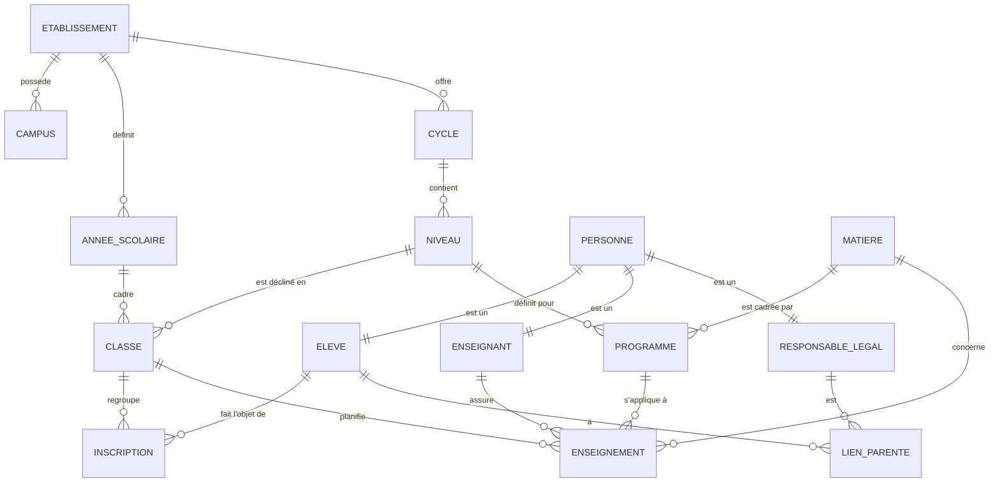
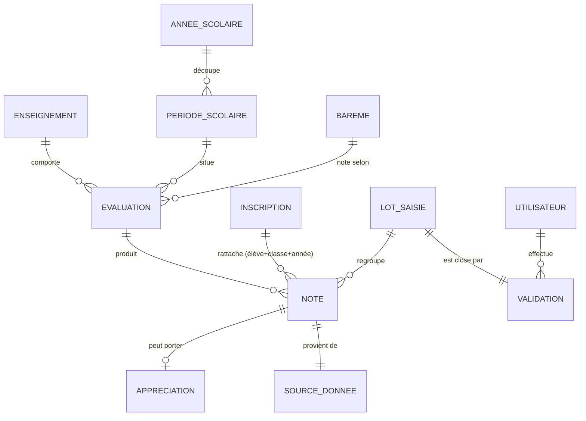
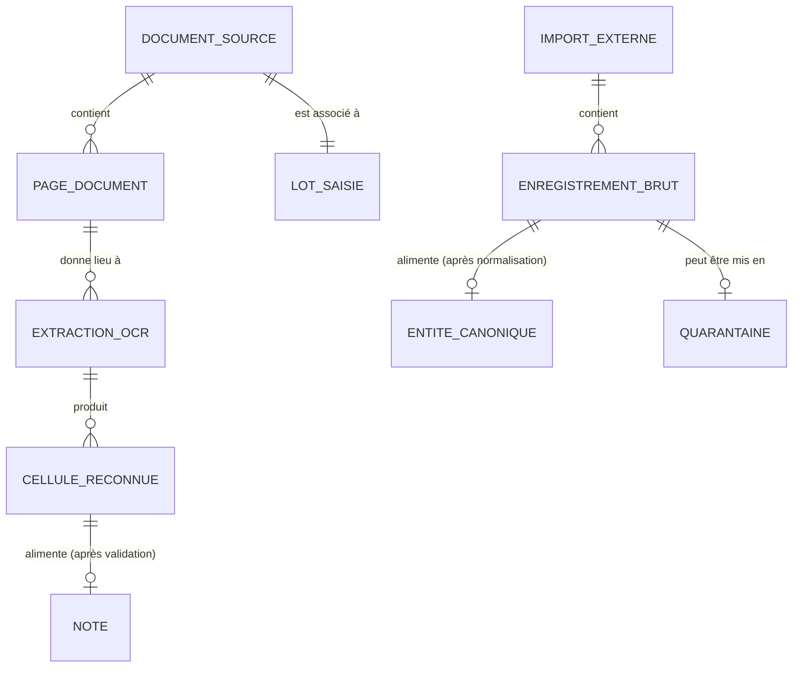
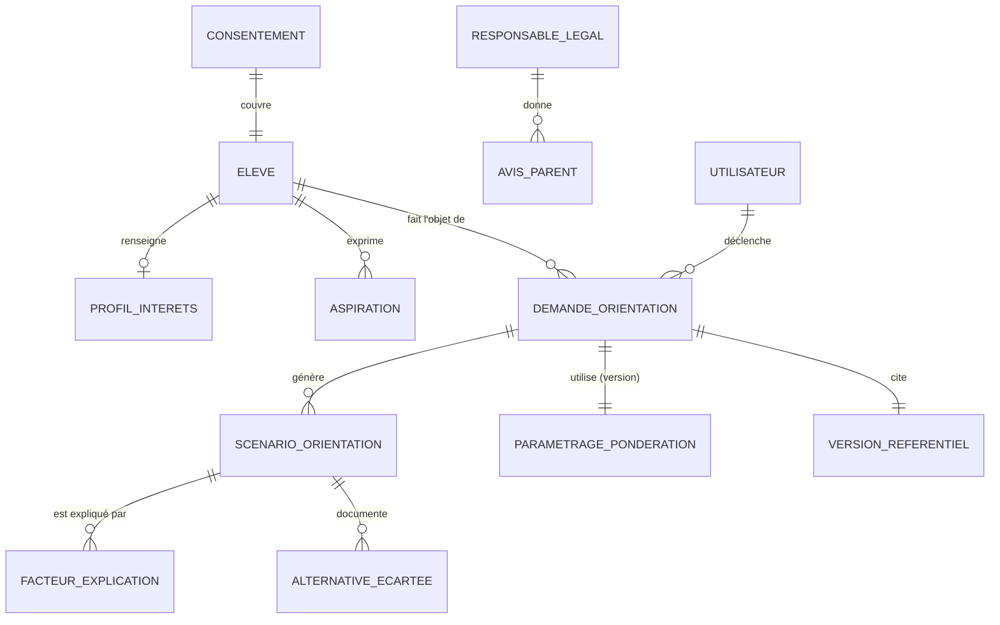
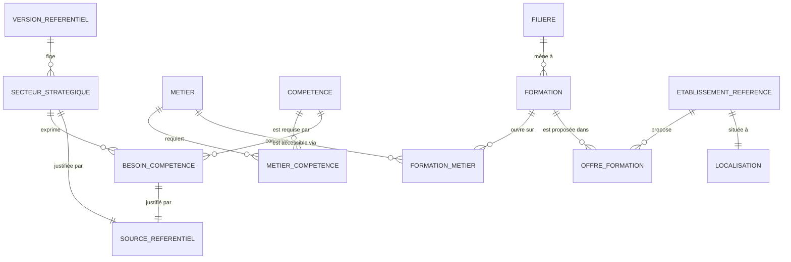
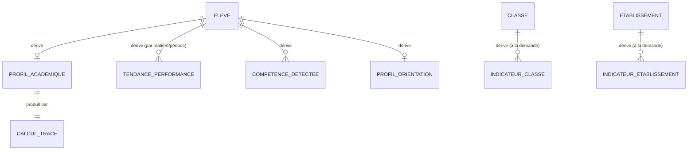
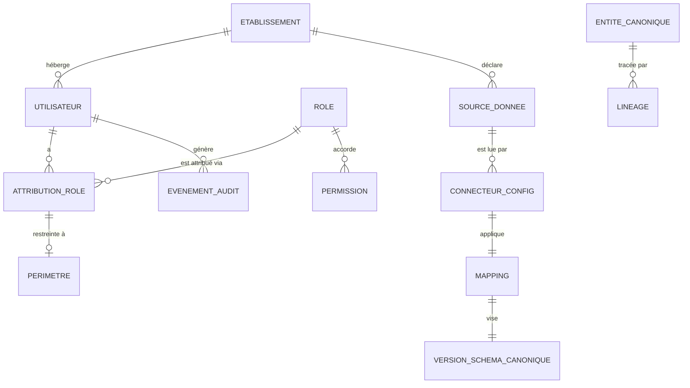

# G. Modèles conceptuel, logique et physique — BuildNote

> **Statut : En revue — Couche 4.** Date : 2026-09-08 (rév. 2026-09-09).
> Complète [`vue-ensemble.md`](vue-ensemble.md). Les types physiques exacts dépendent du SGBD retenu
> (Phase 7) ; les principes ci-dessous sont indépendants du SGBD.
> Le détail **champ par champ** (type logique, obligatoire, valeurs, règle, sensibilité) est dans
> [`dictionnaire-donnees.md`](dictionnaire-donnees.md). Le cycle de vie physique (rétention, purge,
> sauvegarde) est dans [`cycle-de-vie-stockage.md`](cycle-de-vie-stockage.md).
>
> **Frontière avec l'interopérabilité** : ce document définit la **forme interne** des données
> (source de vérité). Le **schéma canonique d'échange** publié aux établissements en est une
> projection versionnée — [`../07-interoperabilite/architecture-detaillee.md`](../07-interoperabilite/architecture-detaillee.md) §H.1.

## G.1 Modèle Conceptuel de Données (MCD)

### G.1.1 Domaine « Structure & personnes » (Normalized Data)

### G.1.2 Domaine « Évaluation & résultats » (Normalized Data)

### G.1.3 Domaine « Raw Data »

### G.1.4 Domaine « Module 2 : saisies & orientation »

### G.1.5 Domaine « Référentiels d'orientation » (semi-Normalized / Reference Data)

### G.1.6 Domaine « Intelligence Data » (dérivé)

### G.1.7 Domaine « Socle : identité, audit, interopérabilité »

## G.2 Modèle Logique de Données (MLD) — principes

### G.2.1 Conventions
- **Clés primaires techniques** : identifiants opaques (UUID) pour toutes les entités.
- **Clé de tenant** : `etablissement_id` **obligatoire et non nul** sur toute table de données
  métier (voir §G.4 isolation).
- **Clés de rapprochement** (métier) : séparées des clés techniques, utilisées par
  l'interopérabilité pour l'idempotence (ex. `code_national_eleve` s'il existe, sinon combinaison
  nom normalisé + date de naissance + établissement).
- **Horodatage systématique** : `cree_le`, `modifie_le`, `cree_par`, `modifie_par`.
- **Suppression logique** (`archive_le`) plutôt que physique pour les entités métier.
- **Libellés bilingues** : les entités de référence portent `libelle_fr` / `libelle_en` (ou une
  table de traductions dédiée).
- **Versioning** : les entités du référentiel d'orientation portent un lien vers
  `version_referentiel`.

### G.2.2 Tables principales (extrait, Normalized Data)

| Table | Colonnes clés (hors audit) | Notes |
|---|---|---|
| `etablissement` | id, nom, type, pays, code, statut | Racine du tenant |
| `annee_scolaire` | id, etablissement_id, libelle, date_debut, date_fin, active | |
| `periode_scolaire` | id, annee_scolaire_id, libelle (trimestre/semestre), ordre | |
| `cycle` / `niveau` | id, etablissement_id, libelle_fr, libelle_en, ordre | Paramétrable (systèmes éducatifs) |
| `classe` | id, etablissement_id, annee_scolaire_id, niveau_id, libelle, effectif | |
| `personne` | id, etablissement_id, nom, prenoms, nom_normalise, date_naissance, sexe, contact | Base commune |
| `eleve` | id (= personne_id), matricule, code_national (nullable) | |
| `enseignant` | id (= personne_id), identifiant_interne | |
| `responsable_legal` | id (= personne_id) | |
| `lien_parente` | id, eleve_id, responsable_legal_id, nature, autorite | |
| `inscription` | id, eleve_id, classe_id, annee_scolaire_id, date, statut | Unicité (eleve, classe, année) |
| `matiere` | id, etablissement_id, libelle_fr, libelle_en, domaine | |
| `programme` | id, etablissement_id, matiere_id, niveau_id, coefficient_defaut | |
| `enseignement` | id, classe_id, matiere_id, enseignant_id, programme_id, coefficient | |
| `bareme` | id, etablissement_id, type (sur_20 / sur_10 / sur_100 / mention), min, max, pas | |
| `evaluation` | id, enseignement_id, periode_scolaire_id, bareme_id, type, date, libelle | |
| `note` | id, evaluation_id, inscription_id, valeur, valeur_texte (mention), statut, lot_saisie_id, source_donnee_id, origine (ocr/manuel/import) | Unicité (evaluation, inscription) ; plage contrôlée par le barème |
| `appreciation` | id, note_id, texte, auteur_id | |
| `lot_saisie` | id, etablissement_id, enseignement_id, evaluation_id, statut, cree_par | Un lot = une session de capture/validation |
| `validation` | id, lot_saisie_id, utilisateur_id, role_validation (enseignant/responsable), horodatage | Trace la (ou les deux) validation(s) |

### G.2.3 Tables Raw Data (extrait)

| Table | Colonnes clés | Notes |
|---|---|---|
| `document_source` | id, etablissement_id, lot_saisie_id, type_media, uri_stockage, hash, taille, capture_le, capture_par | Immuable |
| `page_document` | id, document_source_id, numero, uri_image, dimensions | |
| `extraction_ocr` | id, page_document_id, moteur, version_moteur, horodatage, statut, score_global, payload_uri | Une page peut avoir plusieurs extractions (ré-exécution) |
| `cellule_reconnue` | id, extraction_ocr_id, ligne, colonne, role_colonne, texte_reconnu, score_confiance, bbox, note_id (nullable) | `bbox` = coordonnées ; `note_id` renseigné après validation |
| `import_externe` | id, etablissement_id, source_donnee_id, connecteur_config_id, horodatage, mode (complet/incrémental), curseur, statut | |
| `enregistrement_brut` | id, import_externe_id, entite_cible, payload, hash, statut (chargé/quarantaine/rejeté), entite_canonique_id (nullable) | |
| `quarantaine` | id, enregistrement_brut_id, motif, details_validation, action, resolu_le, resolu_par | |

### G.2.4 Tables Module 2 (extrait)

| Table | Colonnes clés | Notes |
|---|---|---|
| `profil_interets` | id, eleve_id, centres_interet, matieres_preferees, contraintes, maj_le | Minimisation |
| `aspiration` | id, eleve_id, intitule, domaine, priorite, exprimee_le | |
| `avis_parent` | id, eleve_id, responsable_legal_id, contenu, ambition, priorite, saisi_par (parent/tiers), donne_le | |
| `consentement` | id, eleve_id, portee (module2), donne_par, date, statut, retire_le | Condition de EF-M2-11 |
| `demande_orientation` | id, eleve_id, declenchee_par, horodatage, version_referentiel_id, parametrage_ponderation_id, statut, avertissement_fiabilite | |
| `scenario_orientation` | id, demande_orientation_id, rang, filiere_id, score, resume | |
| `scenario_element` | id, scenario_orientation_id, type (formation/etablissement/metier), reference_id, detail | |
| `facteur_explication` | id, scenario_orientation_id, facteur, valeur_pour_eleve, poids, contribution, categorie (profil/aspiration/avis_parent/offre/debouche/besoin_national) | Base de l'explicabilité |
| `alternative_ecartee` | id, demande_orientation_id, filiere_id, raison, score | |
| `parametrage_ponderation` | id, etablissement_id, version, poids_par_categorie (json), bornes, publie_le | Valeurs par défaut publiées |
| `dossier_orientation_version` | id, demande_orientation_id, numero, genere_le, motif (initial/revision), export_uri | Historise EF-M2-24 |

### G.2.5 Tables référentiels d'orientation (extrait)

`secteur_strategique`, `metier`, `competence`, `metier_competence`, `besoin_competence`, `filiere`,
`formation`, `formation_metier`, `etablissement_reference`, `localisation`, `offre_formation`,
`source_referentiel` (référence, organisme, url, date_publication, date_consultation),
`version_referentiel` (numero, date, statut, notes).
Chaque entrée « stratégique » porte `source_referentiel_id` **obligatoire** et `version_referentiel_id`.

### G.2.6 Tables Intelligence Data (extrait)

| Table | Colonnes clés | Notes |
|---|---|---|
| `profil_academique` | id, eleve_id, annee_scolaire_id, synthese (json), calcule_le, calcul_trace_id | Reconstructible |
| `tendance_performance` | id, eleve_id, matiere_id, periode_debut, periode_fin, pente, niveau_moyen, regularite | |
| `competence_detectee` | id, eleve_id, competence_id, niveau_estime, confiance, base_calcul | Sous supervision humaine |
| `profil_orientation` | id, eleve_id, synthese (json), calcule_le | |
| `indicateur_classe` / `indicateur_etablissement` | id, perimetre, indicateur, valeur, calcule_le, couverture_donnees | **Calculés à la demande** ; peuvent être mis en cache avec TTL court |
| `calcul_trace` | id, type_calcul, version_algorithme, entrees_hash, horodatage | Traçabilité des dérivations |

### G.2.7 Tables socle (extrait)

`utilisateur`, `role`, `permission`, `attribution_role` (utilisateur, role, perimetre),
`perimetre` (type, reference_id), `evenement_audit` (acteur, action, objet, avant/après (hashé si
sensible), horodatage, ip, resultat), `source_donnee`, `connecteur_config` (type, parametres
chiffrés, planification), `mapping` (definition, version_schema_canonique_id, version),
`version_schema_canonique` (numero, date, notes, scripts_migration_uri),
`lineage` (entite_canonique_id, origine, mapping_id, transformations (json), horodatage, decideur).

## G.3 Modèle Physique de Données (MPD) — orientations

> Le SGBD exact est décidé en Phase 7. Ces orientations valent pour un SGBD relationnel.

| Sujet | Orientation |
|---|---|
| **Clés** | UUID en clé primaire ; index sur les clés étrangères et les clés de rapprochement. |
| **Isolation tenant** | `etablissement_id` sur toutes les tables métier ; index composite `(etablissement_id, …)` en tête ; voir §G.4. |
| **Notes** | Table volumineuse : index `(evaluation_id)`, `(inscription_id)`, `(etablissement_id, annee_scolaire_id)` ; partitionnement par `annee_scolaire` (et éventuellement par établissement) si la volumétrie l'exige. |
| **Raw média** | Le binaire (images) est stocké hors base (stockage objet/fichier chiffré) ; la base ne conserve que les métadonnées, l'URI et le hash. |
| **Payloads OCR / bruts** | JSON stocké en base (colonne JSON) pour les petits volumes, sur stockage objet au-delà d'un seuil ; toujours immuables. |
| **Intelligence Data** | Schéma / espace de stockage séparé ; peut être purgé et recalculé ; pas de contrainte d'intégrité vers Normalized au-delà des identifiants. |
| **Libellés bilingues** | Colonnes `_fr`/`_en` pour les référentiels stables ; table `traduction(entite, champ, langue, texte)` pour les contenus étendus et l'ajout futur de langues. |
| **Audit** | Table append-only ; pas d'`UPDATE`/`DELETE` applicatif ; export et archivage périodiques ; intégrité renforcée (chaînage de hash optionnel). |
| **Rétention** | Jobs de purge par catégorie et par strate, pilotés par la politique de rétention (décision #2). |
| **Sauvegarde** | Cohérente entre base et stockage média (même point de reprise) ; testée mensuellement. |
| **Chiffrement** | Au repos sur la base et le stockage média ; secrets de `connecteur_config` chiffrés au niveau applicatif + coffre. |

## G.4 Isolation multi-tenant (modèle de données)

Options (décision #4, Phase 4) :

| Option | Mise en œuvre dans le MPD |
|---|---|
| Base par établissement | Une base par tenant ; pas de colonne `etablissement_id` nécessaire ; routage par connexion. Isolation maximale, exploitation lourde à grande échelle. |
| Schéma par établissement | Un schéma par tenant dans une même instance ; migrations répétées par schéma. Bon compromis. |
| Base partagée + cloisonnement | Colonne `etablissement_id` obligatoire partout + politiques d'accès au niveau SGBD (row-level security) **et** au niveau applicatif (filtre systématique injecté par la couche d'accès aux données) + tests d'isolation automatisés. Exploitation simple, rigueur applicative indispensable. |

**Recommandation provisoire** : *schéma par établissement* pour un multi-établissements modéré, ou
*base partagée + cloisonnement (row-level security + couche d'accès)* avec batterie de tests
d'isolation. À trancher en Phase 4 selon la volumétrie de fin de Phase 0.

## G.5 Dictionnaire de données

Le dictionnaire complet (chaque champ : nom, type logique, obligatoire, valeurs admises, règle de
gestion, sensibilité RGPD/PII, strate, source) est produit dans
**[`dictionnaire-donnees.md`](dictionnaire-donnees.md)** — maintenu depuis la Phase 4, **gel prévu à
J4**. Modèle de ligne :

| Champ | Entité | Type logique | Oblig. | Valeurs / règle | Sensibilité | Strate | Source |
|---|---|---|---|---|---|---|---|
| `note.valeur` | note | décimal(5,2) | selon barème | ∈ [barème.min, barème.max] | PII (indirecte) | Normalized | Module 1 / Import |
| `personne.date_naissance` | personne | date | oui | date passée plausible | PII | Normalized | Module 1 / Import |
| `cellule_reconnue.score_confiance` | cellule_reconnue | décimal(4,3) | oui | ∈ [0,1] | — | Raw | OCR |
| `avis_parent.contenu` | avis_parent | texte | non | minimisé | PII sensible (opinion) | Module 2 | Parent |
| … | … | … | … | … | … | … | … |

## G.6 Versioning et migration du schéma canonique

- Chaque évolution du canonique → nouvelle `version_schema_canonique` + scripts de migration
  (avant/arrière) + note de compatibilité des `mapping`.
- Le cœur supporte la version courante **et** la précédente pendant les migrations.
- Les `mapping` sont testés contre la nouvelle version avant publication (lié au POC 3 et à la CI).
- Une migration est **réversible** ou précédée d'une sauvegarde de retour arrière.
