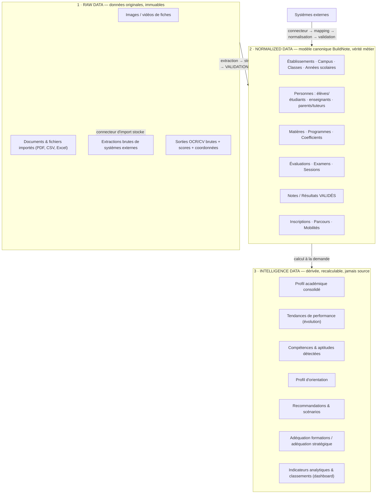
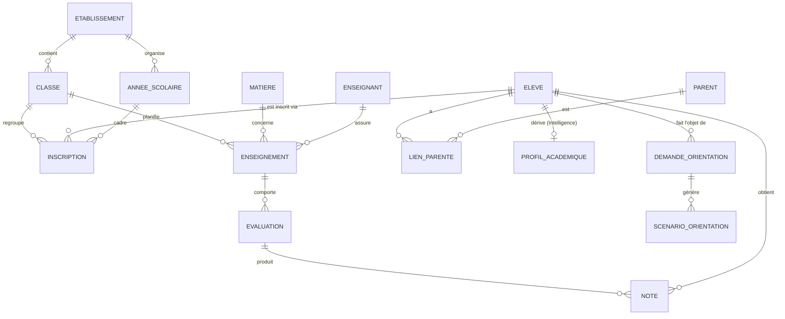

# G. Architecture des données — Vue d'ensemble

> **Statut : En revue — Couche 1.** Date : 2026-09-08 (rév. 2026-09-09).
> Les modèles conceptuel / logique / physique détaillés (MCD, MLD, MPD) et le dictionnaire de
> données sont produits en Couche 4 :
> [`modele-conceptuel-logique-physique.md`](modele-conceptuel-logique-physique.md),
> [`dictionnaire-donnees.md`](dictionnaire-donnees.md),
> [`cycle-de-vie-stockage.md`](cycle-de-vie-stockage.md). Index : [`README.md`](README.md).
>
> **Qui fait foi ?** Le modèle **Normalized** (forme des données métier) est spécifié ici ; le
> **schéma canonique d'échange** en est la **projection versionnée publiquement**
> ([`../07-interoperabilite/architecture-detaillee.md`](../07-interoperabilite/architecture-detaillee.md) §H.1).
> Le **dictionnaire** est la référence unique au niveau champ.

## G.1 Trois strates séparées

| Strate | Rôle | Écriture | Modification | Rétention |
|---|---|---|---|---|
| **Raw** | Preuve, audit, ré-extraction, amélioration des modèles | Module 1 (média + sortie OCR), connecteurs d'import | **Jamais** (append-only) | Longue, à définir en Phase 2 (données de mineurs → durée justifiée) |
| **Normalized** | Seule source de vérité métier ; alimente tout le reste | Module 1 **après validation**, interopérabilité **après normalisation** | Oui, tracée (audit + lineage) | Selon obligations légales de l'établissement |
| **Intelligence** | Vues et scores dérivés | Jobs de calcul (à la demande / planifiés explicitement) | Recalcul complet possible à tout moment | Courte / jetable ; reconstructible |

## G.2 Invariants

1. **La donnée dérivée n'est jamais une entrée.** L'Intelligence Data se reconstruit intégralement à
   partir de Normalized (+ référentiels). Aucun processus ne « lit » l'Intelligence pour écrire dans
   Normalized.
2. **Rien n'entre en Normalized sans passer par une porte.** Porte Module 1 = validation humaine.
   Porte interopérabilité = mapping + normalisation + validation.
3. **Raw est immuable.** On corrige en créant une nouvelle extraction, pas en modifiant l'ancienne.
4. **Toute écriture en Normalized est traçable** : auteur (humain ou connecteur), source, horodatage,
   version de schéma, lineage.
5. **Cloisonnement par établissement** appliqué à chaque strate.
6. **Le calcul du dashboard et de l'orientation lit un instantané cohérent** de Normalized (+
   Intelligence si déjà calculée), à la demande.

## G.3 Entités canoniques principales (aperçu)

> Les cardinalités exactes, attributs, contraintes, types et clés seront fixés dans le **MCD/MLD**
> (Couche 4). Les entités du référentiel d'orientation (FORMATION, FILIERE, METIER,
> SECTEUR_STRATEGIQUE, BESOIN_COMPETENCE, ETABLISSEMENT_REFERENCE) sont détaillées en Couche 5 avec
> le moteur d'orientation.

## G.4 Gestion du temps et de l'historique

- **Années scolaires** comme dimension de premier plan : toute note, inscription, classe est
  rattachée à une année scolaire.
- **Historisation** des changements de classe, d'établissement, de programme.
- Les **tendances de performance** (Intelligence) sont calculées sur la série historique des notes
  validées.

## G.5 Qualité des données

- **Contraintes** au niveau canonique (unicité, plages de notes selon barème, cohérence
  coefficient/matière).
- **Quarantaine** : une donnée importée non conforme est isolée, pas rejetée silencieusement.
- **Tableau de bord qualité** (complétude, fraîcheur, taux de conflit, taux de correction post-OCR).
- **Dédoublonnage** des personnes (élève présent dans plusieurs sources) via règles de rapprochement
  + revue.

## G.6 Rétention, minimisation, souveraineté (à arbitrer en Phase 2)

| Question | Renvoi |
|---|---|
| Durée de conservation du Raw (images de fiches) | [`17-decisions/decisions-prealables.md`](../17-decisions/decisions-prealables.md) #2 |
| Localisation physique des données | Décision #1 (hébergement & souveraineté) |
| Données strictement nécessaires au Module 2 (intérêts, avis parents) | DPIA — Phase 2 |
| Anonymisation / pseudonymisation pour l'analyse agrégée | Couche 6 — [`10-securite/`](../10-securite/) |

## G.7 Livrables Couche 4 (produits)

| Livrable | Document | Statut |
|---|---|---|
| Modèle **Conceptuel** (MCD, toutes entités et relations) | [`modele-conceptuel-logique-physique.md`](modele-conceptuel-logique-physique.md) §G.1 | En revue |
| Modèle **Logique** (MLD : tables, clés, normalisation, index candidats) | idem §G.2 | En revue |
| Modèle **Physique** (MPD : orientations SGBD, partitionnement multi-tenant, stockage des médias, stratégie Raw/Normalized/Intelligence) | idem §G.3–G.4 | En revue |
| **Dictionnaire de données** (chaque champ : type, obligatoire, source, règle, sensibilité, strate) | [`dictionnaire-donnees.md`](dictionnaire-donnees.md) | En revue — gel prévu J4 |
| **Cycle de vie du stockage** (rétention, purge, archivage, sauvegarde, chiffrement, coûts) | [`cycle-de-vie-stockage.md`](cycle-de-vie-stockage.md) | En revue |
| **Stratégie de versioning** du schéma canonique et de migration | [`modele-conceptuel-logique-physique.md`](modele-conceptuel-logique-physique.md) §G.6 + [`../07-interoperabilite/architecture-detaillee.md`](../07-interoperabilite/architecture-detaillee.md) §H.8 | En revue |
