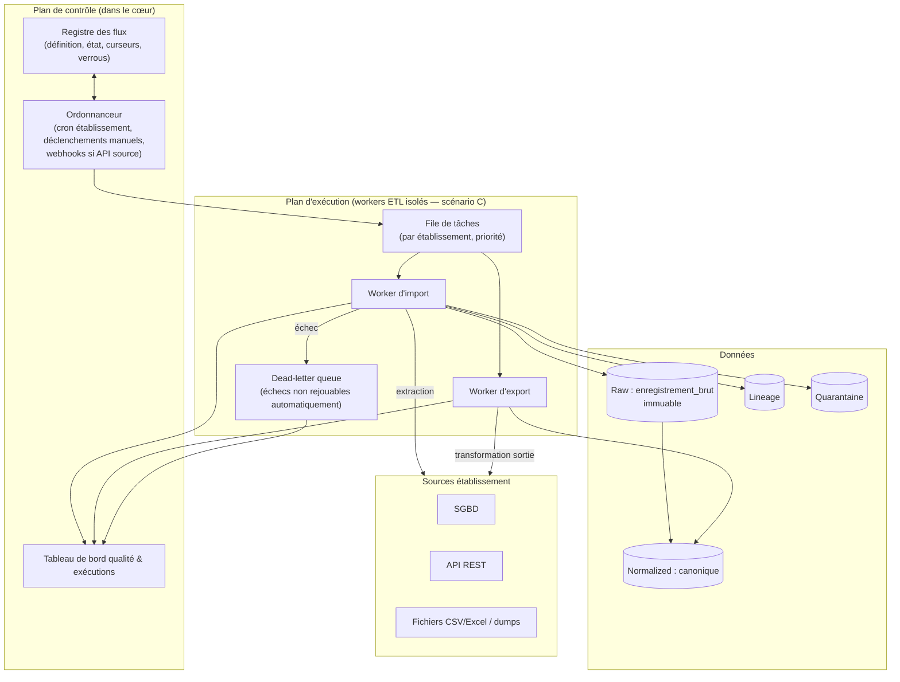
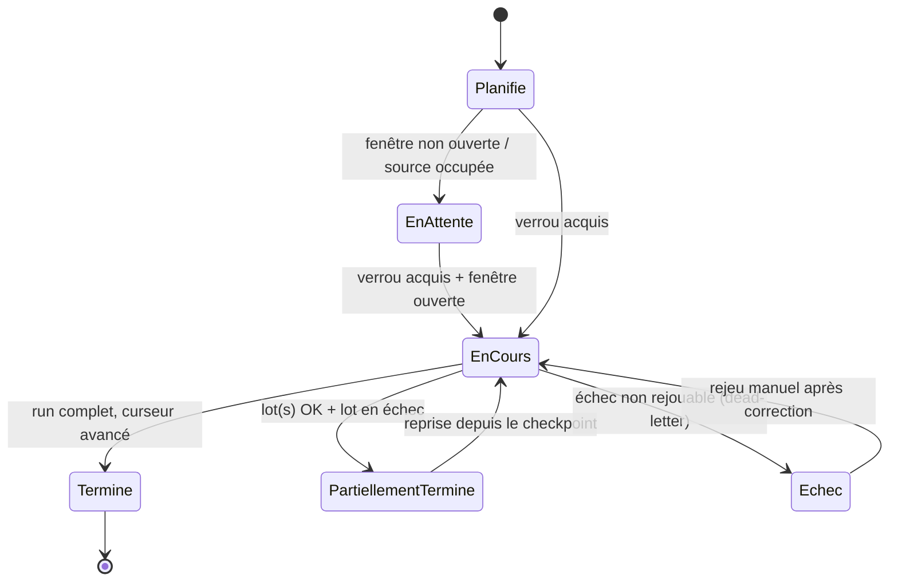

# H. Interopérabilité — ETL & orchestration des flux

> **Statut : En revue — Couche 4.** Date : 2026-09-09.
> Complète [`architecture-detaillee.md`](architecture-detaillee.md) §H.4 et §H.7. Spécifie
> **comment** les flux d'import/export sont exécutés, ordonnancés, repris et surveillés.
> Références : `EF-IOP-04/05/06/09/10`, `ENF-PERF-06`, `ENF-IOP-04`, `RG-10`, `RG-13`, R12, R14.

---

## H-ETL.1 Périmètre

Ce document couvre l'**orchestration** des traitements d'interopérabilité :

- extraction depuis une source (connecteur) → stockage brut → transformation → normalisation →
  rapprochement → validation → *upsert* canonique → lineage ;
- les **modes** : import initial (complet), synchronisation (incrémentale), import ponctuel
  (fichier), export tiers, export de réversibilité ;
- l'**ordonnancement** (déclenchement, dépendances, fenêtres, concurrence) ;
- la **résilience** (idempotence, reprise, *dead-letter*, rejeu) ;
- le **dimensionnement** et l'**isolation** vis-à-vis de la saisie Module 1 ;
- l'**observabilité** des pipelines.

Hors périmètre : la grammaire de mapping (→ §H.3), la politique de conflits (→ §H.5), le format
d'export de réversibilité (→ [`export-reversibilite.md`](export-reversibilite.md)).

---

## H-ETL.2 Topologie logique



**Principes de placement (scénario C — hybride)** :

1. Le **plan de contrôle** (ordonnanceur, registre, tableau de bord) vit **dans le cœur** : léger,
   transactionnel, il n'exécute aucun traitement lourd.
2. Le **plan d'exécution** (*workers*) est **isolé** : un pic d'import ne doit jamais ralentir la
   saisie ou la validation du Module 1 (`EF-M1-19` protège le Module 2 ; ici on protège le Module 1).
3. La **file de tâches** est **partitionnée par établissement** : pas de tête de file monopolisée
   par un gros établissement ; pas de flux inter-tenants.

---

## H-ETL.3 Étapes d'un flux d'import (contrat par étape)

| # | Étape | Entrée | Sortie | Idempotent ? | En cas d'échec |
|---|---|---|---|---|---|
| 1 | **Acquisition du verrou** de flux | `flux_id`, `etablissement_id` | verrou exclusif | — | Abandon si un flux du même `(source, établissement)` tourne déjà (pas de parallélisme sur une même source). |
| 2 | **Extraction** (connecteur) | curseur (`modifie_depuis` / offset) | pages de lignes brutes | Oui (relire = mêmes lignes) | *Retry* avec *backoff* exponentiel (5 tentatives) ; au-delà → flux en `echec`, curseur **non avancé**. |
| 3 | **Stockage brut** | lignes brutes | `enregistrement_brut` (hash, `statut=charge`) | Oui (clé = `hash` + `import_externe_id`) | Transaction ; en cas d'échec, rien n'est écrit, rejouer l'extraction. |
| 4 | **Transformation** | `enregistrement_brut` + `mapping` vN | tuple canonique candidat | Oui (fonction pure du brut + mapping) | Erreur de mapping → `enregistrement_brut.statut=quarantaine`, motif `mapping_error`. |
| 5 | **Normalisation** | tuple candidat | tuple normalisé (types, dates, barèmes, `nom_normalise`) | Oui | Valeur non normalisable → quarantaine, motif `normalisation`. |
| 6 | **Rapprochement** | tuple normalisé + clés de rapprochement | `match` / `no-match` + `entite_canonique_id?` | Oui (clés stables) | Ambiguïté (plusieurs *matches*) → quarantaine, motif `rapprochement_ambigu`. |
| 7 | **Validation** | tuple + entité existante éventuelle | `conforme` / `non conforme` / `conforme + conflit` | Oui | `non conforme` → quarantaine avec motif structuré. |
| 8 | **Résolution de conflit** | valeurs en présence + politique de préséance | valeur retenue **ou** mise en file de revue | Oui (règle déterministe) ou humain | `revue_manuelle` → file de revue, pas d'écriture. |
| 9 | ***Upsert* canonique** | tuple retenu | entité canonique créée/mise à jour | **Oui** (clé de rapprochement → `INSERT ... ON CONFLICT UPDATE`) | Transaction par entité ; échec → *retry* ; 3 échecs → *dead-letter*. |
| 10 | **Écriture du lineage** | contexte complet de l'opération | ligne `lineage` | Oui (append, clé = `entite + import_externe + horodatage`) | Même transaction que l'*upsert* (9 et 10 sont atomiques ensemble). |
| 11 | **Avancement du curseur** | max(`modifie_le`) / dernier offset traité **et confirmé** | nouveau curseur persistant | — | Le curseur n'avance **que** pour les lignes ayant atteint l'étape 10 ou la quarantaine (pas de perte). |
| 12 | **Clôture & métriques** | compteurs du run | `execution_flux` (volumes, durées, taux) + libération du verrou | — | En cas de *crash* avant clôture, un balai (§H-ETL.6) détecte le verrou expiré et rejoue. |

> **Atomicité clé** : étapes 9 + 10 dans **une** transaction. Le reste est *checkpointé* par lot
> (`taille_lot` configurable, défaut 500 entités) pour permettre une reprise fine.

---

## H-ETL.4 Idempotence (RG-13, EF-IOP-09)

L'idempotence est garantie par **trois mécanismes cumulés** :

1. **Clé de rapprochement stable** (→ §H.1.2) : le rapprochement produit toujours le même
   `entite_canonique_id` pour une même entité source, donc l'*upsert* écrase au lieu de dupliquer.
2. **Hash de contenu du brut** : `enregistrement_brut.hash = SHA-256(payload normalisé pré-mapping)`.
   Un brut au hash déjà présent pour le même `import_externe` est ignoré (compteur `deja_vu`).
3. **Détection de non-changement** : si le tuple canonique candidat est identique (champ à champ,
   hors horodatage) à l'entité existante, l'*upsert* est **sauté** — pas d'écriture, pas de lineage,
   `modifie_le` inchangé. Évite le bruit d'audit sur les synchronisations répétées.

**Test d'acceptation** (POC 3, `EF-IOP-09`) : rejouer 3 fois le même import complet → le nombre
d'entités canoniques est **strictement stable** ; le nombre de lignes de lineage n'augmente qu'au
premier passage.

---

## H-ETL.5 Modes de flux et ordonnancement

| Mode | Déclencheur | Fenêtre | Concurrence | Curseur |
|---|---|---|---|---|
| **Import initial** | Manuel (onboarding), rôle habilité | Hors heures de saisie recommandé ; peut durer | 1 par source ; N sources d'un même établissement en série par défaut | Initialisé à «&nbsp;origine&nbsp;» ; avance en fin |
| **Synchronisation planifiée** | Cron **par établissement** (défaut : nocturne, ex. 02:00 heure locale de l'établissement) | Fenêtre de maintenance déclarée par l'établissement | 1 par source | `modifie_depuis` = borne haute du run précédent **confirmé** |
| **Synchronisation événementielle** | Webhook de la source (si API en expose) | Immédiate, débit lissé (file) | Coalescence : plusieurs événements proches → 1 run | Idem planifiée |
| **Import ponctuel (fichier)** | Manuel (assistant d'import) | Immédiate | 1 par fichier | Sans objet (fichier = lot complet) |
| **Export tiers** | Manuel ou planifié | Fenêtre déclarée | 1 par cible | Marqueur d'export (`exporte_depuis`) |
| **Export de réversibilité** | Manuel, rôle habilité | Immédiate, priorité basse | 1 par établissement | Sans objet (instantané cohérent) |

**Règles d'ordonnancement** :

- **Priorité de file** (par établissement) : `revue → import ponctuel → synchro événementielle →
  synchro planifiée → import initial → export`. La revue manuelle rejouée passe devant pour vider
  la quarantaine vite.
- **Anti-chevauchement** : un `(source, établissement)` n'a **jamais** deux runs simultanés
  (verrou §H-ETL.3 étape 1). Un nouveau déclenchement pendant un run en cours est **mis en attente**
  (au plus 1 en attente ; les suivants sont coalescés).
- **Dépendances d'entités** : au sein d'un run, l'ordre de traitement respecte les dépendances
  référentielles du canonique : `Etablissement → AnneeScolaire → Niveau/Classe → Personne →
  Inscription → Matiere/Programme/Enseignement → Bareme → Evaluation → Note → Appreciation`.
  Une `Note` dont l'`Evaluation` n'est pas encore rapprochée part en quarantaine `dependance_absente`
  et est **automatiquement rejouée** en fin de run (2 passes max).
- **Fenêtre de maintenance** : chaque `source_donnee` déclare une fenêtre autorisée
  (`fenetre_synchro` : jours + plage horaire). Hors fenêtre, seuls les imports **manuels** sont
  admis ; les synchros planifiées attendent la fenêtre suivante et le signalent.
- **Budget de charge** : un plafond configurable de *workers* simultanés par établissement (défaut 2)
  et global (défaut selon dimensionnement) protège les sources et le cœur.



---

## H-ETL.6 Reprise, dead-letter, rejeu

### H-ETL.6.1 Niveaux de reprise

| Niveau | Déclencheur | Comportement |
|---|---|---|
| **Retry immédiat** | Erreur transitoire (réseau, verrou source, *timeout*) | *Backoff* exponentiel plafonné (1s, 2s, 4s, 8s, 16s), 5 tentatives. |
| **Reprise sur checkpoint** | *Crash* du worker, coupure | Le run redémarre au dernier lot *checkpointé* ; les lots déjà *upsertés* sont ignorés par idempotence. |
| **Balai (sweeper)** | Verrou de flux expiré (TTL, défaut 2× durée moyenne du run + marge) | Un job périodique du plan de contrôle libère le verrou et remet le flux en file. |
| **Dead-letter** | Échec persistant sur une **entité** (3 *retries* d'*upsert*) ou une **étape** non rejouable | L'entité (ou le run) est déplacé en *dead-letter queue* avec le contexte complet ; **le reste du run continue**. |
| **Rejeu manuel** | Après correction (mapping, données source, règle) | Rôle habilité : rejoue un enregistrement en quarantaine, une entrée *dead-letter*, ou un run entier. Toujours idempotent. |

### H-ETL.6.2 Distinction quarantaine ≠ dead-letter

| | Quarantaine | Dead-letter |
|---|---|---|
| **Nature** | Donnée **non conforme** (métier) : règle violée, mapping incomplet, rapprochement ambigu | Défaut **technique** : *upsert* qui échoue, corruption de payload, incohérence transactionnelle |
| **Visible où** | Tableau de bord qualité, file de revue métier (rôle établissement) | Console d'exploitation (rôle technique BuildNote) |
| **Action** | Corriger la valeur / le mapping, forcer avec justification, ignorer | Investigation technique, correctif, rejeu |
| **Perte de données ?** | Non — rejouable | Non — conservé intégralement avec contexte |
| **Seuil d'alerte** | > 5 % des traités (après stabilisation) | > 0 sur une fenêtre glissante de 24 h |

### H-ETL.6.3 Contenu d'une entrée dead-letter

```json
{
  "id": "uuid",
  "flux_id": "uuid",
  "import_externe_id": "uuid",
  "etablissement_id": "uuid",
  "etape": "upsert_canonique",
  "entite_cible": "Note",
  "cle_rapprochement": { "evaluation": "…", "eleve": "…" },
  "enregistrement_brut_id": "uuid",
  "erreur": { "type": "contrainte_violee", "detail": "…", "trace_hash": "…" },
  "tentatives": 3,
  "premier_echec": "2026-09-09T02:14:03Z",
  "dernier_echec": "2026-09-09T02:14:11Z",
  "payload_normalise_uri": "raw://…",
  "statut": "ouvert"
}
```

---

## H-ETL.7 Débit, volumétrie, dimensionnement

> Les chiffres cibles sont **à établir au POC 3** (`ENF-PERF-06`). Ci-dessous : la méthode et les
> ordres de grandeur de cadrage.

### H-ETL.7.1 Volumétrie de référence (établissement moyen, historique 3 ans)

| Entité | Ordre de grandeur | Commentaire |
|---|---|---|
| Élèves | 800 – 2 000 actifs ; ~5 000 avec historique | |
| Enseignants | 40 – 120 | |
| Classes | 20 – 60 par année | |
| Évaluations | ~30 par enseignement et par an | |
| **Notes** | **≈ 300 000 – 1 500 000** sur 3 ans | Entité dominante ; dimensionne l'import initial |

### H-ETL.7.2 Cibles de débit (à valider POC 3)

| Flux | Cible provisoire | Levier si insuffisant |
|---|---|---|
| Import initial (notes) | ≥ 500 lignes/s en régime établi | Lots plus larges, *bulk upsert*, index différés, parallélisme par entité indépendante |
| Synchro incrémentale | ≤ 2 min pour un delta quotidien typique (< 5 000 lignes) | Curseur fin, coalescence |
| Export de réversibilité | établissement moyen < 15 min | Streaming vers l'archive, pas de matérialisation intégrale en mémoire |

### H-ETL.7.3 Dimensionnement des workers

- **Modèle** : `nb_workers ≈ ceil( charge_import_crête / débit_par_worker )`, borné par les plafonds
  de concurrence (§H-ETL.5) et la capacité des sources.
- **Élasticité** : les *workers* ETL sont sans état (l'état est dans le registre + le brut) → montée
  et descente en charge sans risque ; une campagne d'onboarding multi-établissements augmente
  temporairement le pool.
- **Isolation stricte** : les *workers* ETL et le service OCR partagent le principe (services
  séparés du scénario C) mais **pas** les pools — un gros import n'affame pas l'OCR et
  réciproquement.

---

## H-ETL.8 Observabilité des pipelines

### H-ETL.8.1 Enregistrement d'exécution (`execution_flux`)

| Champ | Description |
|---|---|
| `id`, `flux_id`, `import_externe_id`, `etablissement_id`, `source_ref` | Identité |
| `mode` | initial / synchro_planifiee / synchro_evenementielle / ponctuel / export_tiers / export_reversibilite |
| `debut`, `fin`, `duree_s` | Chronologie |
| `statut` | termine / partiellement_termine / echec |
| `lignes_extraites`, `bruts_charges`, `bruts_deja_vus` | Volumes d'entrée |
| `entites_upsert`, `entites_inchangees`, `entites_quarantaine`, `entites_deadletter` | Volumes de sortie |
| `conflits_auto`, `conflits_revue` | Conflits |
| `curseur_avant`, `curseur_apres` | Progression |
| `debit_lignes_s` | `lignes_extraites / duree_s` |
| `mapping_id`, `mapping_version`, `schema_canonique_version` | Traçabilité de version |
| `declenche_par` | cron / utilisateur / webhook / balai |

### H-ETL.8.2 Métriques exposées (séries temporelles)

- `etl_run_duration_seconds` (par établissement, par mode) ;
- `etl_rows_per_second` ;
- `etl_quarantine_ratio`, `etl_conflict_ratio` ;
- `etl_deadletter_total` (compteur) ;
- `etl_cursor_lag_seconds` = *maintenant* − `max(modifie_le)` synchronisé (fraîcheur) ;
- `etl_queue_depth` (par établissement) et `etl_queue_wait_seconds` ;
- `etl_source_errors_total` (par type d'erreur connecteur).

### H-ETL.8.3 Alertes

| Alerte | Condition | Destinataire |
|---|---|---|
| Synchro en retard | `etl_cursor_lag_seconds` > 2× période planifiée | Exploitation + référent établissement |
| Quarantaine anormale | `etl_quarantine_ratio` > 5 % sur un run (après stabilisation) | Référent qualité de l'établissement |
| Dead-letter | `etl_deadletter_total` croît sur 24 h | Exploitation BuildNote |
| Source injoignable | 5 échecs d'extraction consécutifs | Exploitation + référent établissement |
| File saturée | `etl_queue_depth` > seuil pendant N min | Exploitation (dimensionnement) |

### H-ETL.8.4 Journalisation

- Chaque étape logue : `flux_id`, `import_externe_id`, `etablissement_id` (jamais de PII en clair
  dans les logs — identifiants opaques uniquement), `etape`, `duree`, `resultat`.
- Corrélation de bout en bout par `flux_id` (trace distribuée cœur ↔ worker).
- Rétention des logs ETL : alignée sur la politique d'audit (Couche 6).

---

## H-ETL.9 Sécurité de l'exécution

- Les *workers* n'ont accès qu'aux **secrets de connexion de l'établissement traité**, récupérés
  au coffre à la prise de tâche, jamais persistés côté worker, révoqués en fin de tâche.
- Un *worker* ne traite **qu'un établissement à la fois** ; pas de contexte multi-tenant en mémoire.
- Les payloads bruts transitant vers le stockage Raw sont **chiffrés en transit et au repos**.
- Toute extraction est **journalisée** (source, volume, horodatage, `declenche_par`).
- Les fichiers importés sont **analysés** (type MIME réel, taille, anti-malware, bornes de colonnes)
  avant l'étape 3.

---

## H-ETL.10 Ce qui reste à valider

| Sujet | Où | Quand |
|---|---|---|
| Cibles de débit chiffrées | POC 3 + `ENF-PERF-06` | Phase 6 |
| Choix du mécanisme de file (SGBD vs broker) | [`../05-architecture-technique/scenarios-architecture.md`](../05-architecture-technique/scenarios-architecture.md) §F.7 + ADR | Phase 4 → 7 |
| Choix de l'ordonnanceur (cron intégré vs outil dédié) | ADR | Phase 4 → 7 |
| Politique de rétention des payloads bruts et des logs ETL | Décision #2 + [`../06-architecture-donnees/cycle-de-vie-stockage.md`](../06-architecture-donnees/cycle-de-vie-stockage.md) | Phase 2 |
| Stratégie de parallélisme intra-run (par entité) | POC 3 | Phase 6 |
