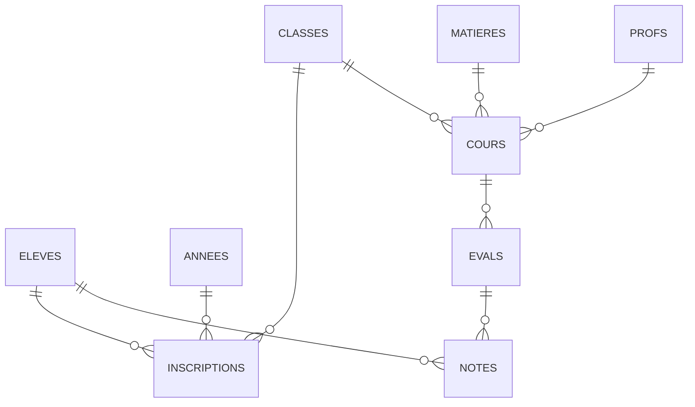
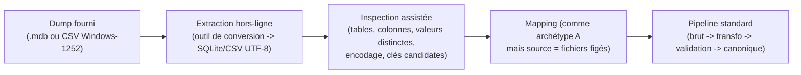

# H. Interopérabilité — Exemples de mapping bout en bout

> **Statut : En revue — Couche 4.** Date : 2026-09-09.
> Complète [`architecture-detaillee.md`](architecture-detaillee.md) §H.3 (grammaire de mapping).
> Trois **archétypes** couvrant l'essentiel du terrain camerounais. Chaque exemple : contexte,
> schéma source, fichier de mapping complet, tables de valeurs, cas de quarantaine et de conflit,
> résultat attendu. Données **fictives**. Référence : `EF-IOP-02/03/04/05/06/07`, `RG-10`, R3, R12.

Les trois archétypes :

| | Archétype | Connecteur | Fréquence terrain estimée | Difficulté |
|---|---|---|---|---|
| **A** | SGBD MySQL d'une application scolaire locale | `sql-mysql-mariadb` | Moyenne (lycées urbains équipés) | Moyenne — schéma relationnel exploitable |
| **B** | Fichiers CSV/Excel tenus à la main | `csv-excel` | **Élevée** (majorité des établissements) | Faible à moyenne — qualité variable |
| **C** | Ancienne application de bureau fermée, via *dump* | `dump-fichier` (SQLite/CSV extraits) | Faible mais critique | Élevée — schéma opaque, encodages douteux |

> Convention : `depuis` = colonne / expression source ; `transformer` = liste de fonctions de
> référence (§H.3.3) ; `table_valeurs` = renvoi à une table de correspondance ; `quarantaine_si` =
> prédicat qui isole la ligne sans la perdre.

---

## H-EX.A — SGBD MySQL d'une application scolaire (« GestNotes Lycée »)

### H-EX.A.1 Contexte

Lycée public urbain, ~1 400 élèves. Application « GestNotes » installée sur un serveur local
(MySQL 5.7). L'établissement fournit un compte **lecture seule** et l'accès réseau depuis le
connecteur. Historique disponible : 3 années scolaires.

### H-EX.A.2 Schéma source (extrait réel typique)



| Table source | Colonnes utiles |
|---|---|
| `eleves` | `id_eleve`, `matricule`, `nom`, `prenom`, `sexe` (`G`/`F`), `date_naiss` (`YYYY-MM-DD`), `id_parent` |
| `parents` | `id_parent`, `nom_complet`, `tel`, `lien` (`PERE`/`MERE`/`TUTEUR`) |
| `classes` | `id_classe`, `libelle` (`2nde C`, `1ère D`…), `id_annee` |
| `annees` | `id_annee`, `libelle` (`2023-2024`) |
| `matieres` | `id_matiere`, `nom` (`MATHS`, `PC`, `SVT`, `FR`, `ANG`…) |
| `profs` | `id_prof`, `nom`, `prenom` |
| `cours` | `id_cours`, `id_classe`, `id_matiere`, `id_prof`, `coef` |
| `evals` | `id_eval`, `id_cours`, `sequence` (1..6), `type` (`DEVOIR`/`COMPO`/`INTERRO`), `date_eval`, `bareme` (`20`) |
| `notes` | `id_eval`, `id_eleve`, `valeur` (`0`..`20`, `NULL` si absent), `appreciation` |

Particularités constatées : pas de code national ; `matieres.nom` en abrégés maison ; `valeur` parfois
à `99` pour « non noté » (convention locale) ; quelques `date_naiss` à `0000-00-00`.

### H-EX.A.3 Fichier de mapping

```yaml
mapping:
  version: "1.0"
  cible_schema_canonique: "v1"
  source:
    type: "sql-mysql"
    ref: "gestnotes-lycee-japoma"
    extraction: { mode: "incremental", curseur: "notes.updated_at | evals.date_eval" }

  entites:

    - canonique: "AnneeScolaire"
      depuis: "SELECT id_annee, libelle FROM annees"
      cle_rapprochement: ["libelle_normalise"]
      champs:
        libelle:            { depuis: "libelle" }
        libelle_normalise:  { depuis: "libelle", transformer: ["trim"] }   # "2023-2024"
        date_debut:         { depuis: "libelle", transformer: ["annee_scolaire_debut"] }  # 2023-09-01 (règle pays)
        date_fin:           { depuis: "libelle", transformer: ["annee_scolaire_fin"] }

    - canonique: "Classe"
      depuis: >
        SELECT c.id_classe, c.libelle, a.libelle AS annee_lib
        FROM classes c JOIN annees a ON a.id_annee = c.id_annee
      cle_rapprochement: ["annee_scolaire", "libelle_normalise"]
      champs:
        libelle:            { depuis: "libelle" }
        libelle_normalise:  { depuis: "libelle", transformer: ["trim", "upper", "espaces_simples"] }
        annee_scolaire:     { depuis: "annee_lib", transformer: ["trim"] }
        niveau:             { depuis: "libelle", table_valeurs: "niveau_depuis_classe" }

    - canonique: "Personne+Eleve"
      depuis: "SELECT id_eleve, matricule, nom, prenom, sexe, date_naiss FROM eleves"
      cle_rapprochement: ["matricule"]          # pas de code_national dans cette source
      champs:
        matricule:          { depuis: "matricule", requis: true, transformer: ["trim", "upper"] }
        nom:                { depuis: "nom", transformer: ["trim", "upper"] }
        prenoms:            { depuis: "prenom", transformer: ["trim"] }
        nom_normalise:      { depuis: ["nom", "prenom"], transformer: ["normaliser_nom"] }
        date_naissance:     { depuis: "date_naiss", format_date: "YYYY-MM-DD" }
        sexe:               { depuis: "sexe", table_valeurs: "sexe" }
      quarantaine_si:
        - "date_naissance is null"
        - "date_naissance == '0000-00-00'"
        - "matricule is null"

    - canonique: "ResponsableLegal+LienParente"
      depuis: >
        SELECT e.id_eleve, e.matricule, p.nom_complet, p.tel, p.lien
        FROM eleves e JOIN parents p ON p.id_parent = e.id_parent
      cle_rapprochement: ["eleve.matricule", "nom_normalise"]
      champs:
        eleve.matricule:    { depuis: "matricule" }
        nom_complet:        { depuis: "nom_complet", transformer: ["trim", "upper"] }
        nom_normalise:      { depuis: "nom_complet", transformer: ["normaliser_nom"] }
        contact:            { depuis: "tel", transformer: ["trim", "tel_e164_cm"] }  # +237…
        nature:             { depuis: "lien", table_valeurs: "lien_parente" }

    - canonique: "Matiere"
      depuis: "SELECT id_matiere, nom FROM matieres"
      cle_rapprochement: ["libelle_normalise"]
      champs:
        libelle_source:     { depuis: "nom" }
        libelle_normalise:  { depuis: "nom", table_valeurs: "matiere_synonymes", defaut_si_vide: "@libelle_source" }
        libelle_fr:         { depuis: "nom", table_valeurs: "matiere_fr" }
        libelle_en:         { depuis: "nom", table_valeurs: "matiere_en" }

    - canonique: "Enseignant"
      depuis: "SELECT id_prof, nom, prenom FROM profs"
      cle_rapprochement: ["nom_normalise"]
      champs:
        nom:                { depuis: "nom", transformer: ["trim", "upper"] }
        prenoms:            { depuis: "prenom", transformer: ["trim"] }
        nom_normalise:      { depuis: ["nom", "prenom"], transformer: ["normaliser_nom"] }
        identifiant_interne:{ depuis: "id_prof", transformer: ["to_string"] }

    - canonique: "Enseignement"
      depuis: >
        SELECT co.id_cours, cl.libelle AS classe_lib, a.libelle AS annee_lib,
               m.nom AS matiere_nom, pr.nom AS prof_nom, pr.prenom AS prof_prenom, co.coef
        FROM cours co
        JOIN classes cl ON cl.id_classe = co.id_classe
        JOIN annees  a  ON a.id_annee   = cl.id_annee
        JOIN matieres m ON m.id_matiere = co.id_matiere
        JOIN profs   pr ON pr.id_prof   = co.id_prof
      cle_rapprochement: ["classe", "matiere", "annee_scolaire"]
      champs:
        classe:             { depuis: "classe_lib", transformer: ["trim", "upper", "espaces_simples"] }
        annee_scolaire:     { depuis: "annee_lib", transformer: ["trim"] }
        matiere:            { depuis: "matiere_nom", table_valeurs: "matiere_synonymes", defaut_si_vide: "@matiere_nom" }
        enseignant:         { depuis: ["prof_nom", "prof_prenom"], transformer: ["normaliser_nom"] }
        coefficient:        { depuis: "coef", type: "decimal", defaut_si_vide: "1" }

    - canonique: "Bareme"
      depuis: "SELECT DISTINCT bareme FROM evals"
      cle_rapprochement: ["type"]
      champs:
        type:               { depuis: "bareme", table_valeurs: "bareme_type" }   # "20" -> "sur_20"
        min:                { constant: "0" }
        max:                { depuis: "bareme", type: "decimal" }
        pas:                { constant: "0.25" }

    - canonique: "Evaluation"
      depuis: >
        SELECT ev.id_eval, cl.libelle AS classe_lib, a.libelle AS annee_lib,
               m.nom AS matiere_nom, ev.sequence, ev.type, ev.date_eval, ev.bareme
        FROM evals ev
        JOIN cours co ON co.id_cours = ev.id_cours
        JOIN classes cl ON cl.id_classe = co.id_classe
        JOIN annees a ON a.id_annee = cl.id_annee
        JOIN matieres m ON m.id_matiere = co.id_matiere
      cle_rapprochement: ["enseignement", "periode", "type", "date", "libelle"]
      champs:
        enseignement:       { depuis: ["classe_lib", "matiere_nom", "annee_lib"], transformer: ["cle_enseignement"] }
        periode:            { depuis: "sequence", table_valeurs: "sequence_vers_periode" }  # 1-2 -> T1, 3-4 -> T2, 5-6 -> T3
        type:               { depuis: "type", table_valeurs: "type_evaluation" }
        date:               { depuis: "date_eval", format_date: "YYYY-MM-DD" }
        libelle:            { depuis: ["type", "sequence"], transformer: ["concatener(' n°')"] }  # "Devoir n°3"
        bareme:             { depuis: "bareme", table_valeurs: "bareme_type" }

    - canonique: "Note"
      depuis: >
        SELECT n.id_eval, e.matricule, n.valeur, n.appreciation
        FROM notes n JOIN eleves e ON e.id_eleve = n.id_eleve
      cle_rapprochement: ["evaluation", "eleve"]
      champs:
        evaluation:         { depuis: "id_eval", transformer: ["cle_evaluation_source"] }
        eleve:              { depuis: "matricule", transformer: ["trim", "upper"] }
        valeur:             { depuis: "valeur", type: "decimal", bareme: "sur_20" }
        valeur_texte:       { constant: null }
        origine:            { constant: "import" }
        appreciation_texte: { depuis: "appreciation", transformer: ["trim", "defaut_si_vide(null)"] }
      quarantaine_si:
        - "valeur == 99"                       # convention locale "non noté"
        - "valeur != null and (valeur < 0 or valeur > 20)"
      ignorer_si:
        - "valeur is null"                     # élève absent : pas de note à créer

  tables_valeurs:
    sexe:               { "G": "masculin", "F": "feminin", "M": "masculin" }
    lien_parente:       { "PERE": "pere", "MERE": "mere", "TUTEUR": "tuteur", "": "non_precise" }
    bareme_type:        { "20": "sur_20", "10": "sur_10", "100": "sur_100" }
    type_evaluation:    { "DEVOIR": "devoir", "COMPO": "composition", "INTERRO": "interrogation" }
    sequence_vers_periode: { "1": "T1", "2": "T1", "3": "T2", "4": "T2", "5": "T3", "6": "T3" }
    niveau_depuis_classe:  # préfixe de libellé -> niveau canonique paramétrable (système CM)
      "6E": "6e", "5E": "5e", "4E": "4e", "3E": "3e",
      "2ND": "2nde", "1ER": "1ere", "1RE": "1ere", "TLE": "terminale", "TSE": "terminale"
    matiere_synonymes:
      "MATHS": "mathematiques", "MATH": "mathematiques",
      "PC": "physique_chimie", "PCT": "physique_chimie",
      "SVT": "sciences_vie_terre", "SVTEEHB": "sciences_vie_terre",
      "FR": "francais", "FRS": "francais",
      "ANG": "anglais", "ANL": "anglais",
      "HG": "histoire_geographie", "EPS": "education_physique_sportive",
      "INFO": "informatique", "PHILO": "philosophie"
    matiere_fr:
      "MATHS": "Mathématiques", "PC": "Physique-Chimie", "SVT": "Sciences de la Vie et de la Terre",
      "FR": "Français", "ANG": "Anglais", "HG": "Histoire-Géographie"
    matiere_en:
      "MATHS": "Mathematics", "PC": "Physics & Chemistry", "SVT": "Life & Earth Sciences",
      "FR": "French", "ANG": "English", "HG": "History & Geography"

  conflits:
    # Politique locale : ce SI officiel fait foi sur l'état civil, jamais sur les notes validées M1.
    - entite: "Personne"
      champs: ["nom", "prenoms", "date_naissance", "sexe"]
      strategie: "source_prioritaire"
      priorite: ["module1_valide", "gestnotes-lycee-japoma"]
    - entite: "Note"
      champs: ["valeur"]
      strategie: "revue_manuelle"
      note: "Toute note importée divergente d'une note validée Module 1 va en revue (RG forte §H.5.3)."
```

### H-EX.A.4 Cas de quarantaine attendus (échantillon)

| Ligne source | Motif | Action proposée |
|---|---|---|
| `eleves` : `date_naiss='0000-00-00'` (3 lignes) | `quarantaine` → `date_naissance` invalide | Corriger la date à la source ou saisir manuellement ; rejeu |
| `notes` : `valeur=99` (≈ 1,2 % des lignes) | `quarantaine` → convention locale « non noté » | Confirmer l'interprétation, puis `ignorer` en masse (règle ajoutée au mapping v1.1) |
| `matieres` : `nom='DAO'` (absent des synonymes) | `mapping_error` → matière non résolue | Compléter `matiere_synonymes` ; rejeu |
| `notes` : élève dont le `matricule` n'a pas de `Personne` rapprochée | `dependance_absente` | Rejeu automatique en fin de run ; sinon quarantaine |

### H-EX.A.5 Résultat attendu

- ~1 400 élèves, ~90 enseignants, ~150 classes (3 ans), ~900 000 notes canoniques.
- Taux de quarantaine < 2 % après mapping v1.1.
- Rejeu de l'import complet : entités **stables** (idempotence).
- Lineage : chaque note pointe vers `gestnotes-lycee-japoma`, mapping `1.1`, transformations
  `["convertir_bareme(sur_20)"]`.

---

## H-EX.B — Fichiers CSV/Excel tenus à la main

### H-EX.B.1 Contexte

Collège rural, aucun SI. Le censeur tient **un classeur Excel par trimestre** : une feuille par
classe, colonnes = matières, lignes = élèves, cellules = moyennes. BuildNote fournit des **gabarits**
que l'établissement remplit à la place — mais le premier import récupère l'existant.

### H-EX.B.2 Forme du fichier existant (`3eA_T1_2025.xlsx`, feuille `3e A`)

| Nom & Prénom | Sexe | Né(e) le | Maths | Français | Anglais | SVT | PCT | Moyenne | Rang |
|---|---|---|---|---|---|---|---|---|---|
| ABENA Marie | F | 12/03/2010 | 13,5 | 11 | 14 | 12,5 | 10 | 12,20 | 8 |
| BALLA Jean Pierre | M | 05/11/2009 | 09 | 8,5 | absent | 11 | 07 | 8,80 | 21 |
| … | | | | | | | | | |

Problèmes typiques : virgule décimale, « absent »/« abs »/« - » dans les cellules, colonnes
`Moyenne`/`Rang` **calculées** (à ne pas importer), en-tête sur 1 ligne mais parfois précédée de
lignes de titre, nom + prénom fusionnés, pas de matricule.

### H-EX.B.3 Fichier de mapping (format « tableau croisé » → dépliage)

```yaml
mapping:
  version: "1.0"
  cible_schema_canonique: "v1"
  source:
    type: "csv-excel"
    ref: "college-mbalmayo-classeurs"
    fichier:
      format: "xlsx"
      feuille_par: "classe"                 # le nom de feuille = libellé de classe
      entete_ligne: "auto"                  # détection de la ligne d'en-tête (1re ligne avec ≥ 3 libellés de matière connus)
      ignorer_colonnes: ["Moyenne", "Rang", "Moy", "Rg", "Observation"]
    contexte_depuis_nom_fichier:
      motif: "^(?<classe>.+?)_(?<periode>T[1-3])_(?<annee>\\d{4})\\.xlsx$"
      # ex. "3eA_T1_2025.xlsx" -> classe=3eA, periode=T1, annee=2025 -> AnneeScolaire "2024-2025"

  entites:

    - canonique: "AnneeScolaire"
      depuis: "contexte.annee"
      cle_rapprochement: ["libelle_normalise"]
      champs:
        libelle_normalise:  { depuis: "contexte.annee", transformer: ["annee_civile_vers_scolaire"] }  # 2025 -> "2024-2025"

    - canonique: "Classe"
      depuis: "feuille"
      cle_rapprochement: ["annee_scolaire", "libelle_normalise"]
      champs:
        libelle:            { depuis: "feuille.nom" }
        libelle_normalise:  { depuis: "feuille.nom", transformer: ["trim", "upper", "espaces_simples"] }  # "3E A"
        annee_scolaire:     { depuis: "contexte.annee", transformer: ["annee_civile_vers_scolaire"] }
        niveau:             { depuis: "feuille.nom", table_valeurs: "niveau_depuis_classe" }

    - canonique: "Personne+Eleve"
      depuis: "lignes"
      cle_rapprochement: ["nom_normalise", "date_naissance", "classe"]   # pas de matricule -> clé composite
      champs:
        nom_prenom_source:  { depuis: "col:Nom & Prénom", requis: true }
        nom:                { depuis: "col:Nom & Prénom", transformer: ["nom_depuis_nom_prenom", "upper"] }
        prenoms:            { depuis: "col:Nom & Prénom", transformer: ["prenoms_depuis_nom_prenom"] }
        nom_normalise:      { depuis: "col:Nom & Prénom", transformer: ["normaliser_nom"] }
        date_naissance:     { depuis: "col:Né(e) le", format_date: "DD/MM/YYYY" }
        sexe:               { depuis: "col:Sexe", table_valeurs: "sexe" }
        matricule:          { transformer: ["matricule_provisoire"] }   # BN-<etab>-<hash court> ; remplacé si un vrai matricule arrive plus tard
      quarantaine_si:
        - "nom_normalise is null"
        - "date_naissance is null"

    - canonique: "Note"
      depuis: "cellules_matieres"            # déplie chaque colonne-matière en une note
      colonne_matiere:
        libelle_depuis: "entete"
        table_valeurs: "matiere_synonymes"
      cle_rapprochement: ["evaluation_synthetique", "eleve"]
      champs:
        eleve:              { depuis: "ligne.nom_normalise" }
        matiere:            { depuis: "colonne.matiere" }
        evaluation_synthetique:
          # pas d'évaluation détaillée : on crée une évaluation "Moyenne <periode>" par (classe, matière, période)
          transformer: ["cle_eval_synthetique(classe, matiere, contexte.periode)"]
        type_evaluation:    { constant: "moyenne_periode" }
        periode:            { depuis: "contexte.periode" }
        valeur:             { depuis: "cellule", transformer: ["virgule_vers_point", "vide_si_absent"], type: "decimal", bareme: "sur_20" }
        origine:            { constant: "import" }
      ignorer_si:
        - "valeur is null"                    # 'absent', 'abs', '-', cellule vide
      quarantaine_si:
        - "valeur != null and (valeur < 0 or valeur > 20)"

  tables_valeurs:
    sexe: { "F": "feminin", "M": "masculin", "G": "masculin", "Fille": "feminin", "Garçon": "masculin" }
    niveau_depuis_classe: { "6E": "6e", "5E": "5e", "4E": "4e", "3E": "3e" }
    matiere_synonymes:
      "MATHS": "mathematiques", "MATH": "mathematiques", "MATHEMATIQUES": "mathematiques",
      "FRANCAIS": "francais", "FRANÇAIS": "francais", "FR": "francais",
      "ANGLAIS": "anglais", "ANG": "anglais",
      "SVT": "sciences_vie_terre", "SVTEEHB": "sciences_vie_terre",
      "PCT": "physique_chimie_technologie", "PC": "physique_chimie"
    absent_marqueurs: ["absent", "abs", "-", "n/a", "nd", ""]

  transformations_personnalisees:
    vide_si_absent: "si la valeur (minuscule, sans espaces) ∈ absent_marqueurs -> null"
    nom_depuis_nom_prenom: "prend les tokens en MAJUSCULES initiales comme nom ; à défaut le 1er token"
    matricule_provisoire: "BN-{etablissement.code}-{sha1(nom_normalise|date_naissance)[:6]}"
```

### H-EX.B.4 Cas de quarantaine / conflit attendus

| Situation | Traitement |
|---|---|
| Ligne de titre parasite au-dessus de l'en-tête | `entete_ligne: auto` la saute ; sinon quarantaine `entete_introuvable` sur la feuille |
| Cellule `"absent"` | `ignorer_si valeur is null` → aucune note créée (pas de quarantaine) |
| Cellule `"12/20"` (barème écrit dans la cellule) | `virgule_vers_point` échoue → quarantaine `normalisation` ; règle ajoutée en v1.1 (`avant_slash`) |
| Même élève dans `T1` et `T2` avec date de naissance tapée différemment | Conflit `rapprochement_ambigu` → revue ; fusion manuelle, `nom_normalise` fait foi |
| `matricule_provisoire` puis vrai matricule importé plus tard (archétype A sur le même établissement) | Rapprochement par `nom_normalise + date_naissance` → l'entité est **complétée** (`non_vide`), le matricule provisoire est remplacé, lineage conservé |

### H-EX.B.5 Résultat attendu

- Une `Evaluation` synthétique « Moyenne T1 » par (classe, matière) ; `origine=import`,
  `type=moyenne_periode` — **distinguable** des notes détaillées pour ne pas fausser les tendances.
- Réversibilité : l'export régénère les mêmes moyennes ; les gabarits BuildNote prennent le relais
  aux périodes suivantes (fin des classeurs manuels).

---

## H-EX.C — Ancienne application de bureau fermée (via *dump*)

### H-EX.C.1 Contexte

Établissement supérieur privé. Logiciel de scolarité des années 2000, monoposte, base **Access**
(ou Paradox/dBase selon les cas), plus maintenu, éditeur injoignable. L'établissement peut produire
un **export** : soit un fichier `.mdb`, soit des CSV extraits table par table (souvent en
**Windows-1252**, séparateur `;`, dates `JJ/MM/AA` sur 2 chiffres).

### H-EX.C.2 Stratégie



Le *dump* est **figé** : pas de synchronisation incrémentale possible ; on fait un **import complet
daté**, et l'établissement bascule sa saisie courante sur BuildNote (Module 1) ou sur un autre
archétype.

### H-EX.C.3 Difficultés spécifiques et parades

| Difficulté | Parade dans le mapping / le connecteur |
|---|---|
| Encodage Windows-1252 (accents cassés : `é`, `Noël`) | `connecteur.encodage: "cp1252"` → recodage UTF-8 à l'extraction ; contrôle par échantillon d'accents attendus |
| Dates `JJ/MM/AA` (année sur 2 chiffres) | `format_date: "DD/MM/YY"` + `pivot_siecle: 1940` (≤ 40 → 20xx, > 40 → 19xx) ; quarantaine si date future |
| Séparateur `;` et guillemets non échappés | `connecteur.dialecte_csv: { sep: ";", quote: "\"", echappement: "double" }` ; lignes cassées → quarantaine `csv_malforme` |
| Noms de colonnes non parlants (`CHAMP1`, `NUM`, `LIB`) | Mapping explicite après inspection ; `assistance_mapping` propose par type et par valeurs distinctes |
| Clés primaires composites ou absentes | Reconstruction d'une clé de rapprochement métier (`nom_normalise + date_naissance`) |
| Valeurs sentinelles (`-1`, `999`, `01/01/1900`) | `quarantaine_si` / `ignorer_si` explicites par champ |
| Barème inconnu (sur 20 ? sur 100 ?) | Détection : `max(valeur)` sur un échantillon + confirmation humaine → `bareme` figé dans le mapping |
| Doublons d'élèves (ré-inscriptions saisies comme nouvelles fiches) | Rapprochement + file de fusion (revue) ; `non_vide` pour consolider |

### H-EX.C.4 Extrait de mapping (spécificités)

```yaml
mapping:
  version: "1.0"
  cible_schema_canonique: "v1"
  source:
    type: "dump-fichier"
    ref: "scolarite-legacy-institut-akwa"
    fige_le: "2026-03-01"
    connecteur:
      encodage: "cp1252"
      dialecte_csv: { sep: ";", quote: "\"", echappement: "double" }
    extraction: { mode: "complet" }

  parametres_globaux:
    pivot_siecle: 1940
    bareme_detecte: "sur_20"     # confirmé humainement après inspection (max observé = 19,5)

  entites:
    - canonique: "Personne+Eleve"
      depuis: "fichier:ETUDIANTS.csv"
      cle_rapprochement: ["nom_normalise", "date_naissance"]
      champs:
        nom:              { depuis: "NOM", transformer: ["recoder_utf8", "trim", "upper"] }
        prenoms:          { depuis: "PRENOM", transformer: ["recoder_utf8", "trim"] }
        nom_normalise:    { depuis: ["NOM", "PRENOM"], transformer: ["recoder_utf8", "normaliser_nom"] }
        date_naissance:   { depuis: "DNAIS", format_date: "DD/MM/YY", pivot_siecle: 1940 }
        sexe:             { depuis: "SEXE", table_valeurs: "sexe" }
        matricule:        { depuis: "NUM", transformer: ["to_string", "defaut_si_vide(matricule_provisoire)"] }
      quarantaine_si:
        - "date_naissance is null"
        - "date_naissance > today()"
        - "date_naissance == '1900-01-01'"

    - canonique: "Note"
      depuis: "fichier:NOTES.csv"
      cle_rapprochement: ["evaluation", "eleve"]
      champs:
        eleve:            { depuis: "NUM_ETU", transformer: ["to_string"] }
        evaluation:       { depuis: ["COD_UE", "SESSION"], transformer: ["cle_evaluation_source"] }
        valeur:           { depuis: "NOTE", transformer: ["virgule_vers_point"], type: "decimal", bareme: "sur_20" }
        origine:          { constant: "import" }
      quarantaine_si:
        - "valeur != null and (valeur < 0 or valeur > 20)"
        - "valeur in [-1, 999]"
      ignorer_si:
        - "valeur is null"

  tables_valeurs:
    sexe: { "1": "masculin", "2": "feminin", "M": "masculin", "F": "feminin", "H": "masculin" }
```

### H-EX.C.5 Résultat attendu

- Import complet **daté** (`fige_le`), marqué `source=legacy` dans le lineage.
- Rapport d'inspection joint : encodage confirmé, barème confirmé, N doublons fusionnés,
  taux de quarantaine.
- Aucune synchro ultérieure sur cette source ; bascule documentée.

---

## H-EX.D — Synthèse : ce que les trois archétypes prouvent (POC 3)

| Capacité | A (SGBD) | B (CSV/Excel) | C (dump legacy) |
|---|---|---|---|
| Mapping déclaratif sans code cœur (`EF-IOP-03`) | ✅ | ✅ (dépliage tableau croisé) | ✅ |
| Normalisation types/dates/barèmes (`EF-IOP-04`) | ✅ | ✅ (virgule, absents) | ✅ (encodage, siècle) |
| Quarantaine tracée (`EF-IOP-06`, `RG-10`) | ✅ | ✅ | ✅ |
| Rapprochement sans identifiant stable | matricule | nom+naissance+classe | nom+naissance |
| Idempotence au rejeu (`EF-IOP-09`, `RG-13`) | ✅ | ✅ | ✅ (import figé) |
| Incrémental (`EF-IOP-10`) | ✅ | partiel (nouveaux fichiers) | ❌ (non applicable) |
| Réversibilité (`EF-IOP-11`) | ✅ | ✅ | ✅ |

Ces trois mappings constituent la **bibliothèque de référence** testée à chaque évolution du schéma
canonique (§H.8, CI d'interopérabilité).
