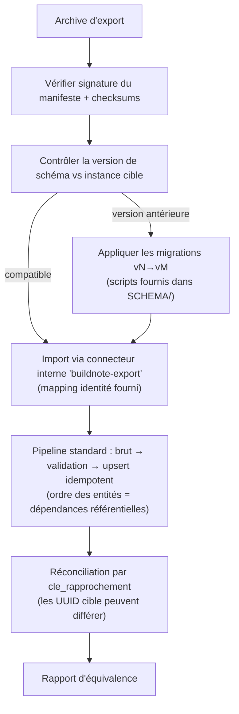

# H. Interopérabilité — Format de l'export de réversibilité

> **Statut : En revue — Couche 4.** Date : 2026-09-09.
> Spécifie le format de l'archive produite par `EF-IOP-11` et la garantie `ENF-IOP-02` (réversibilité :
> un établissement récupère **100 %** de ses données au format canonique documenté).
> Références : `EF-IOP-11`, `EF-IOP-14`, `ENF-IOP-02/03`, `RG-11`, R11 (pérennité), décision #12.

---

## H-REV.1 Objectif et garantie

**Garantie contractuelle** : à tout moment, un établissement peut demander l'**intégralité** de son
patrimoine de données (Normalized + médias Raw + lineage) sous une forme :

1. **complète** — aucune entité, aucun média, aucune trace n'est omis dans le périmètre de
   l'établissement ;
2. **documentée** — chaque fichier suit un schéma publié et versionné ;
3. **auto-portante** — l'archive contient tout le nécessaire pour être relue sans BuildNote ;
4. **ré-importable** — réinjectée dans une instance BuildNote vierge, elle reconstitue les **mêmes
   entités** (test d'équivalence, POC 3).

Pas de verrouillage : la réversibilité est une **exigence de conception**, pas une option
commerciale.

---

## H-REV.2 Structure de l'archive

Archive : un fichier `.tar.zst` (ou `.zip`) chiffré au repos, nommé
`buildnote-export_<code_etab>_<AAAAMMJJ-HHMM>_<schema>.tar.zst`.

```
buildnote-export_LYC-JPM_20260909-1030_v1/
├── manifeste.json                  # métadonnées, versions, comptes attendus, empreintes
├── SCHEMA/
│   ├── schema-canonique-v1.json    # JSON Schema de chaque entité (copie figée)
│   ├── dictionnaire-donnees.csv    # copie du dictionnaire (06) au moment de l'export
│   └── CHANGELOG-schema.md
├── data/
│   ├── etablissement.jsonl
│   ├── annee_scolaire.jsonl
│   ├── periode_scolaire.jsonl
│   ├── cycle.jsonl
│   ├── niveau.jsonl
│   ├── classe.jsonl
│   ├── personne.jsonl
│   ├── eleve.jsonl
│   ├── enseignant.jsonl
│   ├── responsable_legal.jsonl
│   ├── lien_parente.jsonl
│   ├── inscription.jsonl
│   ├── matiere.jsonl
│   ├── programme.jsonl
│   ├── enseignement.jsonl
│   ├── bareme.jsonl
│   ├── evaluation.jsonl
│   ├── note.jsonl
│   ├── appreciation.jsonl
│   ├── profil_interets.jsonl        # Module 2 : inclus si consentement (sinon omis + noté au manifeste)
│   ├── aspiration.jsonl
│   ├── avis_parent.jsonl
│   └── consentement.jsonl
├── data_csv/                        # miroir CSV de data/ (même contenu, pour tableurs)
│   └── *.csv
├── lineage/
│   └── lineage.jsonl                # traçabilité de toutes les entités du périmètre
├── media/
│   ├── media_index.json             # {media_id, entite_liee, type, sha256, taille, chemin}
│   └── <aa>/<bb>/<media_id>.<ext>   # images/vidéos de fiches (Raw), arborescence par préfixe de hash
├── raw_ocr/                         # optionnel (voir manifeste) : payloads OCR bruts
│   └── <extraction_id>.json
└── VERIFICATION/
    ├── checksums.sha256             # empreinte de chaque fichier de l'archive
    ├── manifeste.sig               # signature détachée du manifeste (clé publique BuildNote publiée)
    └── procedure-verification.md
```

### H-REV.2.1 Ce qui est **toujours** inclus

- Toutes les entités **Normalized** du périmètre établissement.
- Le **lineage** complet.
- Les **médias Raw** (images/vidéos de fiches) et leur index.
- Le **schéma** figé et le **dictionnaire** au moment de l'export.

### H-REV.2.2 Ce qui est inclus **sous condition** (tracé au manifeste)

| Contenu | Condition | Si absent |
|---|---|---|
| Données Module 2 (`profil_interets`, `aspiration`, `avis_parent`) | Consentement actif (`EF-M2-11`) | `manifeste.exclusions[]` liste l'entité et le motif `consentement_absent` |
| `raw_ocr/` (payloads OCR bruts) | Demandé explicitement (volumineux) | `manifeste.options.raw_ocr = false` |
| Intelligence Data (profils, tendances, indicateurs) | **Jamais** incluse comme donnée | Reconstructible depuis Normalized ; noté au manifeste |
| Journal d'audit du socle | Export d'audit **séparé** (Couche 6), périmètre et rétention distincts | Renvoi documenté dans le manifeste |

### H-REV.2.3 Ce qui est **exclu par conception**

- Secrets de connexion des connecteurs, configurations techniques internes.
- Données d'un autre établissement (cloisonnement `RG-09`).
- Identifiants techniques d'infrastructure.

---

## H-REV.3 Manifeste (`manifeste.json`)

```json
{
  "format": "buildnote-export",
  "format_version": "1.0",
  "schema_canonique_version": "v1",
  "genere_le": "2026-09-09T10:30:00Z",
  "genere_par": { "role": "responsable_donnees", "utilisateur_ref": "opaque-id" },
  "etablissement": {
    "code": "LYC-JPM",
    "nom": "Lycée de Japoma",
    "pays": "CM",
    "identifiant_canonique": "uuid"
  },
  "perimetre": {
    "annees_scolaires": ["2023-2024", "2024-2025", "2025-2026"],
    "inclut_module2": true,
    "inclut_raw_ocr": false,
    "inclut_media": true
  },
  "comptes_attendus": {
    "etablissement": 1,
    "personne": 5231,
    "eleve": 4980,
    "enseignant": 118,
    "classe": 152,
    "inscription": 11840,
    "evaluation": 41230,
    "note": 918540,
    "appreciation": 22110,
    "lien_parente": 6120,
    "media": 3412
  },
  "exclusions": [
    { "entite": "avis_parent", "motif": "consentement_absent", "nb_omis": 3 }
  ],
  "empreintes": {
    "algo": "sha256",
    "checksums_fichier": "VERIFICATION/checksums.sha256",
    "manifeste_signature": "VERIFICATION/manifeste.sig"
  },
  "notes": [
    "Intelligence Data non incluse (reconstructible).",
    "Journal d'audit exporté séparément (politique de rétention distincte)."
  ]
}
```

---

## H-REV.4 Format des fichiers de données

### H-REV.4.1 JSON Lines (`data/*.jsonl`)

- Un objet JSON par ligne, encodage **UTF-8**, fin de ligne `\n`.
- Chaque objet porte :
  - `id_canonique` : UUID stable de l'entité dans l'instance source ;
  - `cle_rapprochement` : objet décrivant la (ou les) clé(s) métier (permet le ré-import même si les
    UUID sont régénérés) ;
  - les **champs métier** nommés selon le schéma canonique `vN` (cf. `SCHEMA/schema-canonique-vN.json`) ;
  - `_meta` : `{ cree_le, modifie_le, origine, schema_version }`.
- Les **références** entre entités utilisent l'`id_canonique` **et** la `cle_rapprochement` de la
  cible (double lien : robuste à la régénération d'UUID).

Exemple (`data/note.jsonl`, une ligne) :

```json
{"id_canonique":"7b1e…","cle_rapprochement":{"evaluation":{"cle":["enseignement","T2","devoir","2025-02-14","Devoir n°3"]},"eleve":{"matricule":"JPM-2021-0455"}},"evaluation_ref":{"id_canonique":"a91c…"},"inscription_ref":{"id_canonique":"c02f…"},"valeur":13.5,"valeur_texte":null,"bareme":"sur_20","origine":"import","statut":"active","_meta":{"cree_le":"2025-02-15T08:12:00Z","modifie_le":"2025-02-15T08:12:00Z","origine":"import","schema_version":"v1"}}
```

### H-REV.4.2 CSV miroir (`data_csv/*.csv`)

- Même contenu, une entité par fichier, en-tête = noms de champs, séparateur `,`, guillemets `"`,
  UTF-8 avec BOM (compatibilité tableurs), dates ISO 8601.
- Les objets imbriqués (`cle_rapprochement`, `_meta`) sont **aplatis** (`cle_rapprochement.eleve.matricule`).
- Fourni pour lecture humaine / tableur ; le **JSONL fait foi** en cas de divergence.

### H-REV.4.3 Lineage (`lineage/lineage.jsonl`)

Une ligne par événement de traçabilité (schéma identique à §H.6 de `architecture-detaillee.md`),
restreint au périmètre de l'établissement.

### H-REV.4.4 Médias (`media/`)

- Fichiers binaires rangés par préfixe de hash (`media/<2 premiers>/<2 suivants>/<media_id>.<ext>`).
- `media_index.json` : pour chaque média, `{ media_id, sha256, taille, type_mime, entite_liee:
  {type, id_canonique}, capture_le }`.
- Un média orphelin (non lié) n'existe pas : tout média référence une entité Raw (`document_source`).

---

## H-REV.5 Procédure de ré-import et test d'équivalence

### H-REV.5.1 Ré-import



Le format d'export est traité comme **une source parmi d'autres** : il a son connecteur
(`buildnote-export`) et un **mapping identité** publié. Rien de spécial dans le cœur.

### H-REV.5.2 Test d'équivalence (`ENF-IOP-02`, critère POC 3)

Après ré-import dans une instance vierge, un **rapport d'équivalence** compare :

| Contrôle | Attendu |
|---|---|
| Comptes par entité | = `manifeste.comptes_attendus` (aux exclusions près, listées) |
| Somme de contrôle métier | Ex. `SUM(note.valeur)` par (classe, matière, période) identique |
| Rapprochement | 100 % des entités ré-appariées par `cle_rapprochement` |
| Médias | 100 % des `sha256` retrouvés |
| Lineage | Chaque entité importée porte un lineage `origine=buildnote-export` + conserve la chaîne d'origine en référence |
| Intégrité référentielle | 0 référence pendante |

Divergence → **rapport détaillé** (entité, clé, écart) ; l'export n'est **pas** considéré conforme
tant que l'équivalence n'est pas atteinte sur le jeu de test.

---

## H-REV.6 Versionnement et publication

- Le **format d'export** (`format_version`) et le **schéma canonique** (`schema_canonique_version`)
  évoluent indépendamment ; le manifeste porte les deux.
- Le schéma canonique et les formats d'échange sont **documentés publiquement** pour les
  établissements (`ENF-IOP-03`) : JSON Schema + dictionnaire + changelog, versionnés dans le dépôt
  de spécification.
- Toute archive reste **relisible** : les migrations `vN → vN+1` sont fournies et testées ; une
  archive ancienne peut toujours être ré-importée après migration.

---

## H-REV.7 Sécurité et gouvernance de l'export

| Aspect | Règle |
|---|---|
| **Autorisation** | Rôle dédié « responsable des données de l'établissement » ; action **tracée à l'audit** (qui, quand, périmètre). |
| **Chiffrement** | Archive chiffrée au repos ; remise via canal sécurisé ; lien de téléchargement à durée limitée. |
| **Contenu personnel** | L'archive contient des données personnelles de mineurs → transfert encadré par la politique de conformité (Couche 6, décision #2) ; journalisé. |
| **Signature** | Manifeste signé (clé BuildNote publiée) pour prouver l'origine et l'intégrité. |
| **Rétention de l'archive côté BuildNote** | L'archive générée est purgée après un délai court (ex. 30 j) ; l'établissement en est propriétaire. |
| **Cloisonnement** | Strictement mono-établissement ; impossible d'exporter un périmètre multi-tenant. |

---

## H-REV.8 Ce qui reste à valider

| Sujet | Où | Quand |
|---|---|---|
| Choix du conteneur d'archive (`tar.zst` vs `zip`) et de la taille de découpe | ADR | Phase 4 → 7 |
| Jeu de données de test d'équivalence | POC 3 | Phase 6 |
| Publication de la spécification publique (dépôt, licence — décision #12) | Phase 2 | Phase 2 |
| Délai de rétention de l'archive côté BuildNote | Décision #2 | Phase 2 |
| Intégration au flux « départ d'un établissement » (offboarding) | [`../14-deploiement/plan-deploiement.md`](../14-deploiement/plan-deploiement.md) | Phase 4 |
