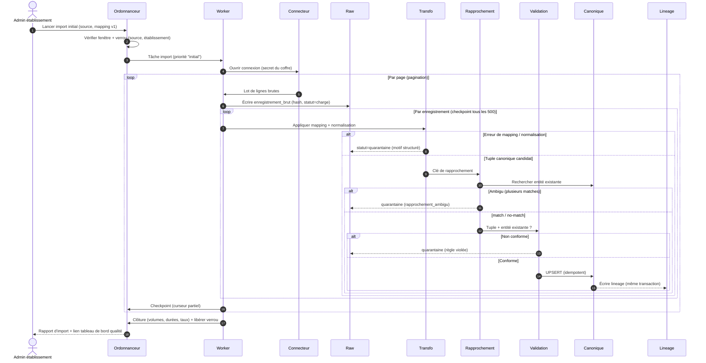
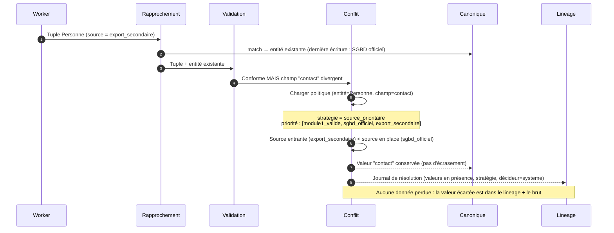
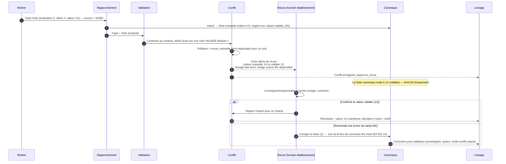
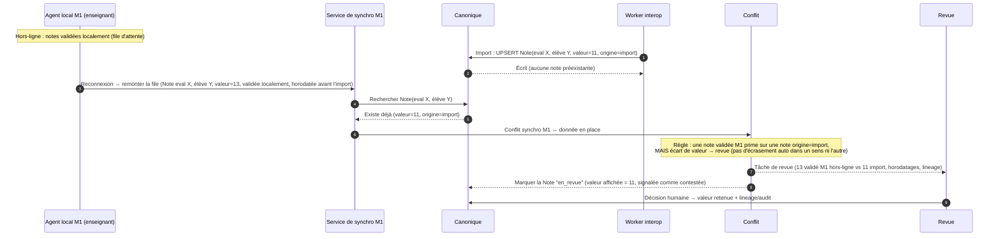
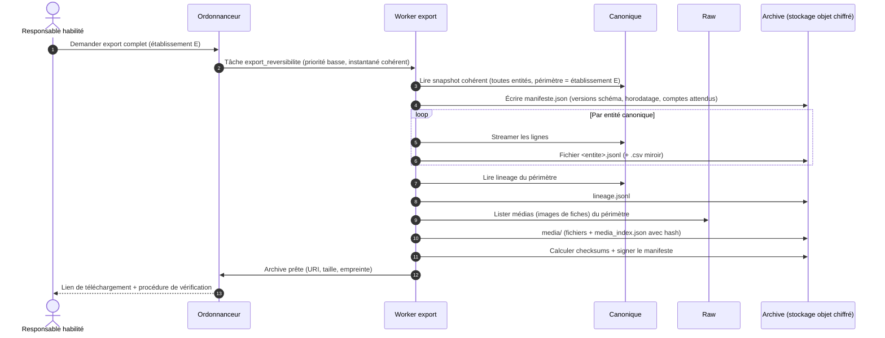
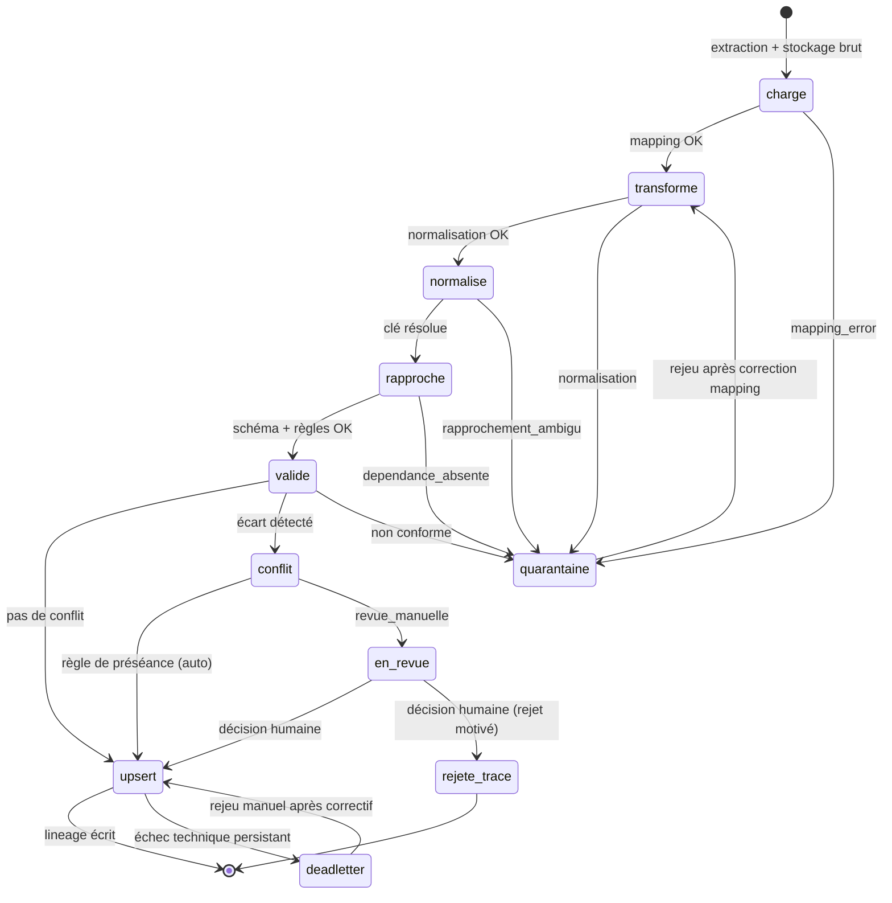

# H. Interopérabilité — Flux et diagrammes de séquence

> **Statut : En revue — Couche 4.** Date : 2026-09-09.
> Vues dynamiques du pipeline d'interopérabilité. Complète [`architecture-detaillee.md`](architecture-detaillee.md)
> (§H.4 pipeline, §H.5 conflits) et [`etl-orchestration.md`](etl-orchestration.md).
> Références : `EF-IOP-05..10`, `EF-M1-15/16`, `RG-10`, `RG-13`, R12.

Acteurs et composants récurrents :

| Nom | Rôle |
|---|---|
| **Ordonnanceur** | Plan de contrôle : déclenche les flux (cron, manuel, webhook) |
| **Worker** | Exécuteur ETL isolé (scénario C) |
| **Connecteur** | Adaptateur de la source (SGBD/API/fichier) |
| **Raw** | Stockage brut immuable (`enregistrement_brut`) |
| **Transfo** | Moteur de transformation + normalisation (applique le mapping) |
| **Rapprochement** | Résolution clé de rapprochement → entité canonique |
| **Validation** | Contrôle schéma + règles métier |
| **Conflit** | Moteur de préséance / file de revue |
| **Canonique** | Normalized Data |
| **Lineage** | Journal de traçabilité |
| **Revue** | File de revue manuelle (humain établissement) |

---

## H-S.1 Import initial (complet)



**Points clés** : le curseur n'avance que sur des lots *checkpointés* ; une reprise après coupure
repart du dernier checkpoint ; l'idempotence rend les lots déjà traités inoffensifs au rejeu.

---

## H-S.2 Synchronisation incrémentale

```mermaid
sequenceDiagram
    autonumber
    participant Ord as Ordonnanceur
    participant W as Worker
    participant Cx as Connecteur
    participant Src as Source
    participant Tr as Transfo
    participant Cn as Canonique
    participant Lin as Lineage

    Ord->>Ord: Cron établissement (02:00 local) + fenêtre ouverte ?
    Ord->>W: Tâche synchro (curseur = borne haute du run précédent confirmé)
    W->>Cx: Extraire lignes où modifie_le > curseur
    Cx->>Src: Requête incrémentale (modifie_depuis)
    Src->>Cx: Delta (ex. 320 lignes)
    Cx->>W: Lignes brutes
    loop Par enregistrement
        W->>Tr: mapping + normalisation
        Tr->>Cn: Rechercher entité (clé de rapprochement)
        alt Tuple identique à l'existant
            Cn-->>W: Aucun changement → UPSERT sauté (pas de lineage)
        else Tuple différent
            Cn->>Cn: UPSERT
            Cn-->>Lin: Lineage (transformation, version mapping)
        end
    end
    W->>Ord: curseur_apres = max(modifie_le) des lignes confirmées
    Ord->>Ord: Persister curseur ; métrique cursor_lag
    Note over Ord: Si extraction échoue → curseur NON avancé, retry au prochain cron
```

**Détection de non-changement** (§H-ETL.4 mécanisme 3) : évite le bruit d'audit quand la source
réécrit des lignes sans modification réelle.

---

## H-S.3 Résolution de conflit multi-sources (préséance automatique)

Cas : la même `Personne` (clé `nom_normalise + date_naissance`) arrive du SGBD officiel **et** d'un
ancien export ; le champ `contact` diffère.



Variante `non_vide` : si l'entité en place a `contact = null`, la valeur entrante **complète** sans
conflit.

---

## H-S.4 Conflit import ↔ note validée Module 1 (règle forte, RG-10 / §H.5.3)



**Invariant** : un import ne modifie **jamais** silencieusement une note validée. La décision est
humaine et tracée des deux côtés (lineage interop + audit Module 1).

---

## H-S.5 Conflit import ↔ agent local hors-ligne Module 1

Cas particulier de `EF-M1-16` : un enseignant a saisi et validé des notes **hors-ligne** ; sa file
de synchronisation n'est pas encore remontée quand un import interopérabilité écrit les mêmes notes.



**Règle de conception** : l'ordre d'arrivée (import avant ou après la synchro hors-ligne) ne change
pas le résultat — tout écart entre une **validation humaine M1** et un **import** finit en revue.

---

## H-S.6 Rejeu après correction de mapping

```mermaid
sequenceDiagram
    autonumber
    actor Ref as Référent qualité établissement
    participant TB as Tableau de bord qualité
    participant Map as Éditeur de mapping
    participant Ord as Ordonnanceur
    participant W as Worker
    participant Raw
    participant Cn as Canonique

    Ref->>TB: Consulter la quarantaine (motif "mapping_error" : matière "DAO" non résolue)
    TB->>Ref: 42 enregistrements bruts concernés
    Ref->>Map: Ajouter "DAO" → "dessin_assiste_ordinateur" (mapping v1.0 → v1.1)
    Map->>Map: Validation du mapping (lint + prévisualisation sur échantillon)
    Ref->>Ord: Rejouer la quarantaine avec mapping v1.1
    Ord->>W: Tâche rejeu (portée = enregistrements bruts en quarantaine, motif mapping_error)
    loop Par enregistrement brut (immuable, relu tel quel)
        W->>Raw: Lire enregistrement_brut (inchangé)
        W->>Cn: mapping v1.1 → transfo → validation → UPSERT idempotent
    end
    W->>Ord: 42 traités, 0 quarantaine restante
    Ord-->>Ref: Quarantaine vidée ; lineage mis à jour (mapping_version=1.1)
```

Le **brut n'est jamais modifié** ; seule la version de mapping change. Le rejeu est idempotent.

---

## H-S.7 Export de réversibilité



Détail du format et de la procédure de ré-import : [`export-reversibilite.md`](export-reversibilite.md).

---

## H-S.8 Vue d'ensemble des états d'un enregistrement


