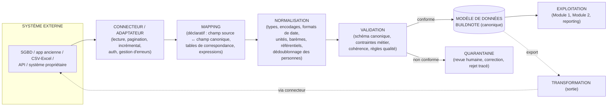

# H. Interopérabilité — Vue d'ensemble

> **Statut : En revue — Couche 1.** Date : 2026-09-08.
> Spécification détaillée (catalogue de connecteurs, langage de mapping, règles de transformation et
> de validation, gestion fine des conflits, lineage, versioning de schéma, tableau de bord qualité)
> en Couche 4.

## H.1 Position du problème

Les établissements peuvent utiliser : **MySQL, PostgreSQL, Microsoft SQL Server, MariaDB, SQLite,
Oracle**, d'autres SGBD SQL, d'**anciennes applications scolaires**, des **fichiers CSV/Excel**, des
**API**, des **systèmes propriétaires** — ou **rien** (tout est sur papier).

**Ce qu'on ne fait pas :** essayer de rendre une base « compatible avec toutes les bases SQL ».
C'est illusoire (dialectes, schémas métier différents, qualité variable) et non maintenable.

**Ce qu'on fait :** interposer un **modèle canonique BuildNote** et une **couche d'abstraction des
données**, et connecter chaque système par un **connecteur/adaptateur** dédié.

## H.2 Chaîne cible



Et dans l'autre sens :

```
BUILDNOTE → TRANSFORMATION → CONNECTEUR → SYSTÈME EXTERNE
```

## H.3 Composants

| Composant | Rôle |
|---|---|
| **Modèle canonique** | Le schéma pivot BuildNote (Normalized Data). Toute donnée externe y est traduite ; toute donnée exportée en part. Versionné. |
| **Couche d'abstraction des données** | Isole le cœur BuildNote des spécificités de chaque source. Le cœur ne « parle » qu'au canonique. |
| **Connecteurs / adaptateurs** | Un par type de source : `sql-generic` (via pilotes), `mysql`, `postgresql`, `sqlserver`, `oracle`, `mariadb`, `sqlite`, `csv-excel`, `rest-api`, `proprietaire-X`. Chargés de la connexion, de l'extraction (complète ou incrémentale), de la pagination, de l'authentification, de la reprise sur erreur. |
| **Moteur de mapping** | Définition **déclarative** (fichier de mapping par établissement/source) : correspondance de champs, tables de correspondance de valeurs (ex. « TB/B/AB » ↔ mention canonique), expressions de calcul, gestion des champs manquants. |
| **Moteur de transformation** | Applique le mapping + les conversions (dates, nombres, encodages, découpage/fusion de champs, calcul de clés). |
| **Moteur de validation** | Vérifie la conformité au schéma canonique et aux règles métier (plages de notes, cohérence matière/coefficient, existence de la classe, etc.). |
| **Gestion des conflits** | Quand la même entité arrive de plusieurs sources ou en doublon : règles de **préséance** (source faisant foi par champ), stratégies (dernier gagnant, source prioritaire, fusion, revue manuelle), journal des résolutions. |
| **Traçabilité / lineage** | Pour chaque donnée canonique : d'où elle vient, par quel mapping, quelles transformations, quand, décidé par qui/quoi. |
| **Versioning du schéma** | Le canonique évolue → versions numérotées, scripts de migration, compatibilité ascendante des mappings, dépréciation contrôlée. |
| **Contrôle qualité des données** | Indicateurs : complétude, fraîcheur, taux de quarantaine, taux de conflit, taux d'erreur de mapping ; alertes ; rapports. |
| **Import / Export** | Batch planifié, import ponctuel (assistant), export à la demande, gabarits CSV/Excel fournis. |
| **ETL** | Orchestration des flux batch quand il n'y a pas d'API (extraction → transformation → chargement → contrôle). |
| **API** | Utilisées quand la source en expose ; BuildNote expose aussi ses propres API pour être consommé. |

## H.4 Modes d'intégration d'un établissement

```mermaid
flowchart TB
    Q{Quel système\nde départ ?}
    Q -->|SGBD accessible| A["Connecteur SGBD + mapping\n→ import initial + synchro incrémentale"]
    Q -->|API disponible| B["Connecteur REST + mapping\n→ synchro périodique ou événementielle"]
    Q -->|Fichiers CSV/Excel| C["Assistant d'import + gabarits\n→ imports périodiques"]
    Q -->|App ancienne fermée| D["Export de la base / dumps\n→ connecteur fichier + mapping"]
    Q -->|Rien (papier)| E["BuildNote = système de saisie primaire\n(Module 1), pas d'import"]
    A --> Z["Modèle canonique BuildNote"]
    B --> Z
    C --> Z
    D --> Z
    E --> Z
```

## H.5 Principes

1. **Le canonique est roi** : aucune fonctionnalité BuildNote ne dépend d'un schéma externe.
2. **Mapping déclaratif et versionné**, révisable sans redéploiement du cœur.
3. **Aucune perte silencieuse** : ce qui ne passe pas la validation va en quarantaine, tracé.
4. **Idempotence** : rejouer un import ne crée pas de doublons (clés de rapprochement stables).
5. **Incrémental par défaut** quand la source le permet (curseur, horodatage, journal de
   modifications).
6. **Sécurité** : identifiants de connexion aux sources chiffrés, accès au minimum nécessaire,
   journalisation des extractions.
7. **Réversibilité** : un établissement peut **exporter tout son patrimoine** au format canonique
   documenté (pas de verrouillage).
8. **Séparation des tenants** : un connecteur est rattaché à un établissement ; pas de flux
   inter-établissements.

## H.6 Ce qui vient en Couche 4

- Spécification formelle du **modèle canonique** (entités, attributs, clés de rapprochement).
- **Catalogue des connecteurs** cibles pour la V1 + priorisation.
- **Format du fichier de mapping** (grammaire, exemples pour 2–3 systèmes types).
- **Règles de transformation et de validation** de référence.
- **Politique de gestion des conflits** par entité et par champ.
- **Modèle de lineage** et schéma de la base de traçabilité.
- **Processus de versioning** du schéma canonique et procédure de migration.
- Maquette du **tableau de bord qualité des données**.
- Lien avec le **POC interopérabilité** (Couche 7 — [`12-poc/`](../12-poc/)).
