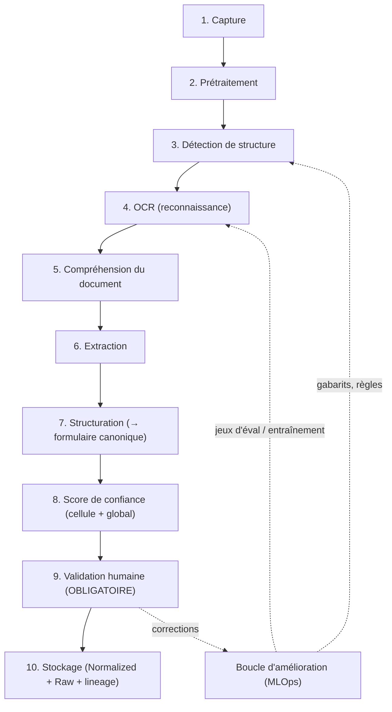
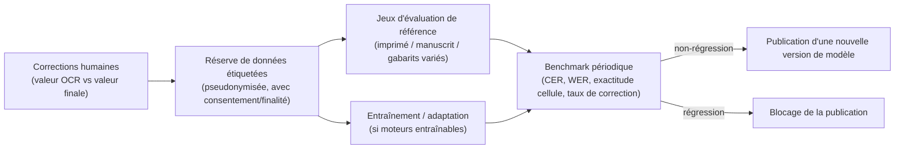

# I. Pipeline OCR / Computer Vision / Document Understanding — BuildNote

> **Statut : En revue — Couche 5.** Date : 2026-09-08.
> Complète [`README.md`](README.md). Le choix du/des moteur(s) est **différé au POC (Phase 6) puis
> figé en Phase 7** ; ce document spécifie le pipeline **indépendamment du moteur**, derrière une
> **interface d'abstraction OCR** interne.

## I.1 Vue d'ensemble



**Principe cardinal** : le pipeline **assiste**, il ne décide pas. Aucune sortie n'atteint
Normalized Data sans l'étape 9.

## I.2 Étape 1 — Capture

| Sujet | Spécification |
|---|---|
| Modalités | Photo unique, rafale, courte vidéo (extraction de la meilleure image), import de fichier (image/PDF), lot multi-pages |
| Assistance | Détection de contour de la feuille en temps réel, guide de cadrage, alerte flou / faible lumière / reflet, incitation à recadrer |
| Contexte | Fonctionne **hors-ligne** ; compression maîtrisée ; conservation de l'image d'origine (avant compression destructive) en Raw |
| Métadonnées | Établissement, classe, évaluation, auteur, horodatage, appareil (type) |
| Consignes | Guide de prise de vue fourni (fond contrasté, à plat, lumière homogène, une fiche par photo sauf lot) |

## I.3 Étape 2 — Prétraitement

Objectif : produire une image exploitable par la détection et l'OCR.

- Correction géométrique : détection des 4 coins, **redressement de perspective**, rotation
  automatique.
- Correction radiométrique : égalisation de l'éclairage, suppression d'ombre, normalisation du
  contraste.
- Débruitage ; suppression des reflets ponctuels si possible.
- Binarisation adaptative (pour les moteurs qui en bénéficient) **en conservant** aussi la version
  en niveaux de gris / couleur.
- Estimation d'un **indice de qualité image** (netteté, contraste, résolution utile en points par
  caractère) → conditionne un avertissement à l'enseignant et le seuillage aval.
- Découpe des pages multiples d'un lot.

Toutes les transformations sont **paramétrées et tracées** (pour reproductibilité et amélioration).

## I.4 Étape 3 — Détection de structure

Objectif : localiser la **grille de notes** et ses composants.

- Détection des **zones** : en-tête (établissement, classe, matière, évaluation), tableau principal,
  pieds de page.
- Détection du **tableau** : lignes, colonnes, cellules, cellules fusionnées, lignes d'en-tête.
- Reconnaissance du **rôle des colonnes** (nom/prénom, matricule, note, coefficient, appréciation,
  rang…) par : (a) OCR de l'en-tête, (b) **gabarit** de l'établissement s'il existe, (c) heuristiques
  (une colonne de nombres bornés par le barème = colonne de notes).
- Cas sans bordures visibles : détection par alignement des contenus.

**Gabarits de fiches** (`EF-M1-17`) : par établissement, on peut enregistrer la structure attendue
(colonnes, ordre, types, position approximative) pour fiabiliser la détection et permettre un repli
déterministe.

**Repli** : si la structure n'est pas reconnue avec une confiance suffisante → l'enseignant choisit
un gabarit ou saisit manuellement, l'image restant affichée (`EF-M1-18`).

## I.5 Étape 4 — OCR (reconnaissance)

- **Deux régimes** : texte **imprimé** (en-têtes, fiches générées par un logiciel) et **manuscrit**
  (notes portées à la main) — souvent mélangés sur la même fiche.
- L'**interface d'abstraction OCR** expose : `reconnaitre(zone_image, type_attendu) → { texte,
  score, variantes, bbox }`. Derrière : un moteur imprimé, un moteur manuscrit (reconnaissance de
  texte manuscrit), un reconnaisseur de **nombres** spécialisé pour les cellules de notes.
- **Type attendu par cellule** : nombre borné (note), texte court (nom), énuméré (mention),
  texte libre (appréciation) → améliore la reconnaissance et le contrôle.
- Sortie par cellule : meilleure hypothèse + **hypothèses alternatives** + score + boîte englobante.

## I.6 Étape 5 — Compréhension du document (Document Understanding)

Objectif : passer de « des textes dans des cases » à « les notes de tels élèves à telle évaluation ».

- **Association ligne ↔ élève** : rapprochement du nom reconnu avec la **liste de la classe**
  (distance de chaînes tolérante aux fautes, gestion des noms composés, ordre nom/prénoms) ;
  utilisation du matricule si présent ; signalement des lignes non rapprochées (`EF-M1-05`).
- **Association colonne ↔ sémantique** : consolidation du rôle des colonnes (étape 3) avec le
  contenu observé.
- **Cohérence transversale** : une ligne doit avoir au plus une note par colonne de note ; le total
  de lignes ≈ effectif de la classe ; détection des lignes en double ou manquantes.
- **En-tête** : extraction de matière / évaluation / date / période pour préremplir et **vérifier**
  la cohérence avec l'évaluation choisie par l'enseignant (alerte si divergence).

## I.7 Étape 6 — Extraction

- Valeur finale par cellule = hypothèse retenue après application des contrôles de type et de plage.
- Normalisation locale : virgule/point décimal, « 12,5 », « 12.5 », « 12 ½ » → `12.5` ;
  « Abs »/« NE »/« — » → statut *absent / non évalué* ; mentions → valeur énumérée canonique.
- Les cellules vides sont distinguées des cellules **non lues**.

## I.8 Étape 7 — Structuration

- Construction de l'objet **formulaire canonique** : `{ evaluation, bareme, lignes: [ { eleve (ou
  ligne non rapprochée), valeur|statut, appreciation, cellules_source: [bbox...] , scores } ] }`.
- Rattachement aux entités Normalized (classe, enseignement, évaluation, inscriptions).
- Préparation de l'affichage : ordre des lignes = ordre de la liste de classe ; cellules douteuses
  en tête de parcours.

## I.9 Étape 8 — Score de confiance

| Niveau | Calcul | Usage |
|---|---|---|
| **Cellule** | Combinaison : score du moteur OCR, accord entre hypothèses, conformité au type/plage, qualité image locale, cohérence transversale | Code couleur + seuil de mise en avant (`EF-M1-06/07`) |
| **Ligne** | Agrégat des cellules + réussite du rapprochement élève | Priorisation de la revue |
| **Document** | Agrégat + indice qualité image + complétude | Avertissement global, décision de repli manuel |

Seuils **paramétrables** (par établissement, par type de fiche). Trois bandes : *vert* (à vérifier
rapidement), *orange* (à contrôler), *rouge* (à corriger / saisir).

> Aucun seuil, même « vert », n'autorise l'enregistrement sans l'étape 9.

## I.10 Étape 9 — Validation humaine (obligatoire)

- Écran de vérification : formulaire prérempli, **image source consultable et zoomable à la
  cellule**, cellules triées par risque, navigation clavier, clavier adapté au type.
- Actions : corriger une valeur (marquée « corrigée manuellement »), rapprocher une ligne à un
  élève, marquer *absent / non évalué*, ajouter une appréciation.
- Contrôles en direct : valeur hors barème, doublon d'élève, note manquante pour un élève de la
  liste.
- **Récapitulatif** avant validation ; **validation explicite** ; contre-validation responsable si
  activée (`EF-M1-12`).
- Traçabilité : chaque champ conserve *valeur OCR* / *valeur finale* / *auteur* / *horodatage*.

## I.11 Étape 10 — Stockage

- **Normalized Data** : les `note` validées (avec `origine = ocr`), `appreciation`, `validation`(s),
  clôture du `lot_saisie`.
- **Raw Data** : `document_source` (+ image d'origine), `page_document`, `extraction_ocr` (payload,
  moteur, version, scores), `cellule_reconnue` (texte, score, bbox) — chaque cellule liée à sa
  `note` finale.
- **Lineage** : lien note ↔ cellule ↔ page ↔ document ↔ lot ↔ validateur(s).
- **Aucun** déclenchement du Module 2 (`EF-M1-19`).
- Hors-ligne : écriture locale + mise en file ; à la synchro, résolution de conflit si la note
  existe déjà (`EF-M1-16`).

## I.12 Boucle d'amélioration (MLOps)



- Les modèles / réglages ne sont publiés **que** si les métriques ne régressent pas sur les jeux de
  référence (`versioning` : voir
  [`../01-project-management/gestion-changements-versions-documentaire.md`](../01-project-management/gestion-changements-versions-documentaire.md) §2.1).
- Données d'entraînement : **pseudonymisées**, usage couvert par une finalité déclarée et le
  consentement ; séparation stricte prod / entraînement ; jamais de données identifiantes hors
  environnement maîtrisé.
- Amélioration **non-ML** aussi : enrichissement des gabarits, des tables de synonymes de matières,
  des heuristiques.

## I.13 Métriques et cibles (rappel, provisoire — cf. POC 1 & 2)

| Métrique | Définition | Cible provisoire |
|---|---|---|
| Exactitude cellule (imprimé) | cellules correctes / total, fiches imprimées | ≥ 90 % |
| Exactitude cellule (manuscrit lisible) | idem, manuscrit lisible | ≥ 70 % |
| Reconstruction de structure | fiches dont lignes/colonnes/cellules correctes | ≥ 85 % |
| Rapprochement élève automatique | lignes auto-rapprochées correctes / total | ≥ 90 % |
| CER / WER (en-têtes, appréciations) | taux d'erreur caractère / mot | mesuré, suivi |
| Taux de correction post-OCR | cellules modifiées / total | ≤ 10 % (imprimé) |
| Temps de traitement | capture → formulaire | ≤ 20 s en ligne / ≤ 45 s hors-ligne dégradé |
| Taux d'erreur résiduel après validation | notes erronées détectées a posteriori / total | ≤ 0,5 % |

## I.14 Modes dégradés et cas limites

| Cas | Comportement |
|---|---|
| Image inexploitable | Message + conseils, nouvelle capture demandée ; pas de formulaire produit |
| Structure non reconnue | Choix de gabarit ou saisie manuelle, image affichée |
| Moteur manuscrit indisponible (hors-ligne) | Reconnaissance limitée à l'imprimé + saisie manuelle des notes manuscrites, image affichée ; ré-extraction possible en ligne |
| Fiche non standard (colonnes inhabituelles) | Mapping manuel des colonnes, mémorisable comme gabarit |
| Élève absent de la liste de classe | Signalement ; ajout impossible sans passer par la gestion des inscriptions |
| PDF multi-pages | Traitement page par page, regroupement en un lot |

## I.15 Interface d'abstraction OCR (contrat interne)

```
OcrProvider:
  detecter_structure(image, gabarit?) -> Structure { zones, tableau{lignes,colonnes,cellules}, scores }
  reconnaitre(zone_image, type_attendu) -> Reconnaissance { texte, score, variantes[], bbox }
  capacites() -> { imprime: bool, manuscrit: bool, hors_ligne: bool, langues[] }
```

Permet de brancher un **service managé**, un **moteur open source auto-hébergé**, ou une
**combinaison**, sans impact sur le reste du pipeline (décision #3).
