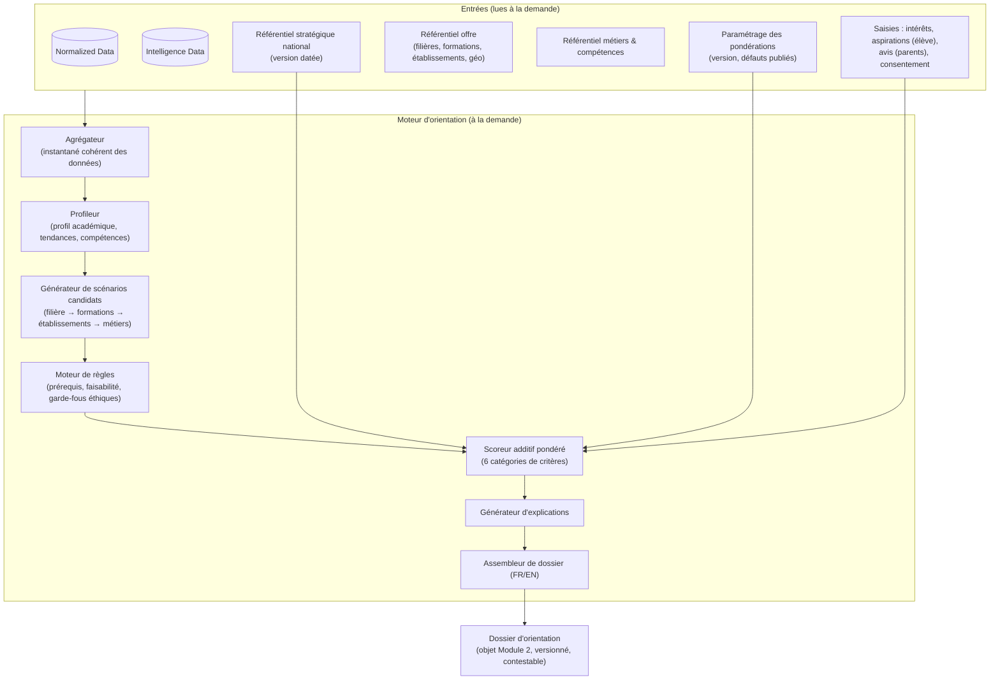
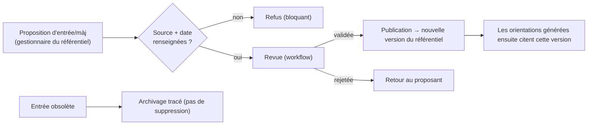

# J. Moteur d'orientation — Architecture détaillée

> **Statut : En revue — Couche 5.** Date : 2026-09-09.
> Complète [`vue-ensemble.md`](vue-ensemble.md). Le **format du dossier et les gabarits de
> présentation FR/EN** sont détaillés dans [`gabarits-presentation.md`](gabarits-presentation.md).

## J.1 Rappel des principes

Indépendant du Module 1 · **aucun** recalcul automatique · fonctionne **à la demande** · **aide à la
décision**, jamais prescription · **explicabilité obligatoire** · dimension stratégique nationale
= critère **pondéré et transparent**.

## J.2 Architecture logique

Composants dimensionnés **séparément** du Module 1 (scénario d'architecture C) : une campagne
d'orientation ne ralentit jamais la saisie des notes.

## J.3 Étape par étape

### J.3.1 Agrégateur — couche d'accès aux données

Point d'entrée **unique** de toute lecture du moteur. Aucun autre composant n'interroge directement
les bases.

**Modèle de déclenchement (lecture à la demande).** Deux seules portes : un conseiller déclenche une
orientation individuelle (`EF-M2-10`) ; un utilisateur ouvre ou **rafraîchit** un dashboard
(`EF-M2-02`). Une « campagne d'orientation » est un **lot de demandes déclenché explicitement** par
un responsable — **pas un planificateur**. Aucune lecture n'est déclenchée par l'écriture d'une note
(`EF-M1-19`).

**Gardes d'entrée (avant toute lecture).**
1. **Consentement** de l'élève et des parents enregistré (`EF-M2-11`) — sinon la génération est
   refusée, aucune donnée n'est lue.
2. **Habilitation** du demandeur (rôle conseiller / portée dashboard).
3. **Cloisonnement** : `etablissement_id` (ou groupe d'établissements autorisé) injecté dans
   **chaque** requête (`invariant G.2-5`).

**Instantané cohérent (snapshot).** À `t0` de la demande, l'agrégateur fige une lecture cohérente de
Normalized (isolation snapshot / MVCC, ou copie applicative horodatée). Le snapshot est **identifié
et horodaté** et cité dans le dossier. Rejouer `snapshot + version de référentiel + version de
pondérations` reproduit **le même dossier** (base de la reproductibilité testée au POC 4).

**Ordre et périmètre de lecture.**
| # | Source | Ce qui est lu | Notes |
|---|---|---|---|
| 1 | **Normalized** | Identité, inscriptions/parcours (classes/années), matières & coefficients, évaluations, **notes validées uniquement**, périodes, années scolaires | Filtré élève + établissement. Jamais de note non validée, jamais Raw. |
| 2 | **Intelligence** | Profil académique, tendances, compétences détectées — **si déjà calculés et frais** | Sinon → calcul à la demande (J.3.2) depuis Normalized, avec `calcul_trace`. |
| 3 | **Saisies Module 2** | `profil_interets`, aspirations de l'élève, avis des parents | Lues telles quelles, avec leur date (âge de la saisie). |
| 4 | **Référentiels** | Offre de formation + géodonnées, métiers & compétences, **référentiel stratégique national** | **Version épinglée à `t0`** ; l'identifiant de version est écrit dans `demande_orientation` (`EF-M2-44`). |
| 5 | **Pondérations** | Jeu de pondérations courant ou explicitement choisi | Version épinglée elle aussi et tracée (`EF-M2-20`). |

**Complétude & fraîcheur.** Chaque source renvoie : présence/absence, date de la donnée la plus
récente, volume (nombre de notes, longueur d'historique, catégories de saisies présentes). L'agrégat
produit l'**indice de fiabilité** et la liste des **zones d'incertitude** → avertissement
proportionné (`EF-M2-21`, gabarits §J.P.6 de
[`gabarits-presentation.md`](gabarits-presentation.md)).

**Interdits.** La génération n'écrit **rien** dans Normalized (`EF-M2-25`) ; l'Intelligence n'est
jamais lue comme entrée d'une écriture Normalized (`invariant G.2-1`).

### J.3.2 Profileur (produit / rafraîchit l'Intelligence Data de l'élève)
| Sortie | Méthode |
|---|---|
| **Profil académique** | Moyennes par matière/période/année, pondérées par coefficient ; réussite relative (position dans la classe/le niveau) ; matières fortes / fragiles. |
| **Tendances de performance** | Régression sur la série temporelle des notes par matière ; pente, niveau moyen, **régularité** (dispersion), points de rupture. |
| **Compétences & aptitudes détectées** | Règles de correspondance matière(s) → compétences (ex. mathématiques + physique réguliers et en progression → « raisonnement quantitatif : solide ») ; **niveau estimé + indice de confiance + base de calcul explicitée** ; sous **supervision humaine** (le conseiller peut ajuster/annoter). |
| **Profil d'orientation** | Synthèse : domaines d'affinité académique, style (régulier/irrégulier), signaux d'intérêt. |

> Tout est **recalculable** à partir de Normalized Data ; chaque calcul écrit une `calcul_trace`
> (version d'algorithme, hash des entrées, horodatage).

### J.3.3 Générateur de scénarios candidats
- Part des **filières** accessibles depuis le niveau courant de l'élève.
- Pour chaque filière : **formations** associées, **établissements de référence** qui les proposent
  (avec **distance** à l'élève via `localisation`), **métiers** ouverts.
- Élargit avec les filières cohérentes avec les **aspirations** de l'élève même si moins évidentes
  académiquement (elles seront scorées, pas exclues).
- Produit un ensemble de scénarios `filière → {formations} → {établissements} → {métiers}`.

### J.3.4 Moteur de règles (filtres et garde-fous)
| Type de règle | Exemple | Effet |
|---|---|---|
| Prérequis | Série scientifique : niveau minimal attendu en maths/sciences | Marque le scénario « sous condition » ou le déclasse, **avec explication** — ne le supprime pas silencieusement |
| Faisabilité géographique | Aucune offre à moins de X km et pas d'internat | Signale la contrainte + indique l'établissement le plus proche + la distance |
| Capacité / sélectivité | Formation très sélective | Ajoute une note de probabilité d'accès, propose une alternative de repli |
| Garde-fou éthique | Interdiction d'utiliser un critère sensible prohibé | Bloque toute règle/pondération non conforme |
| Garde-fou « non-prescription » | Jamais d'affectation, jamais « impossible » du seul fait du référentiel national | Contrôle de sortie |

### J.3.5 Scoreur additif pondéré (interprétable par conception)

`score(scénario) = Σ  poids_catégorie × contribution_catégorie(scénario)`

| Catégorie | Contribution (exemples de sous-critères) | Poids par défaut (à publier / ajuster) |
|---|---|---|
| **Profil élève** | adéquation matières fortes ↔ filière ; tendance positive ; compétences requises détectées | 30 % |
| **Aspirations de l'élève** | proximité avec les métiers/domaines visés ; intérêts déclarés | 20 % |
| **Avis / ambition des parents** | alignement avec le souhait parental ; niveau de priorité exprimé | 15 % |
| **Offre & faisabilité** | existence d'une offre accessible ; distance ; prérequis atteints ; probabilité d'accès | 15 % |
| **Perspectives professionnelles** | débouchés de la filière/formation ; diversité des métiers ouverts | 10 % |
| **Besoins stratégiques nationaux** | métier/compétence en tension ; secteur prioritaire (référentiel daté) | 10 % |

- **Additif et transparent** : chaque sous-critère a une valeur normalisée [0,1] et une contribution
  = poids × valeur, **affichée** dans l'explication.
- Pondérations : valeurs par défaut **publiées** ; ajustables par un rôle habilité **dans des
  bornes** ; tout ajustement est **tracé et affiché**.
- **Pas de boîte noire** : si un jour un composant d'apprentissage est introduit (ex. estimation
  d'un sous-critère), il fournit une **contribution explicable** et reste borné par le moteur de
  règles et la supervision humaine.
- **Données de catégorie absentes** (ex. avis des parents non renseigné) : la catégorie est
  **neutralisée** — son poids est **redistribué proportionnellement** sur les catégories
  renseignées, de sorte que le score reste comparable entre scénarios sans pénaliser l'élève pour
  une donnée qu'il ne maîtrise pas. La neutralisation et la redistribution sont **affichées** dans
  l'explication (bloc « zones d'incertitude » et « répartition du score ») et baissent l'indice de
  fiabilité (`EF-M2-21`).

### J.3.6 Générateur d'explications
Pour chaque scénario, produit les 5 blocs (`EF-M2-18`) :
1. **Facteurs déterminants** : liste triée par contribution, en langage naturel FR/EN
   (« Métiers visés par l'élève : cohérents avec cette filière — contribution +0,18 »).
2. **Données utilisées** : catégories, sources, **fraîcheur**, **indice de fiabilité**.
3. **Alternatives écartées** : filières/scénarios de rang inférieur + **raison** (score, prérequis,
   distance).
4. **Zones d'incertitude** : données manquantes et leur effet (« avis des parents non renseigné :
   la catégorie correspondante est neutralisée, fiabilité réduite »).
5. **Répartition du score** : part de chaque catégorie dans le total (graphique + valeurs).

### J.3.7 Assembleur de dossier
- Compose le **dossier d'orientation** : scénarios classés, explications, synthèse, avertissement de
  fiabilité éventuel, **version du référentiel** et **version des pondérations** utilisées.
- Rendu **FR ou EN** ; export lisible destiné à l'entretien.
- Enregistré comme `demande_orientation` + `scenario_orientation` + `facteur_explication` +
  `dossier_orientation_version` (n° 1). Les révisions créent une nouvelle version (`EF-M2-24`).

## J.4 Dashboard de situation (usage A)

Séparé du moteur individuel, mais dans le Module 2. Passe par la **même couche d'accès** (J.3.1) :
gardes de cloisonnement et instantané cohérent identiques.

**Bibliothèque de requêtes paramétrées (catalogue fermé).**
- Chaque indicateur = une **requête nommée** + un jeu de **paramètres typés** : périmètre (élève /
  classe / niveau / matière / établissement / groupe autorisé), matière, période, `N`. **Pas de
  requête libre** côté utilisateur (`EF-M2-01`).
- Contenu minimal du catalogue (`EF-M2-04`) : meilleurs élèves d'une matière sur un périmètre ;
  évolution d'une classe/d'un niveau dans le temps ; régularité d'un élève ; comparaison entre
  classes d'un niveau. Extensible par ajout revu au catalogue.
- Le catalogue est **versionné** ; chaque résultat cite la version de requête utilisée.

**Exécution.**
- Déclenchée **au chargement de l'écran ou sur clic « Rafraîchir »** (`EF-M2-02`) — jamais
  autrement.
- Lecture sur Normalized (+ Intelligence si déjà calculée) au sein d'un instantané cohérent.
- Chaque résultat porte : **date/heure du calcul**, **couverture des données** (nombre de classes /
  d'élèves inclus, part de notes validées), version de requête (`EF-M2-03`).

**Cache.**
- Clé = `(indicateur, paramètres, version de requête, identifiant de version des données)`.
- **TTL court**. Invalidation **uniquement** sur rafraîchissement explicite ou expiration du TTL.
- **Jamais** d'invalidation déclenchée par l'écriture d'une note (`EF-M1-19`, `RG-05/06`).

**Données non disponibles.** Un indicateur reposant sur des données absentes (ex. aptitude sportive
sans données EPS) est rendu « non disponible » avec la donnée manquante nommée — **jamais estimé**
(`EF-M2-05`).

**Portée multi-établissements.** Un périmètre « groupe d'établissements » n'est calculable que si le
rôle du demandeur porte cette portée ; sinon la requête est restreinte aux établissements autorisés.

Rendu et formats de présentation : §J.P.7 de
[`gabarits-presentation.md`](gabarits-presentation.md).

## J.5 Gouvernance du référentiel stratégique national

- **Sources candidates** : SND30 (MINEPAT), INS, observatoires emploi-formation (ex. ONEFOP),
  études sectorielles — à arbitrer (décision #5).
- Chaque entrée : `source_referentiel` (référence, organisme, url, date de publication, date de
  consultation) **obligatoire**.
- **Fraîcheur** suivie (KPI : ancienneté médiane ≤ 24 mois) ; l'ancienneté d'une donnée est
  **affichée** dans l'explication.
- **Neutralité** : le référentiel **pondère**, ne **verrouille** rien (`EF-M2-19`).

## J.6 Garde-fous éthiques et équité

| Mesure | Mise en œuvre |
|---|---|
| Supervision humaine | Un dossier n'a de valeur qu'après revue du conseiller ; la décision reste au conseil d'orientation |
| Non-discrimination | Liste de critères prohibés ; contrôle automatique qu'aucune règle/pondération ne les utilise |
| Audit d'équité | Analyse périodique : à profil académique comparable, les distributions de recommandations ne présentent pas d'écart significatif inexpliqué entre groupes (`KPI` équité) |
| Transparence | Pondérations par défaut publiées ; explications systématiques ; version du référentiel citée |
| Consentement & minimisation | Génération conditionnée au consentement ; seules les données utiles sont mobilisées |
| Contestabilité | Toute personne concernée peut demander une révision (données complétées, pondérations ajustées) ; historique conservé |
| Traçabilité | Chaque dossier journalisé (entrées, versions, décideur, horodatage) pour audit |

## J.7 Extensibilité multi-pays

- Le **système de notation**, la **structure des cycles**, les **filières**, l'**offre**, le
  **référentiel stratégique** et les **langues** sont des **données de configuration**, pas du code.
- Le moteur (règles + scoring additif + explications) est indépendant du pays ; seuls les
  référentiels et les paramètres changent.

## J.8 Format du dossier & présentation

Le contenu, l'ordre des sections, l'anatomie d'une carte de scénario, les 5 blocs d'explication, la
graduation de l'avertissement de fiabilité, le rendu du dashboard et l'export pour l'entretien
famille sont spécifiés dans [`gabarits-presentation.md`](gabarits-presentation.md). Principes
directeurs : aide à la décision et non prescription dans la formulation (`EF-M2-26`), texte produit
par **gabarits paramétrés bilingues** (aucun modèle génératif dans le dossier), tout graphe doublé
de ses valeurs (`ENF-UX-06`).

## J.9 Lien avec le POC 4

Le [POC moteur d'orientation](../12-poc/README.md) valide, sur des cas d'élèves **réels
anonymisés** : faisabilité du scoring additif pondéré à 6 catégories, qualité perçue des
recommandations par des conseillers, **complétude et clarté des explications**, stabilité des
résultats, et intégration d'une version de référentiel national.
