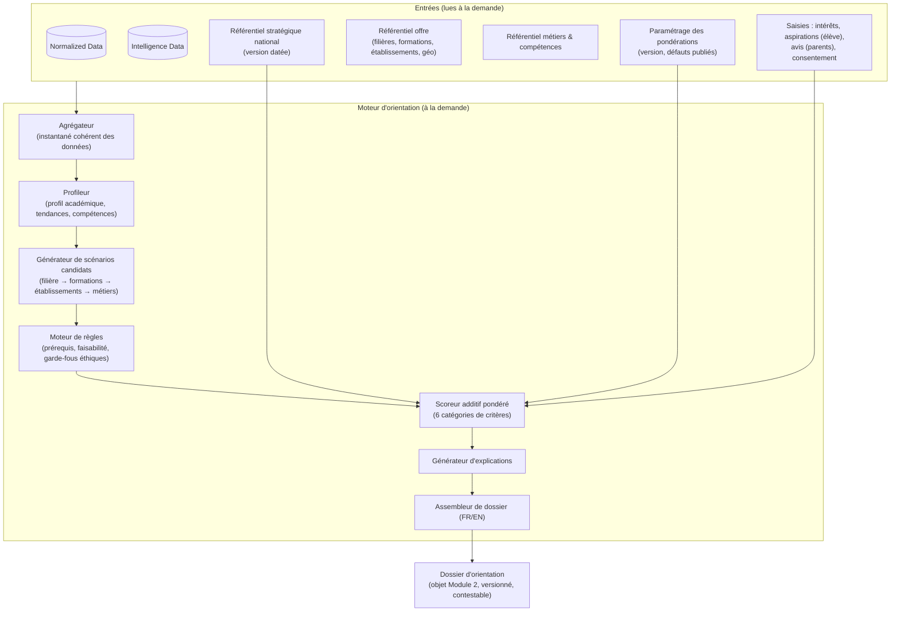
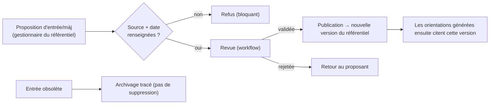

# J. Moteur d'orientation — Architecture détaillée

> **Statut : En revue — Couche 5.** Date : 2026-09-08.
> Complète [`vue-ensemble.md`](vue-ensemble.md).

## J.1 Rappel des principes

Indépendant du Module 1 · **aucun** recalcul automatique · fonctionne **à la demande** · **aide à la
décision**, jamais prescription · **explicabilité obligatoire** · dimension stratégique nationale
= critère **pondéré et transparent**.

## J.2 Architecture logique

Composants dimensionnés **séparément** du Module 1 (scénario d'architecture C) : une campagne
d'orientation ne ralentit jamais la saisie des notes.

## J.3 Étape par étape

### J.3.1 Agrégateur
- Construit un **instantané cohérent** (au sens transactionnel) des données de l'élève au moment de
  la demande : identité, inscriptions, parcours (classes/années), notes validées, évaluations,
  matières, périodes.
- Vérifie le **consentement** (`EF-M2-11`) : sans consentement enregistré, la génération est
  refusée.
- Mesure la **complétude** et la **fraîcheur** (dernière note, présence d'intérêts/aspirations/avis
  parents, longueur de l'historique) → alimente l'avertissement de fiabilité.

### J.3.2 Profileur (produit / rafraîchit l'Intelligence Data de l'élève)
| Sortie | Méthode |
|---|---|
| **Profil académique** | Moyennes par matière/période/année, pondérées par coefficient ; réussite relative (position dans la classe/le niveau) ; matières fortes / fragiles. |
| **Tendances de performance** | Régression sur la série temporelle des notes par matière ; pente, niveau moyen, **régularité** (dispersion), points de rupture. |
| **Compétences & aptitudes détectées** | Règles de correspondance matière(s) → compétences (ex. mathématiques + physique réguliers et en progression → « raisonnement quantitatif : solide ») ; **niveau estimé + indice de confiance + base de calcul explicitée** ; sous **supervision humaine** (le conseiller peut ajuster/annoter). |
| **Profil d'orientation** | Synthèse : domaines d'affinité académique, style (régulier/irrégulier), signaux d'intérêt. |

> Tout est **recalculable** à partir de Normalized Data ; chaque calcul écrit une `calcul_trace`
> (version d'algorithme, hash des entrées, horodatage).

### J.3.3 Générateur de scénarios candidats
- Part des **filières** accessibles depuis le niveau courant de l'élève.
- Pour chaque filière : **formations** associées, **établissements de référence** qui les proposent
  (avec **distance** à l'élève via `localisation`), **métiers** ouverts.
- Élargit avec les filières cohérentes avec les **aspirations** de l'élève même si moins évidentes
  académiquement (elles seront scorées, pas exclues).
- Produit un ensemble de scénarios `filière → {formations} → {établissements} → {métiers}`.

### J.3.4 Moteur de règles (filtres et garde-fous)
| Type de règle | Exemple | Effet |
|---|---|---|
| Prérequis | Série scientifique : niveau minimal attendu en maths/sciences | Marque le scénario « sous condition » ou le déclasse, **avec explication** — ne le supprime pas silencieusement |
| Faisabilité géographique | Aucune offre à moins de X km et pas d'internat | Signale la contrainte + indique l'établissement le plus proche + la distance |
| Capacité / sélectivité | Formation très sélective | Ajoute une note de probabilité d'accès, propose une alternative de repli |
| Garde-fou éthique | Interdiction d'utiliser un critère sensible prohibé | Bloque toute règle/pondération non conforme |
| Garde-fou « non-prescription » | Jamais d'affectation, jamais « impossible » du seul fait du référentiel national | Contrôle de sortie |

### J.3.5 Scoreur additif pondéré (interprétable par conception)

`score(scénario) = Σ  poids_catégorie × contribution_catégorie(scénario)`

| Catégorie | Contribution (exemples de sous-critères) | Poids par défaut (à publier / ajuster) |
|---|---|---|
| **Profil élève** | adéquation matières fortes ↔ filière ; tendance positive ; compétences requises détectées | 30 % |
| **Aspirations de l'élève** | proximité avec les métiers/domaines visés ; intérêts déclarés | 20 % |
| **Avis / ambition des parents** | alignement avec le souhait parental ; niveau de priorité exprimé | 15 % |
| **Offre & faisabilité** | existence d'une offre accessible ; distance ; prérequis atteints ; probabilité d'accès | 15 % |
| **Perspectives professionnelles** | débouchés de la filière/formation ; diversité des métiers ouverts | 10 % |
| **Besoins stratégiques nationaux** | métier/compétence en tension ; secteur prioritaire (référentiel daté) | 10 % |

- **Additif et transparent** : chaque sous-critère a une valeur normalisée [0,1] et une contribution
  = poids × valeur, **affichée** dans l'explication.
- Pondérations : valeurs par défaut **publiées** ; ajustables par un rôle habilité **dans des
  bornes** ; tout ajustement est **tracé et affiché**.
- **Pas de boîte noire** : si un jour un composant d'apprentissage est introduit (ex. estimation
  d'un sous-critère), il fournit une **contribution explicable** et reste borné par le moteur de
  règles et la supervision humaine.

### J.3.6 Générateur d'explications
Pour chaque scénario, produit les 5 blocs (`EF-M2-18`) :
1. **Facteurs déterminants** : liste triée par contribution, en langage naturel FR/EN
   (« Métiers visés par l'élève : cohérents avec cette filière — contribution +0,18 »).
2. **Données utilisées** : catégories, sources, **fraîcheur**, **indice de fiabilité**.
3. **Alternatives écartées** : filières/scénarios de rang inférieur + **raison** (score, prérequis,
   distance).
4. **Zones d'incertitude** : données manquantes et leur effet (« avis des parents non renseigné :
   la catégorie correspondante est neutralisée, fiabilité réduite »).
5. **Répartition du score** : part de chaque catégorie dans le total (graphique + valeurs).

### J.3.7 Assembleur de dossier
- Compose le **dossier d'orientation** : scénarios classés, explications, synthèse, avertissement de
  fiabilité éventuel, **version du référentiel** et **version des pondérations** utilisées.
- Rendu **FR ou EN** ; export lisible destiné à l'entretien.
- Enregistré comme `demande_orientation` + `scenario_orientation` + `facteur_explication` +
  `dossier_orientation_version` (n° 1). Les révisions créent une nouvelle version (`EF-M2-24`).

## J.4 Dashboard de situation (usage A)

Séparé du moteur individuel, mais dans le Module 2.

- **Requêtes paramétrées** sur Normalized Data (+ Intelligence si déjà calculée), exécutées **au
  chargement ou sur rafraîchissement explicite** (`EF-M2-02`).
- Bibliothèque d'indicateurs : top N par matière/périmètre, évolution d'une classe/d'un niveau,
  régularité d'un élève, comparaison inter-classes, distribution des mentions, etc.
- Chaque résultat affiche **date/heure du calcul** et **couverture des données**.
- Indicateurs non académiques (ex. aptitude sportive) : uniquement si des données correspondantes
  existent (EPS, observations) ; sinon « non disponible » (`EF-M2-05`).
- Mise en cache autorisée avec **TTL court** et invalidation sur rafraîchissement ; **jamais**
  d'invalidation déclenchée par l'écriture d'une note.

## J.5 Gouvernance du référentiel stratégique national

- **Sources candidates** : SND30 (MINEPAT), INS, observatoires emploi-formation (ex. ONEFOP),
  études sectorielles — à arbitrer (décision #5).
- Chaque entrée : `source_referentiel` (référence, organisme, url, date de publication, date de
  consultation) **obligatoire**.
- **Fraîcheur** suivie (KPI : ancienneté médiane ≤ 24 mois) ; l'ancienneté d'une donnée est
  **affichée** dans l'explication.
- **Neutralité** : le référentiel **pondère**, ne **verrouille** rien (`EF-M2-19`).

## J.6 Garde-fous éthiques et équité

| Mesure | Mise en œuvre |
|---|---|
| Supervision humaine | Un dossier n'a de valeur qu'après revue du conseiller ; la décision reste au conseil d'orientation |
| Non-discrimination | Liste de critères prohibés ; contrôle automatique qu'aucune règle/pondération ne les utilise |
| Audit d'équité | Analyse périodique : à profil académique comparable, les distributions de recommandations ne présentent pas d'écart significatif inexpliqué entre groupes (`KPI` équité) |
| Transparence | Pondérations par défaut publiées ; explications systématiques ; version du référentiel citée |
| Consentement & minimisation | Génération conditionnée au consentement ; seules les données utiles sont mobilisées |
| Contestabilité | Toute personne concernée peut demander une révision (données complétées, pondérations ajustées) ; historique conservé |
| Traçabilité | Chaque dossier journalisé (entrées, versions, décideur, horodatage) pour audit |

## J.7 Extensibilité multi-pays

- Le **système de notation**, la **structure des cycles**, les **filières**, l'**offre**, le
  **référentiel stratégique** et les **langues** sont des **données de configuration**, pas du code.
- Le moteur (règles + scoring additif + explications) est indépendant du pays ; seuls les
  référentiels et les paramètres changent.

## J.8 Lien avec le POC 4

Le [POC moteur d'orientation](../12-poc/README.md) valide, sur des cas d'élèves **réels
anonymisés** : faisabilité du scoring additif pondéré à 6 catégories, qualité perçue des
recommandations par des conseillers, **complétude et clarté des explications**, stabilité des
résultats, et intégration d'une version de référentiel national.
