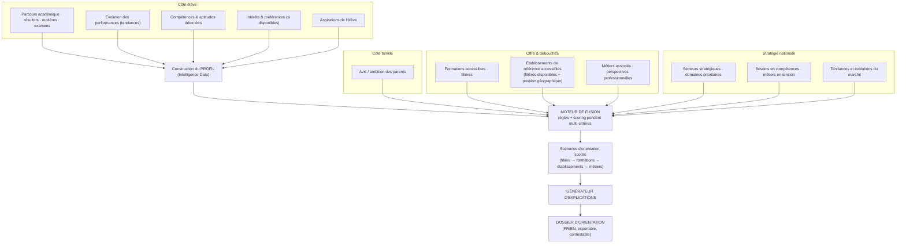
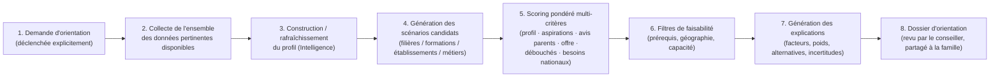
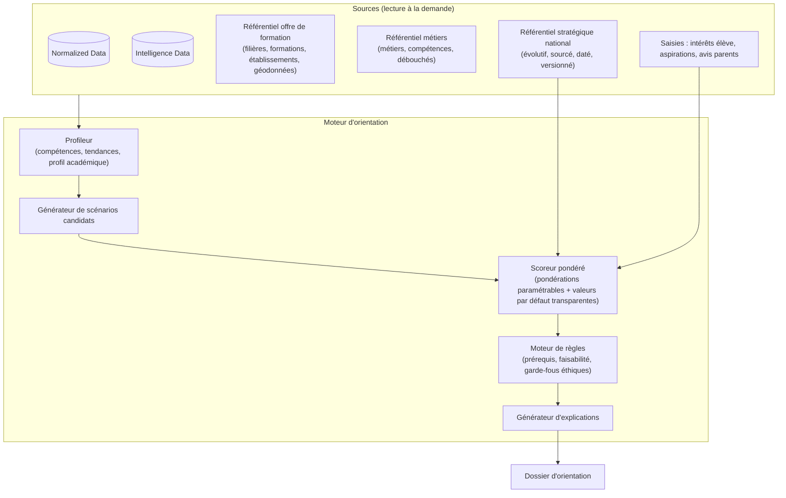

# J. Moteur d'orientation — Vue d'ensemble

> **Statut : En revue — Couche 1.** Date : 2026-09-08.
> Architecture détaillée (sources, calcul du profil, moteur de règles + scoring, référentiel
> stratégique national, génération d'explications, garde-fous éthiques, gouvernance) en Couche 5.

## J.1 Principes fondateurs

1. **Indépendance du Module 1.** Le moteur ne se déclenche **jamais** automatiquement à
   l'enregistrement d'une note. Il fonctionne **à la demande**.
2. **Deux usages** : le **dashboard de situation** (classements/insights par classe et établissement,
   rafraîchis à la demande) et l'**orientation individuelle** (dossier explicable pour un élève).
3. **Aide à la décision, pas prescription.** Le moteur propose des scénarios hiérarchisés et
   argumentés ; il n'affecte personne à une filière ni à un métier.
4. **Explicabilité obligatoire.** Toute recommandation est justifiable, traçable et contestable.
5. **La dimension stratégique nationale est un critère pondéré et transparent**, pas une contrainte
   cachée : l'utilisateur voit sa part dans le score.

## J.2 Ce que le moteur combine

## J.3 Chaîne de traitement (orientation individuelle)

## J.4 Architecture logique cible

## J.5 Rendre les recommandations explicables

Chaque dossier d'orientation expose :

| Élément d'explication | Contenu |
|---|---|
| **Facteurs déterminants** | Les critères qui ont fait remonter chaque scénario, avec leur **poids** et leur **valeur** pour cet élève (ex. « aptitude scientifique : forte (poids 25 %) », « métier en tension au niveau national : oui (poids 15 %) »). |
| **Données utilisées** | Liste des données mobilisées, leur **source**, leur **fraîcheur** et un **indice de fiabilité** (ex. notes validées vs partiellement importées). |
| **Scénarios alternatifs** | Les options écartées et **pourquoi** (score plus faible, prérequis non atteint, éloignement géographique…). |
| **Zones d'incertitude** | Ce qui manque (pas d'intérêts renseignés, historique court, avis parents absent) et l'effet sur la fiabilité. |
| **Répartition du score** | Part respective de **profil élève**, **aspirations**, **avis parents**, **offre/faisabilité**, **débouchés**, **besoins nationaux**. |
| **Contestation** | Comment demander une révision, ajuster les pondérations, compléter les données. |

**Approche technique** (à confirmer en Couche 5) : privilégier un **modèle interprétable par
conception** (règles + scoring additif pondéré, type score-cards) plutôt qu'un modèle boîte noire.
Si des composants d'apprentissage sont introduits (ex. détection de compétences), ils sont
accompagnés de méthodes d'explication (contributions par facteur) et restent **sous supervision
humaine**.

## J.6 Référentiel stratégique national (évolutif)

- Représente : **secteurs stratégiques, métiers, compétences, formations, filières, besoins en
  compétences, domaines prioritaires, tendances et évolutions du marché, autres indicateurs
  pertinents**.
- **Chaque entrée est sourcée et datée** (référence à un document officiel, une étude, une
  statistique) et **versionnée**.
- **Sources candidates** (à valider en Phase 2) : Stratégie Nationale de Développement (SND30),
  Institut National de la Statistique (INS), MINEPAT, observatoires de l'emploi et de la formation
  (ex. ONEFOP), études sectorielles, partenaires. → Décision
  [`17-decisions/decisions-prealables.md`](../17-decisions/decisions-prealables.md) #5.
- **Gouvernance** : un rôle « gestionnaire du référentiel » ; processus de proposition → validation →
  publication ; fréquence de revue ; mention explicite de l'ancienneté d'une donnée.
- **Neutralité** : le référentiel **informe** le scoring, il ne **verrouille** aucune option. Un
  élève peut être orienté à l'encontre d'un « besoin national » si son profil et ses aspirations le
  justifient — l'explication le dira.

## J.7 Dashboard de situation (rappel)

- Répond à des questions concrètes : « le plus brillant en mathématiques du collège », « l'élève le
  plus athlétique de la classe de 5ᵉ », « les 5 meilleurs en philosophie de toutes les terminales du
  lycée de Japoma ».
- **Interroge les bases à la demande** (chargement ou rafraîchissement explicite) — pas de mise à
  jour déclenchée par la saisie des notes.
- Périmètres : élève, classe, niveau, matière, établissement, groupe d'établissements (dans le
  respect du cloisonnement).
- Les indicateurs « non académiques » (ex. « athlétique ») supposent des données correspondantes
  (EPS, observations) : leur disponibilité conditionne l'indicateur.

## J.8 Garde-fous éthiques (aperçu — détail Couche 5 & Couche 6)

- **Supervision humaine** systématique (conseiller d'orientation).
- **Non-discrimination** : audit régulier des recommandations par profil ; pas d'usage de critères
  sensibles interdits.
- **Transparence des pondérations** ; valeurs par défaut publiées.
- **Consentement** de l'élève et des parents pour l'usage des données du Module 2.
- **Droit de rectification** et de contestation.
- **Journalisation** de chaque dossier produit (pour audit).

## J.9 Ce qui vient en Couche 5

- Modèle de calcul du **profil** (compétences, tendances) et ses données d'entrée exactes.
- **Barème de scoring** : critères, échelles, pondérations par défaut, paramétrage autorisé.
- **Catalogue de règles** (prérequis, faisabilité, garde-fous).
- **Format du dossier d'orientation** et gabarits d'explication FR/EN.
- **Schéma de données** des référentiels offre / métiers / stratégique national.
- **Processus de gouvernance** du référentiel stratégique.
- Lien avec le **POC moteur d'orientation** (Couche 7).
