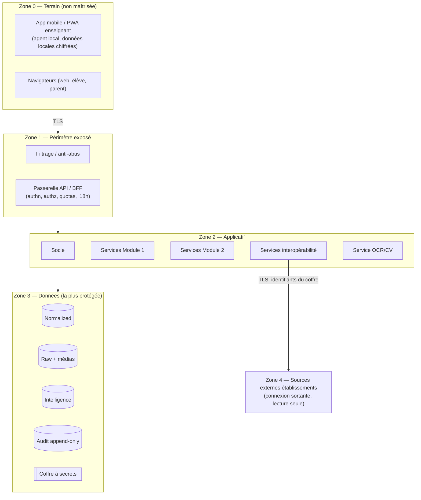

# K. Architecture de sécurité — BuildNote

> **Statut : En revue — Couche 6.** Date : 2026-09-08.
> Dépend des décisions #1 (hébergement/souveraineté), #2 (juridique), #4 (multi-tenant).

## K.1 Objectifs de sécurité

| # | Objectif |
|---|---|
| OS-1 | **Confidentialité** des données personnelles (élèves mineurs, familles, enseignants). |
| OS-2 | **Intégrité** des données académiques (une note validée ne doit pas être altérée sans trace). |
| OS-3 | **Isolation stricte** entre établissements (aucune fuite inter-tenant). |
| OS-4 | **Traçabilité** complète des actions sensibles (audit inviolable). |
| OS-5 | **Disponibilité** du service et **résilience** (sauvegardes testées, reprise). |
| OS-6 | **Minimisation** et conformité au cadre applicable (loi N° 2010/012, socle type RGPD). |
| OS-7 | **Souveraineté** : localisation des données conforme à la décision #1. |

## K.2 Zones de confiance

Règles : aucun accès direct Z0 → Z3 ; Z2 n'accède à Z3 que via la **couche d'accès aux données**
(qui injecte le filtre tenant) ; les secrets ne quittent jamais le coffre en clair vers les logs.

## K.3 Authentification

| Élément | Spécification |
|---|---|
| Comptes | Rattachés à un établissement (sauf rôle éditeur) ; identifiant + secret ; pas de compte partagé |
| MFA | **Obligatoire** pour chef d'établissement, admin SI, admin BuildNote, gestionnaire du référentiel ; recommandé pour les autres |
| Politique de secret | Longueur minimale, blocage des secrets courants, verrouillage temporaire après N échecs |
| Sessions | Durée limitée, renouvellement, révocation ; invalidation à la déconnexion et au changement de rôle |
| Élèves / parents | Accès restreint (questionnaires, consultation de dossier) via lien nominatif à usage contrôlé + vérification légère ; pas de données sensibles exposées sans authentification |
| Agent local (Module 1) | Jeton d'appareil lié à l'utilisateur et à l'établissement ; données locales chiffrées ; effacement à la révocation |
| Fédération | Optionnelle et différée (SSO d'un établissement) — décision ultérieure, jamais imposée |

## K.4 Autorisation

- **RBAC** : rôles = enseignant, responsable pédagogique, conseiller d'orientation, chef
  d'établissement, admin SI établissement, admin BuildNote, gestionnaire du référentiel, élève,
  parent.
- **ABAC** en complément : périmètre (établissement, niveau, classe, matière), propriété (l'auteur
  d'un lot de saisie), état (consentement présent pour le Module 2).
- **Moindre privilège** : un enseignant ne voit que ses enseignements ; un conseiller ne génère une
  orientation que pour les élèves de son périmètre et avec consentement.
- **Contrôle systématique du tenant** : toute requête de données porte `etablissement_id` du
  contexte ; la couche d'accès aux données **rejette** toute requête sans ce filtre (défense en
  profondeur avec la row-level security du SGBD si option « base partagée »).
- Révision périodique des accès ; retrait automatique à la fin d'affectation.

Matrice rôle → permissions (extrait) :

| Action | Ens. | Resp. | Cons. | Chef | Admin SI | Admin BN | Gest. réf. | Élève | Parent |
|---|---|---|---|---|---|---|---|---|---|
| Capturer / valider une fiche | ✔ (son périmètre) | ✔ | | | | | | | |
| Contre-valider un lot | | ✔ | | ✔ | | | | | |
| Consulter dashboard | ✔ (ses classes) | ✔ | ✔ | ✔ | | | | | |
| Générer une orientation | | | ✔ | ✔ | | | | | |
| Saisir intérêts / aspirations | | | ✔ (pour) | | | | | ✔ | |
| Donner l'avis parent | | | ✔ (tiers) | | | | | | ✔ |
| Importer depuis un SI | | | | ✔ (autorise) | ✔ | | | | |
| Export de réversibilité | | | | ✔ (autorise) | ✔ | | | | |
| Gérer comptes établissement | | | | ✔ | ✔ | | | | |
| Créer un établissement (tenant) | | | | | | ✔ | | | |
| Modifier le référentiel national | | | | | | | ✔ | | |
| Consulter le journal d'audit | | | | ✔ | ✔ (technique) | ✔ | | | |

## K.5 Chiffrement

| Donnée | En transit | Au repos |
|---|---|---|
| Toutes communications client ↔ service | TLS 1.2+ (pas de canal clair) | — |
| Base Normalized / Intelligence | TLS | Chiffrement au niveau stockage |
| Raw : images de fiches, payloads OCR | TLS | Chiffrement du stockage objet/fichier ; clés gérées (coffre / KMS selon décision #1) |
| Données locales de l'agent (Module 1 hors-ligne) | — | Chiffrement du stockage local de l'app |
| Secrets (accès aux sources externes, clés) | TLS | **Coffre à secrets** ; jamais en base en clair ; jamais journalisés ; rotation possible |
| Sauvegardes | TLS | Chiffrées |
| Journal d'audit | TLS | Chiffré + intégrité renforcée (chaînage de hash optionnel) |

## K.6 Isolation multi-tenant (sécurité)

| Couche | Mesure |
|---|---|
| Données | `etablissement_id` obligatoire ; option « schéma par établissement » ou « base partagée + row-level security » (décision #4) |
| Accès aux données (applicatif) | Filtre tenant injecté systématiquement ; refus si absent ; revue de code dédiée |
| API | Le contexte d'établissement est déduit du jeton, jamais d'un paramètre client librement modifiable |
| Stockage média | Cloisonnement par préfixe/tenant + contrôle d'accès ; URLs signées à durée courte |
| Sauvegardes | Restauration possible par établissement sans exposer les autres |
| Tests | **Batterie de tests d'isolation automatisés** exécutée à chaque release ; test d'intrusion ciblé sur le cloisonnement |
| Journalisation | Toute tentative d'accès inter-établissements = **alerte de sécurité** |

## K.7 Journalisation & audit

- **Événements audités** : authentification (succès/échec), changement de rôle, validation et
  contre-validation de notes, correction de note après enregistrement, génération/révision de
  dossier d'orientation, modification du référentiel national, import/export, gestion de comptes,
  accès au journal d'audit, tentative d'accès refusée.
- **Format** : acteur, rôle, établissement, action, objet, valeur avant/après (hashée si sensible),
  horodatage, adresse, résultat.
- **Stockage** : append-only, chiffré, conservé selon la politique de rétention ; export et
  archivage périodiques ; pas d'`UPDATE`/`DELETE` applicatif.
- **Consultation** : rôles habilités uniquement ; recherche et export.
- **Corrélation** : alertes sur motifs suspects (accès inter-tenant, pics d'échecs d'authn, exports
  massifs).

## K.8 Protection des données personnelles (conformité)

| Mesure | Détail |
|---|---|
| **DPIA** | Réalisée en Phase 2 (préliminaire) puis finalisée en Phase 4/7 ; couvre Module 1, Module 2, interopérabilité |
| **Registre des traitements** | Finalités, catégories de données, bases légales, durées, destinataires |
| **Base légale & consentement** | Mission éducative + consentement parental pour le Module 2 ; consentement enregistré, **retirable** ; génération d'orientation conditionnée (`EF-M2-11`) |
| **Minimisation** | Le Module 2 ne collecte que l'utile (intérêts, aspirations, avis) ; pas de collecte « au cas où » |
| **Durées de conservation** | Par strate et catégorie (décision #2) ; purge automatique ; Raw (images) conservé le temps justifié |
| **Droits des personnes** | Accès, rectification, opposition, effacement dans les limites légales ; procédure outillée |
| **Pseudonymisation** | Obligatoire pour analyses agrégées, jeux de test, données d'entraînement OCR ; aucune donnée réelle identifiante hors production |
| **Localisation** | Conforme à la décision #1 ; documentée |
| **Sous-traitants** | Contrats encadrant tout fournisseur (OCR managé, hébergeur) : localisation, sécurité, non-réutilisation des données |
| **Non-discrimination (Module 2)** | Critères prohibés listés ; audit d'équité périodique |

## K.9 Sauvegardes & continuité

| Élément | Politique |
|---|---|
| Fréquence | Sauvegarde complète quotidienne + incrémentales ; cohérence base ↔ stockage média (même point de reprise) |
| Test de restauration | **Mensuel**, tracé |
| RPO | ≤ 24 h (données centrales) ; 0 pour les données validées localement non synchronisées (conservées sur l'appareil) |
| RTO | ≤ 4 h pour le service central |
| Rétention des sauvegardes | Définie (ex. 30 j glissants + jalons mensuels), chiffrées |
| Plan de continuité (PCA) / reprise (PRA) | Rédigés en Phase 7, testés avant généralisation ; scénarios : perte d'instance, perte de zone, corruption de données, compromission |
| Isolation des sauvegardes | Copie hors-ligne / hors-site ; accès restreint ; protection contre la suppression (immuabilité) |

## K.10 Sécurité du développement et de l'exploitation (DevSecOps)

- Analyse des dépendances en continu ; correctifs **critiques sous 7 j**.
- Analyse statique de sécurité en CI (bloquante sur les catégories critiques).
- Revue de code obligatoire, avec point d'attention sécurité (injection, contrôle d'accès, tenant,
  secrets).
- Gestion des secrets : jamais dans le code ni les logs ; coffre ; rotation.
- **Tests d'intrusion** : avant la première mise en production, et à chaque évolution majeure ;
  périmètre incluant explicitement le **cloisonnement multi-tenant** et l'**agent local**.
- Modèle de menaces (STRIDE) tenu à jour par module ; voir §K.11.
- Gestion des vulnérabilités et divulgation : procédure de signalement, délais de correction, suivi.
- Journalisation des accès d'exploitation ; comptes nominatifs ; MFA ; principe du moindre
  privilège pour l'équipe.

## K.11 Modèle de menaces (extrait STRIDE)

| Menace | Exemple | Contre-mesure |
|---|---|---|
| **S**poofing | Usurpation d'un compte enseignant | MFA (rôles sensibles), politique de secret, verrouillage, journalisation |
| **T**ampering | Altération d'une note validée | Audit append-only, contrôle d'accès, lineage, contre-validation, alertes |
| **R**epudiation | « Ce n'est pas moi qui ai validé » | Journal d'audit horodaté et attribué, double validation tracée |
| **I**nformation disclosure | Fuite inter-établissements | Isolation multi-couches, tests d'isolation, alertes, chiffrement |
| **D**enial of service | Saturation par imports/captures | Quotas, files, anti-abus, dimensionnement séparé OCR/ETL |
| **E**levation of privilege | Un enseignant accède aux fonctions d'admin | RBAC/ABAC strict, revue d'accès, tests, moindre privilège |
| Menace données perso | Réutilisation par un sous-traitant OCR | Contrats, pseudonymisation, option auto-hébergée (décision #3) |
| Menace agent local | Vol d'un téléphone | Chiffrement local, jeton révocable, effacement à distance, pas de données au-delà du nécessaire |

## K.12 Ce qui reste à figer

- Choix du coffre / KMS et de la stratégie de clés (lié à #1).
- Modèle multi-tenant définitif (#4) et sa déclinaison sécurité (row-level security ou schéma).
- Encadrement contractuel des sous-traitants (lié à #3 et #1).
- Politique de rétention chiffrée par catégorie (#2).
- Périmètre exact et prestataire des tests d'intrusion.
