# L. Architecture UX/UI — BuildNote

> **Statut : En revue — Couche 6.** Date : 2026-09-08.
> Les wireframes détaillés et les prototypes cliquables sont produits en Phase 5 ; ce document pose
> l'**architecture UX**, le **design system** et les **principes**.

## L.1 Principes UX

1. **Séparation visible des deux modules** : une entrée « Notes » (Module 1) et une entrée
   « Orientation » (Module 2) clairement distinctes, jamais mélangées dans un même écran.
2. **La vérification prime sur la saisie** : l'écran clé du Module 1 est un écran de **contrôle
   rapide**, pas un formulaire vierge.
3. **Sobriété** : peu d'éléments par écran, gros boutons, textes courts — utilisable sur petit écran
   et mauvaise lumière.
4. **Hors-ligne assumé** : l'état de connexion et de synchronisation est toujours visible et
   compréhensible.
5. **Explicabilité lisible** : les recommandations d'orientation se lisent comme un raisonnement,
   pas comme un score brut.
6. **Bilingue de bout en bout** : FR/EN, choix dès l'accueil, aucun texte codé en dur.
7. **Aucune action irréversible sans confirmation claire** (validation de notes, export, partage).

## L.2 Architecture de l'information

```mermaid
flowchart TB
    ACC["Écran d'accueil\n(sélecteur langue FR/EN, connexion)"] --> HOME["Accueil authentifié\n(établissement courant, rôle, raccourcis)"]
    HOME --> NOTES["NOTES (Module 1)"]
    HOME --> ORI["ORIENTATION (Module 2)"]
    HOME --> DATA["DONNÉES & IMPORTS (interopérabilité)"]
    HOME --> ADMIN["ADMINISTRATION"]
    HOME --> COMPTE["Compte & langue"]

    NOTES --> N1["Mes classes / évaluations"]
    NOTES --> N2["Nouvelle capture"]
    NOTES --> N3["Vérifier & valider un lot"]
    NOTES --> N4["Lots en attente de contre-validation"]
    NOTES --> N5["File de synchronisation"]

    ORI --> O1["Dashboard de situation"]
    ORI --> O2["Élèves / demandes d'orientation"]
    ORI --> O3["Dossier d'orientation"]
    ORI --> O4["Questionnaire élève (intérêts, aspirations)"]
    ORI --> O5["Avis parent"]
    ORI --> O6["Référentiel stratégique (gestionnaire)"]

    DATA --> D1["Sources & connecteurs"]
    DATA --> D2["Assistant d'import"]
    DATA --> D3["Quarantaine & conflits"]
    DATA --> D4["Tableau de bord qualité"]
    DATA --> D5["Export (tiers / réversibilité)"]

    ADMIN --> A1["Comptes & rôles"]
    ADMIN --> A2["Années scolaires, classes, matières, barèmes"]
    ADMIN --> A3["Gabarits de fiches"]
    ADMIN --> A4["Consentements"]
    ADMIN --> A5["Journal d'audit"]
    ADMIN --> A6["Sauvegardes"]
```

La navigation de premier niveau visible dépend du **rôle** (un enseignant voit surtout NOTES ; un
conseiller surtout ORIENTATION ; un admin SI surtout DONNÉES & IMPORTS).

## L.3 Design system — palette

Palette imposée : **bleu clair**, **orange**, **blanc**, complétée de neutres.

| Jeton | Rôle | Usage |
|---|---|---|
| `--bn-blue` (bleu clair) | **Primaire** | Barre de navigation, boutons d'action principaux, liens, éléments sélectionnés, en-têtes de section |
| `--bn-blue-dark` | Primaire foncé | États survol/pressé, texte sur fond clair nécessitant du contraste |
| `--bn-orange` | **Accent** | Appels à l'action secondaires, éléments à contrôler (score de confiance moyen), badges, mise en avant ponctuelle |
| `--bn-orange-dark` | Accent foncé | États d'accent, contraste |
| `--bn-white` | Fond | Fond des pages et des cartes, respiration |
| `--bn-gray-050 → 900` | Neutres | Texte (900/700), bordures (200/300), fonds secondaires (050/100), désactivé (400) |
| États sémantiques | Dérivés **sans trahir la palette** | Succès = bleu-vert sobre ; **avertissement / faible confiance = orange** ; erreur = rouge réservé aux vraies erreurs ; info = bleu |

Règles :
- **Bleu = navigation et action** ; **orange = attention / à vérifier** ; **blanc = fond**.
- Contraste **AA minimum** pour tout texte (vérifié sur chaque paire fond/texte).
- L'orange n'est jamais utilisé comme fond de grande surface (fatigue visuelle) ; réservé aux
  accents.
- Pas de dépendance à la couleur seule : les états portent aussi une icône / un libellé (score de
  confiance : couleur **+** valeur **+** picto).

### Score de confiance OCR — codage visuel

| Bande | Couleur | Signification | Comportement |
|---|---|---|---|
| Élevée | bleu clair discret | à vérifier rapidement | affichée normalement |
| Moyenne | **orange** | à contrôler | mise en avant, listée dans « à vérifier » |
| Faible | orange soutenu + picto | à corriger / ressaisir | placée en tête de parcours, cellule marquée |

## L.4 Typographie, espacement, composants

- **Typographie** : une police système ou libre à forte lisibilité, tailles limitées à 4–5 niveaux ;
  chiffres tabulaires pour les colonnes de notes.
- **Grille** : espacement basé sur une unité (ex. 4 px) ; cartes à coins légèrement arrondis ;
  ombres discrètes.
- **Bibliothèque de composants** (à spécifier en Phase 5) : barre de navigation, cartes de classe,
  **tableau de vérification de notes** (composant central), cellule éditable avec score et loupe
  d'image, sélecteur de langue, bandeau d'état hors-ligne/synchro, carte de scénario d'orientation,
  bloc d'explication (facteurs/poids), graphe de répartition du score, assistant multi-étapes
  (import), file de quarantaine, formulaires courts (questionnaire élève, avis parent).
- **États** : chaque composant définit repos / survol / focus (visible au clavier) / pressé /
  désactivé / chargement / erreur / vide.

## L.5 Écrans clés (cadrage ; wireframes en Phase 5)

### L.5.1 Écran d'accueil (non authentifié)
- Logo BuildNote, **sélecteur de langue FR/EN bien visible** (`EF-SOC-01`), connexion.
- Choix de langue appliqué immédiatement et mémorisé (appareil).

### L.5.2 Module 1 — Vérifier & valider un lot (écran central)
- En-tête : classe, matière, évaluation, barème ; nombre de lignes ; **score de confiance global**.
- Corps : **tableau** élève × colonnes ; chaque cellule = valeur + bande de confiance ; clic →
  **zoom sur la zone d'image source** ; édition inline avec clavier adapté.
- Barre latérale : « À vérifier (N) » — liste des cellules orange/rouges, navigation rapide ;
  lignes non rapprochées à traiter.
- Contrôles en direct : hors barème, doublon, note manquante.
- Pied : récapitulatif → **Valider** (confirmation) → (contre-validation si activée).
- Bandeau : état hors-ligne / « sera synchronisé ».

### L.5.3 Module 1 — File de synchronisation
- Liste des lots locaux : statut (en attente / envoyé / conflit) ; action de résolution guidée en
  cas de conflit (deux valeurs, deux sources, choix tracé).

### L.5.4 Module 2 — Dashboard de situation
- Sélecteur de périmètre (établissement / niveau / classe / matière / groupe) et d'indicateur.
- **Bouton « Rafraîchir »** ; affichage de la **date/heure du calcul** et de la **couverture des
  données**.
- Résultats : classements (top N), tendances, comparaisons ; export FR/EN.
- Aucun rafraîchissement automatique ; message explicite « données au JJ/MM à HH:MM ».

### L.5.5 Module 2 — Dossier d'orientation
- En-tête élève + **avertissement de fiabilité** si données incomplètes.
- Liste de **scénarios** du plus au moins recommandé : filière → formations → établissements (avec
  **distance**) → métiers ; score visible.
- Pour chaque scénario, un panneau **Explication** : facteurs déterminants (libellés + contributions
  + / −), données utilisées (source, fraîcheur, fiabilité), **alternatives écartées et pourquoi**,
  **zones d'incertitude**, **répartition du score** (6 catégories, graphe).
- Actions : ajuster les pondérations (dans les bornes, tracé), demander une révision, **exporter
  (FR/EN)**.
- Mention : version du référentiel national utilisée + ancienneté des données.

### L.5.6 Module 2 — Questionnaire élève / Avis parent
- Formulaires **courts**, langage simple, FR/EN ; sauvegarde progressive ; modifiable.
- Avis parent accessible par lien ; possibilité de saisie par le conseiller (marquée « saisi par un
  tiers »).

### L.5.7 Interopérabilité — Assistant d'import
- Étapes : choisir la source → configurer la connexion → **mapper les champs** (propositions
  automatiques, tables de valeurs, prévisualisation) → import de test → **rapport** (importés /
  quarantaine / conflits) → import complet → planifier la synchro.
- File de **quarantaine** : chaque ligne a un motif et des actions ; file de **conflits** : deux
  valeurs, deux sources, lineage, choix tracé.
- **Tableau de bord qualité** : complétude, fraîcheur, quarantaine, conflits.

## L.6 Internationalisation (i18n)

- Sélecteur FR/EN dès l'accueil, persistant (compte si connecté, sinon appareil) — `EF-SOC-01/03`.
- 100 % des textes externalisés ; **lint i18n** en CI (`ENF-I18N-01`).
- FR et EN complets à chaque livraison : UI, messages, e-mails/notifications, **exports**,
  **explications d'orientation**, documentation utilisateur (`ENF-I18N-02`).
- Formats locaux (dates, nombres, ordre nom/prénoms) paramétrables.
- Architecture i18n **non limitée à deux langues** (préparer l'extension multi-pays) —
  `ENF-I18N-03` ; libellés de référentiel gérés en FR/EN (et extensible).
- Longueur de texte variable prise en compte dans les maquettes (l'anglais et le français n'ont pas
  la même longueur).

## L.7 Accessibilité

| Exigence | Cible |
|---|---|
| Contraste | AA minimum sur tout texte et élément d'interface |
| Clavier | 100 % des actions des écrans de saisie/correction accessibles au clavier ; focus visible |
| Cibles tactiles | Taille minimale confortable ; espacement suffisant |
| Information non portée par la couleur seule | Icône + libellé systématiques (états, scores) |
| Lisibilité | Tailles de police suffisantes ; pas de texte sur image chargée |
| Messages | Explicites, actionnables, FR/EN |
| Matériel modeste | Testé sur appareils bas de gamme (`ENF-UX-05`, `ENF-CTX-01`) |

## L.8 Mode faible connectivité / hors-ligne (UX)

- **Indicateur d'état permanent** : en ligne / hors ligne / synchronisation en cours / conflit.
- Module 1 : toutes les actions de capture → validation fonctionnent hors-ligne ; message clair
  « enregistré localement, sera synchronisé ».
- Économie de données : compression des images, chargement différé, indicateur de consommation,
  réglage « qualité photo ».
- Reprise de synchronisation transparente ; résolution de conflit **guidée**, jamais d'écrasement
  silencieux.
- Module 2 : consultation possible en cache (dossiers déjà générés) ; génération et dashboard
  nécessitent la connexion (message explicite).

## L.9 Tests d'utilisabilité (Phase 5)

- Cibles : enseignants (capture/validation), conseillers (dossier d'orientation), admins SI
  (import), élèves/parents (questionnaires).
- Mesures : réussite de la tâche au 1er essai, temps, erreurs, satisfaction, **compréhension des
  explications d'orientation** (`ENF-UX-06`).
- Itérations sur les prototypes avant le gel du design system (J5).

## L.10 Livrables Phase 5

Architecture de l'information finalisée · design system (jetons, composants, états, accessibilité) ·
wireframes des écrans clés (L.5) · prototypes cliquables des parcours critiques · spécification i18n
et offline · rapport de tests d'utilisabilité · guide de contribution UI.
