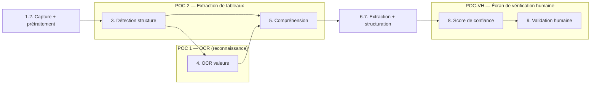

# M-ACQ. Dossier POC — Chaîne d'acquisition des données académiques

> **Statut : Brouillon — Couche 7.** Date : 2026-09-09.
> Ce dossier **outille l'exécution** (Phase 6) des POC qui portent sur la chaîne d'acquisition du
> Module 1 : de la photo d'une fiche jusqu'à l'affichage du **formulaire prérempli** et sa
> **vérification humaine**, avant tout enregistrement. Il complète — sans le remplacer — le cadrage
> de [`../plans-poc.md`](../plans-poc.md) (§M.1, §M.2).
> Prototypes **jetables** : le code produit ici ne devient pas le produit.

## Périmètre

La chaîne couverte correspond aux étapes **1 → 9** du pipeline
([`../../08-ocr-computer-vision/pipeline.md`](../../08-ocr-computer-vision/pipeline.md)) :
capture → prétraitement → détection de structure → OCR → compréhension → extraction → structuration
→ score de confiance → **validation humaine**. L'étape 10 (stockage) est hors périmètre POC
d'acquisition (couverte par POC 3 — interopérabilité pour la partie lineage/réversibilité).

| POC | Cadrage | Ce dossier ajoute |
|---|---|---|
| **POC 1 — OCR** | [`../plans-poc.md` §M.1](../plans-poc.md) | Protocole d'exécution, jeu de données annoté, harnais de mesure, modèle de rapport |
| **POC 2 — Extraction de tableaux** | [`../plans-poc.md` §M.2](../plans-poc.md) | idem, volet structure + rapprochement élève |
| **POC-VH — Écran de vérification humaine** | *nouveau* (issu du pipeline §I.10 et de `EF-M1-06/07/08/09/10/11/18`) | Hypothèses, maquettes basse fidélité, protocole de test utilisateur, grille, critères chiffrés |

> **POC-VH** est un ajout aux quatre POC de `plans-poc.md`. Il peut être exécuté en parallèle de
> POC 1/2 (il consomme des sorties **figées** de POC 1) ou juste après.

## Contenu du dossier

| Fichier | Objet |
|---|---|
| [`protocole.md`](protocole.md) | Protocole d'exécution commun : environnement isolé, gel des jeux, moteurs candidats, matrice de tests, déroulés POC 1 / POC 2 / POC-VH, planning, rôles, critères de sortie |
| [`jeux-de-donnees.md`](jeux-de-donnees.md) | Constitution du corpus (≥ 150 fiches), conditions à couvrir, **pseudonymisation**, format de **vérité terrain** (schéma + exemple), guide d'annotation, accord inter-annotateur, gel et conservation |
| [`harnais-mesure.md`](harnais-mesure.md) | Spécification du harnais (jetable) : appariement prédiction ↔ vérité, normalisation, **formules exactes** des métriques (exactitude cellule, CER/WER, matrice de confusion des chiffres, structure, rapprochement élève, temps, coût), formats de fichiers de résultats, dépouillement |
| [`verification-humaine.md`](verification-humaine.md) | POC-VH : hypothèses, **maquettes ASCII/Mermaid** de l'écran de vérification, prototype de test (Magicien d'Oz), protocole utilisateur, grille d'observation, critères de succès |
| [`modele-rapport.md`](modele-rapport.md) | Gabarit commun de **rapport de POC** : verdict (atteint / partiel / non atteint) vs critères, analyse, menaces à la validité, **recommandation pour J7**, impact ADR |

## Exigences tracées

`EF-M1-01` à `EF-M1-11`, `EF-M1-17`, `EF-M1-18`, `EF-M1-20` ·
`ENF-PERF-01/02` · `ENF-CTX-*` (hors-ligne) ·
Besoins `B1-01` à `B1-07`, `B1-12`, `B1-14`.

## Risques adressés

`R1` (fiabilité OCR), `R6` (dépendance fournisseur OCR), `R9` (adoption enseignants — volet POC-VH).
Voir [`../../16-risques/risques.md`](../../16-risques/risques.md).

## Décisions alimentées (ADR)

- **#3 — Stratégie OCR** (managé / open source / mixte) : tranchée en Phase 7 **après** POC 1 & 2.
- **#10 — Stack technologique** : candidats confirmés/écartés selon faisabilité observée.
- **#8 — Cible de connectivité** : le volet hors-ligne de POC 1 fournit des éléments chiffrés.

Voir [`../../17-decisions/decisions-prealables.md`](../../17-decisions/decisions-prealables.md).
