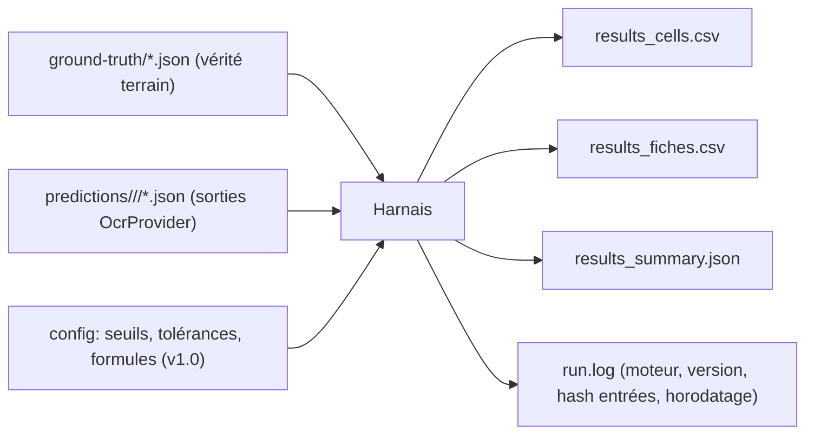

# M-ACQ.3 Harnais de mesure — spécification

> **Statut : Brouillon — Couche 7.** Date : 2026-09-09.
> Spécifie l'outil **jetable** qui compare les sorties des moteurs à la vérité terrain
> ([`jeux-de-donnees.md`](jeux-de-donnees.md)) et produit les tableaux de résultats du rapport
> ([`modele-rapport.md`](modele-rapport.md)). **Formules gelées** avant exécution
> ([`protocole.md` §P.3](protocole.md)). Aucune métrique n'est calculée « à la main ».

## H.1 Entrées / sorties



**Format des prédictions** — le moteur, exposé via `OcrProvider`, écrit un JSON par fiche, même
structure de grille que la vérité terrain, chaque cellule portant :

```json
{ "col": 2, "ligne_index": 0,
  "texte": "125", "score": 0.71,
  "variantes": [ { "texte": "12.5", "score": 0.68 }, { "texte": "125", "score": 0.71 } ],
  "bbox": [990, 341, 1141, 389],
  "ecriture_detectee": "manuscrit" }
```

Plus, au niveau fiche : structure détectée (zones, grille, rôles de colonnes), association ligne ↔
`eleve_ref` proposée, en-tête reconnu, temps de traitement, mode réseau.

## H.2 Appariement prédiction ↔ vérité

L'appariement se fait **par position logique** `(ligne_index, col)` après alignement de la grille :

1. Aligner les colonnes prédites sur les colonnes vérité par `role` puis, à défaut, par
   recouvrement horizontal des `bbox` (IoU 1-D ≥ 0,5).
2. Aligner les lignes par recouvrement vertical des `bbox` (IoU 1-D ≥ 0,5) ; en cas d'ambiguïté,
   par ordre.
3. Une cellule vérité sans prédiction appariée = **cellule non lue** (`omission`).
   Une prédiction sans cellule vérité = **hallucination** (`ajout`).
4. Le taux d'appariement de grille est lui-même une mesure (POC 2).

## H.3 Normalisation avant comparaison

Appliquée **identiquement** aux deux côtés, avec les règles de l'étape 6 du pipeline :

- trim, espaces multiples réduits ;
- séparateur décimal `,` → `.` ; suppression du `0` non significatif de tête (`08` → `8`) ;
  `12.50` → `12.5` ;
- `20/20` → `20` quand le barème est connu ;
- casse : comparaison des noms **insensible à la casse et aux accents** pour l'exactitude « souple »,
  sensible pour l'exactitude « stricte » (les deux sont reportées) ;
- `Abs`/`NE`/`—` → jetons de statut `@ABS`, `@NE`.

La configuration fige : liste des synonymes de statut, tolérance numérique (défaut **0** — égalité
stricte), politique accents.

## H.4 Métriques — POC 1 (OCR)

### H.4.1 Exactitude cellule

Population = cellules vérité avec `etat ∈ {rempli, statut}` **et** appariées ou en omission
(les `etat=vide` et `etat=illisible` sont **exclues** du dénominateur, comptées à part).

```
exactitude_cellule = cellules_correctes / cellules_comparables
```

Une cellule est **correcte** si :

| Type | Condition |
|---|---|
| `nombre` | valeur normalisée prédite == valeur normalisée vérité (tolérance = config, défaut 0) ; ou statut prédit == statut vérité |
| `texte` court (nom) | exact match normalisé ; l'exactitude souple (sans accents/casse) est reportée en parallèle |
| énuméré (mention) | valeur canonique identique |
| `texte` libre (appréciation) | **non** comptée en exactitude cellule ; évaluée en CER/WER (§H.4.3) |

Reporté : global, **par strate**, par moteur, par régime d'écriture (`imprime` / `manuscrit`),
en ligne / hors-ligne. IC 95 % par bootstrap sur les fiches.

### H.4.2 Matrice de confusion des chiffres

Sur les cellules `nombre` **de longueur 1** et, par extension, chiffre à chiffre sur les cellules
alignables :

- classes : `0..9`, `@VIDE` (rien prédit), `@AUTRE` (symbole non chiffre), `@SEP` (`.`/`,`).
- sortie : matrice 13×13 + top des confusions (attendu : `1↔7`, `0↔6`, `0↔8`, `3↔8`, `4↔9`,
  `1↔4`, `5↔6`, `7↔1`).
- indicateur dérivé : **taux d'erreur sur le chiffre des dizaines** vs **unités** (une erreur de
  dizaine = écart de note important).

### H.4.3 CER / WER (en-têtes et appréciations)

```
CER = levenshtein_caracteres(pred, ref) / max(1, len(ref))
WER = levenshtein_mots(pred, ref)       / max(1, nb_mots(ref))
```

- calculés sur `entete.texte_brut_attendu` et sur chaque cellule `appreciation` ;
- agrégation : **micro** (somme des distances / somme des longueurs) et **macro** (moyenne des CER
  par élément) — les deux reportées ;
- cible `plans-poc.md` : CER en-têtes ≤ 5 %.

### H.4.4 Cellules non lues / hallucinations

```
taux_omission     = cellules_vérité_sans_prédiction / cellules_comparables
taux_hallucination = prédictions_sans_cellule_vérité / cellules_prédites
```

Distinguer omission sur cellule **vide** (bénin) et sur cellule **remplie** (grave).

### H.4.5 Score de confiance — calibration

Le score de confiance sert à trier la revue humaine ; on vérifie qu'il **discrimine** :

- courbe de fiabilité (score prédit vs exactitude observée, 10 bacs) + **ECE** (Expected
  Calibration Error) ;
- AUC de la détection « cellule erronée » à partir du score ;
- au seuil « orange » proposé : **rappel des cellules erronées** (objectif : peu d'erreurs classées
  « vert ») et **charge de revue** (part de cellules ≥ seuil).

### H.4.6 Temps et coût

| Mesure | Définition |
|---|---|
| Temps de traitement | capture → formulaire structuré, par fiche ; p50 / p95 ; en ligne / hors-ligne / débit bridé ; cible ≤ 20 s serveur, ≤ 45 s hors-ligne dégradé |
| Débit | fiches/heure soutenu sur le poste de traitement |
| Ressources | CPU/GPU/RAM pic (moteurs open source) |
| Coût projeté managé | `coût_mensuel = pages_par_mois × prix_unitaire_page` ; `pages_par_mois = n_etablissements × n_classes × n_evaluations_an / 12 × pages_par_fiche` ; 2 scénarios (bas / haut) + coût par fiche vérifiée |

### H.4.7 Faisabilité hors-ligne

- sous-ensemble (≥ 30 fiches, toutes strates) exécuté **réseau coupé** ;
- `delta_exactitude = exactitude_en_ligne − exactitude_hors_ligne` par strate ;
- capacités effectives hors-ligne (`imprime` seul ? nombres ? manuscrit ?) ;
- verdict H3 de `plans-poc.md` : « hors-ligne au moins dégradé possible » = oui/non + conditions.

## H.5 Métriques — POC 2 (Extraction de tableaux)

### H.5.1 Reconstruction de structure

Par fiche, booléen `structure_ok` = **toutes** les conditions :

- `n_colonnes` détecté == vérité ;
- `n_lignes` détecté == vérité **± tolérance** (config, défaut ±1 pour les fiches > 40 lignes,
  0 sinon) ;
- rôle correct pour **toutes** les colonnes `note`, `nom`/`nom_prenom`, `matricule` (les rôles
  secondaires comptent dans H.5.3 mais pas ici) ;
- cellules fusionnées de la vérité toutes retrouvées.

```
taux_structure_ok = fiches_structure_ok / fiches   (global + par strate + sans_bordure + ordre_inhabituel)
```

Cible : ≥ 85 %.

### H.5.2 Rapprochement élève

Population = lignes dont la vérité a `eleve_ref != null` (lignes rapprochables).

```
rapprochement_correct = lignes_bien_rapprochées / lignes_rapprochables      (cible ≥ 90 %)
faux_rapprochement     = lignes_attribuées_au_mauvais_élève / lignes_rapprochables   (à minimiser — grave)
omission_rapprochement = lignes_rapprochables_laissées_non_rapprochées / lignes_rapprochables
```

Et sur les lignes **non** rapprochables (vérité `null`) :
`signalement_correct = non_rapprochables_bien_signalées / non_rapprochables_vérité`.

> Un **faux rapprochement** est plus grave qu'une omission : il attribue une note au mauvais élève.
> Reporté séparément et commenté cas par cas.

### H.5.3 Rôle des colonnes

```
role_correct = colonnes_au_bon_rôle / colonnes_totales    (cible ≥ 90 %)
```
+ matrice de confusion des rôles (`note` ↔ `coefficient` ↔ `rang` ↔ `moyenne` sont les confusions
attendues).

### H.5.4 Gain des gabarits

Sur `sans_bordure` et `ordre_inhabituel`, avec vs sans gabarit :

```
gain_gabarit = taux_structure_ok(avec) − taux_structure_ok(sans)
```
Significativité : test de McNemar sur les fiches appariées (même fiche, deux conditions).
Reporté aussi : gain sur `rapprochement_correct` et `role_correct`.

### H.5.5 Temps de repli manuel

Chronométré (opérateur non expert) sur les fiches `structure_ok = false` : temps pour choisir un
gabarit ou saisir la grille manuellement, image affichée. p50 / p95. Sert à dimensionner le mode
dégradé (`EF-M1-18`).

## H.6 Métriques — POC-VH (Écran de vérification humaine)

Collecte décrite dans [`verification-humaine.md`](verification-humaine.md) ; formules ici.

| Métrique | Formule / définition | Cible provisoire |
|---|---|---|
| Temps de revue | secondes pour vérifier + valider une fiche, ramené à **40 élèves** : `t × 40 / n_lignes` | ≤ 6 min (à confirmer) |
| Taux d'erreur résiduel (simulé) | cellules encore fausses après validation / cellules de la fiche, sur des fiches à erreurs OCR **connues** | ≤ 0,5 % |
| Détection des cellules à corriger | cellules erronées corrigées par le testeur / cellules erronées injectées | ≥ 98 % |
| Cellules ratées « en vert » | erreurs non détectées qui étaient classées « vert » par le score | 0 visé |
| Tâches réussies sans aide | tâches du scénario menées à bien sans intervention du facilitateur / tâches | ≥ 80 % |
| Blocage d'écriture sans validation | tentatives d'enregistrement sans validation explicite qui **échouent** / tentatives | 100 % (`EF-M1-10`) |
| SUS | score standard (0–100) | ≥ 70 |
| NASA-TLX | charge perçue pondérée (0–100) | ≤ 50 |
| Corrections par fiche | nb de cellules modifiées / fiche (proxy du « taux de correction post-OCR » de POC 1) | mesuré |

## H.7 Formats de fichiers de résultats

### `results_cells.csv`
Une ligne par cellule comparée.

| Colonne | Description |
|---|---|
| `run_id`, `moteur`, `moteur_version`, `reseau` | identification du run |
| `fiche_id`, `strate`, `ligne_index`, `col`, `role` | localisation |
| `type`, `ecriture` | `nombre`/`texte`/`enum` ; `imprime`/`manuscrit` |
| `verite`, `verite_statut`, `verite_etat` | valeur canonique attendue |
| `pred`, `pred_score`, `pred_variante_2` | hypothèse retenue + score + 2ᵉ hypothèse |
| `correcte` | `1` / `0` / `NA` (cellule exclue) |
| `type_erreur` | `ok`, `substitution`, `omission`, `hallucination`, `statut`, `hors_bareme` |
| `cer_cellule` | pour les cellules texte |

### `results_fiches.csv`
Une ligne par (fiche × run) : `structure_ok`, `n_lignes_pred`, `role_correct_frac`,
`rapprochement_correct_frac`, `faux_rapprochement_n`, `temps_s`, `exactitude_fiche`,
`cer_entete`, `hors_ligne`.

### `results_summary.json`
Agrégats par (moteur × strate × réseau) : toutes les métriques §H.4/H.5 avec IC 95 %, plus un bloc
`verdicts` qui met chaque **critère chiffré de `plans-poc.md`** en regard de la valeur observée et
d'un statut `atteint` / `partiel` / `non_atteint`.

## H.8 Reproductibilité

- versions des moteurs **épinglées** au gel ; toute mise à jour = nouveau `run_id`, pas d'écrasement ;
- `run.log` : horodatage, hash SHA-256 des entrées (corpus + prédictions), paramètres, opérateur ;
- le harnais est **déterministe** : mêmes entrées → mêmes CSV (tri stable, pas d'aléa non seedé ;
  le bootstrap des IC est seedé).

## H.9 Procédure de dépouillement

1. Exécuter le harnais sur tous les runs → CSV + `results_summary.json`.
2. Vérifier les **exclusions** (cellules `vide`/`illisible`, appariements manqués) : leur volume est
   reporté ; s'il dépasse 5 %, investiguer l'appariement (§H.2) avant d'interpréter.
3. Reporter les tableaux de `results_summary.json` dans [`modele-rapport.md`](modele-rapport.md),
   section « Résultats vs critères ».
4. Pour chaque critère `non_atteint` ou `partiel` : joindre 3–5 cas d'échec illustratifs (crops
   d'image + valeur vérité + prédiction) et une hypothèse de cause.
5. Rédiger la **recommandation** (poursuivre / ajuster / renoncer) et son impact ADR (#3, #8, #10).
