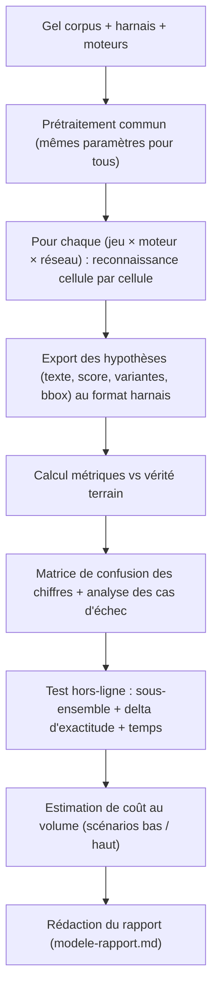
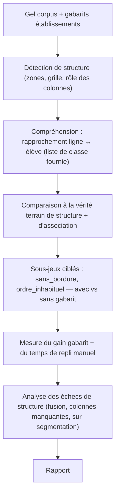

# M-ACQ.1 Protocole d'exécution — POC chaîne d'acquisition

> **Statut : Brouillon — Couche 7.** Date : 2026-09-09.
> Protocole **commun** aux POC 1 (OCR), 2 (extraction de tableaux) et POC-VH (écran de vérification
> humaine). À **geler** (version `v1.0`, signée) avant la première exécution ; toute modification
> ultérieure ouvre une version et est journalisée (§P.11).

## P.0 Principes

1. **Rien n'est mesuré avant que le protocole et les jeux de test soient gelés.** Le jeu annoté,
   les seuils, les formules ([`harnais-mesure.md`](harnais-mesure.md)) et les versions de moteurs
   sont figés et horodatés.
2. **Environnement isolé** dédié aux prototypes jetables (méthodologie §8). Aucune donnée
   identifiante n'en sort ; l'environnement est **détruit** en fin de POC, les jeux annotés
   pseudonymisés étant seuls conservés (Phase 9).
3. **Interface d'abstraction OCR** : tout moteur candidat est branché derrière le contrat
   `OcrProvider` ([pipeline §I.15](../../08-ocr-computer-vision/pipeline.md)). Aucun test n'appelle
   un SDK moteur en direct → comparabilité et réversibilité du choix.
4. **Aveugle sur la vérité terrain** : le harnais ne reçoit les annotations qu'au moment du calcul
   des scores, jamais en entrée des moteurs.
5. **Reproductibilité** : chaque exécution produit un journal (moteur, version, date, jeu, hash des
   entrées, paramètres) et est rejouable à l'identique.

## P.1 Environnement

| Élément | Spécification |
|---|---|
| Isolation | Réseau cloisonné ; comptes nominatifs ; pas de lien vers un futur environnement de prod ; chiffrement au repos du volume de travail |
| Postes | 1 poste de traitement (serveur / VM) pour l'exécution des moteurs ; 1 poste « terrain » (smartphone d'entrée/milieu de gamme) pour la capture et le test hors-ligne |
| Connectivité | Capacité à **couper le réseau** de façon contrôlée (test hors-ligne) et à le brider (débit faible simulé) |
| Moteurs managés | Clés d'API dédiées au POC, quota plafonné, région de traitement documentée (alimente ADR #1 et #3) |
| Moteurs open source | Conteneurs versionnés, exécutables hors-ligne, ressources (CPU/GPU/RAM) relevées |
| Sauvegarde | Jeux annotés + résultats sauvegardés hors de l'environnement de calcul ; images sources jamais dupliquées hors zone maîtrisée |
| Registre | Registre de traitement POC : finalité déclarée, base légale, durée, responsable, liste des accès |

## P.2 Données

Voir [`jeux-de-donnees.md`](jeux-de-donnees.md). Rappels bloquants :

- Fiches **réelles anonymisées / pseudonymisées**, fournies sous accord écrit d'un ou plusieurs
  établissements pilotes, avec **finalité déclarée** (« évaluation de faisabilité technique, sans
  usage pédagogique ni conservation au-delà du POC »).
- Corpus figé = `corpus-acq-v1` : ≥ 150 fiches réparties par strate, établissement, gabarit, qualité
  de photo, barème.
- Vérité terrain **double annotation** + résolution des désaccords ; accord inter-annotateur mesuré.

## P.3 Gel du protocole de mesure

Avant J-0 (première exécution), sont gelés et versionnés ensemble :

| Artefact | Version | Emplacement |
|---|---|---|
| Ce protocole | `v1.0` | ce fichier |
| Corpus annoté | `corpus-acq-v1` | environnement isolé + sauvegarde |
| Spéc. du harnais + formules + seuils | `v1.0` | [`harnais-mesure.md`](harnais-mesure.md) |
| Liste des moteurs candidats + versions | `v1.0` | §P.4 |
| Maquettes + scénarios POC-VH | `v1.0` | [`verification-humaine.md`](verification-humaine.md) |

## P.4 Moteurs candidats

**Contrainte** : au moins **2 familles** — un moteur **managé** et un moteur **open source
auto-hébergeable** — pour instruire la décision #3 sans la préempter. Candidats représentatifs
(liste indicative, à figer avec les versions au gel) :

| Famille | Candidats représentatifs | Imprimé | Manuscrit | Hors-ligne |
|---|---|---|---|---|
| Managé — Document Understanding | Google Document AI, Azure AI Document Intelligence, AWS Textract | oui | partiel/oui | non |
| Open source — OCR généraliste | PaddleOCR, docTR, Tesseract 5, Surya | oui | faible | oui |
| Open source — manuscrit | TrOCR (handwritten), moteurs HTR | faible | oui | oui |
| Spécialisé nombres | reconnaisseur de chiffres dédié (cellules de notes) | — | oui | oui |

> Le POC teste **des approches** (managé vs open source, généraliste vs spécialisé nombres, avec vs
> sans adaptation), pas un classement commercial. Chaque candidat est exposé via `OcrProvider`.

## P.5 Matrice de tests

Chaque cellule de la matrice = un run reproductible, journalisé.

| Dimension | Modalités |
|---|---|
| Jeu | `imprime_bon`, `imprime_degrade`, `manuscrit_lisible`, `manuscrit_difficile`, `mixte` |
| Moteur / combinaison | ≥ 2 managés-ou-open source + ≥ 1 combinaison (imprimé + nombres) |
| Gabarit (POC 2) | sans gabarit / avec gabarit établissement |
| Réseau (POC 1) | en ligne / hors-ligne / débit bridé |
| Prise de vue | photo à plat / de biais / éclairage inégal (déjà encodé dans les jeux) |

Runs minimaux : `5 jeux × 3 configurations moteur × 2 (réseau) = 30` pour POC 1 ;
`5 jeux × 2 (gabarit) × 2 configurations = 20` pour POC 2. Répéter 1 fois pour vérifier la stabilité.

## P.6 Déroulé — POC 1 (OCR)

Points de contrôle : (a) le prétraitement est **identique** pour tous les moteurs ; (b) aucune
correction manuelle n'est faite avant la mesure ; (c) les cas d'échec sont catégorisés (photo,
manuscrit, confusion de chiffres, cellule non lue, hors barème).

## P.7 Déroulé — POC 2 (Extraction de tableaux)

Points de contrôle : (a) les **faux rapprochements** élève (ligne attribuée au mauvais élève) sont
comptés **à part** — c'est le risque grave ; (b) le « temps de repli manuel » est chronométré sur
les fiches où la structure échoue, avec un opérateur non expert.

## P.8 Déroulé — POC-VH (Écran de vérification humaine)

Voir [`verification-humaine.md`](verification-humaine.md). Enchaînement :

1. Figer 5 fiches et leurs **sorties OCR réelles** issues de POC 1 (1 propre, 2 moyennes, 2
   difficiles) + la liste de classe correspondante.
2. Préparer le prototype basse fidélité (papier animé / écran statique) selon les maquettes §V.2.
3. Sessions individuelles : 6–8 enseignants + 2 responsables (contre-validation).
4. Mesurer : temps de revue par fiche, cellules erronées **non** détectées, tâches réussies sans
   aide, tentatives d'enregistrement sans validation explicite, SUS, NASA-TLX.
5. Débrief + synthèse des irritants → recommandations Couche 11 + J7.

## P.9 Planning indicatif

| Semaine | POC 1 | POC 2 | POC-VH |
|---|---|---|---|
| S1 | Collecte + prise de vue terrain | idem (partagé) | — |
| S2 | Annotation (double) + gel `corpus-acq-v1` | annotation structure + gabarits | — |
| S3 | Runs moteurs + hors-ligne | runs structure + gabarit | préparation prototype + recrutement |
| S4 | Métriques + confusion + coût | métriques + gain gabarit | sessions utilisateurs |
| S5 | Rapport POC 1 | Rapport POC 2 | Rapport POC-VH |
| S6 | **Synthèse commune → J7** | | |

Durées à ajuster selon disponibilité des établissements ; l'annotation est le chemin critique.

## P.10 Rôles

| Rôle | Responsabilité |
|---|---|
| Pilote POC | Gel du protocole, journal des écarts, synthèse J7 |
| Ingénieur traitement | Branchement `OcrProvider`, runs, harnais, reproductibilité |
| Annotateurs (×2) | Vérité terrain, indépendants ; un arbitre pour les désaccords |
| Facilitateur POC-VH | Sessions utilisateurs, Magicien d'Oz, dépouillement |
| Référent données / conformité | Accords établissements, registre de traitement, pseudonymisation, destruction |
| Observateurs métier | 1 conseiller pédagogique, 1 responsable d'établissement (revue des résultats) |

## P.11 Critères de sortie et passage à la synthèse J7

Un POC est **terminé** quand :

- tous les runs de la matrice §P.5 sont exécutés et journalisés ;
- le rapport ([`modele-rapport.md`](modele-rapport.md)) est complété, avec pour **chaque critère
  chiffré** de `plans-poc.md` un verdict *atteint / partiellement / non atteint* et les preuves ;
- une **recommandation** explicite est formulée (poursuivre / ajuster l'approche / renoncer à une
  brique) avec son impact sur les ADR #3, #8, #10.

Journal des écarts : tout écart au protocole gelé (jeu modifié, moteur remplacé, critère réinterprété)
est consigné avec date, motif, effet sur les résultats, et validé par le Pilote POC.

## P.12 Éthique et conformité (rappel)

- Consentement / information des établissements et, selon le cadre retenu (#2), des représentants
  légaux ; finalité limitée au POC.
- Pas de profilage d'élève, pas de restitution nominative, pas de décision.
- Suppression documentée des images sources en fin de POC ; conservation limitée au **strict
  nécessaire** pour la Phase 9 (jeux pseudonymisés).
