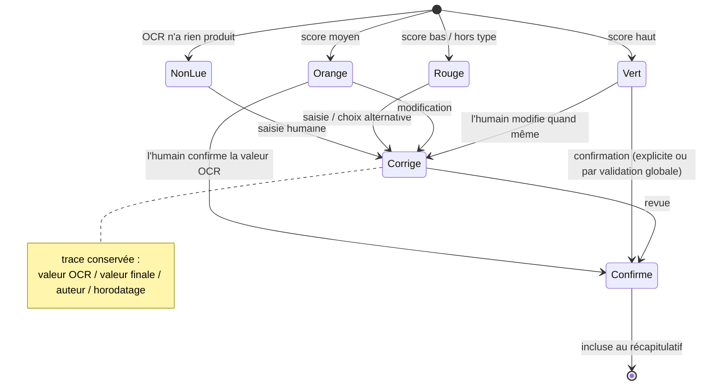
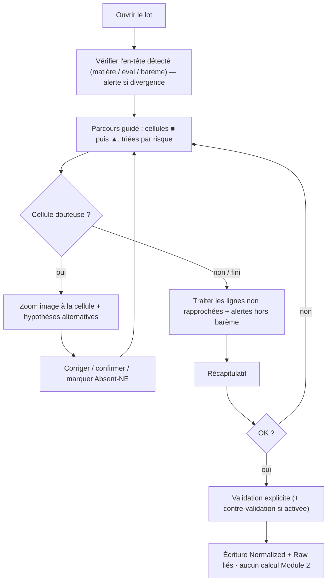

# M-ACQ.4 POC-VH — Écran de vérification humaine (formulaire prérempli avant enregistrement)

> **Statut : Brouillon — Couche 7.** Date : 2026-09-09.
> POC d'**ergonomie** de l'étape 9 du pipeline
> ([`../../08-ocr-computer-vision/pipeline.md` §I.10](../../08-ocr-computer-vision/pipeline.md)) :
> l'enseignant voit un **formulaire prérempli** à partir de l'OCR, avec image source, scores de
> confiance et cellules douteuses en avant, corrige, puis **valide explicitement** — aucune écriture
> en Normalized Data sans cette validation. Prototype **jetable** ; les maquettes ci-dessous sont
> basse fidélité et alimentent la Couche 11 (UX/UI), pas des specs définitives.

Exigences visées : `EF-M1-06`, `EF-M1-07`, `EF-M1-08`, `EF-M1-09`, `EF-M1-10`, `EF-M1-11`,
`EF-M1-12`, `EF-M1-16`, `EF-M1-18`, `EF-M1-20`. Risque adressé : `R9` (adoption enseignants).

## V.1 Hypothèses à valider

| # | Hypothèse | Critère (voir [`harnais-mesure.md` §H.6](harnais-mesure.md)) |
|---|---|---|
| H1 | Une fiche de ~40 élèves se vérifie et se valide en un temps acceptable pour l'enseignant | temps de revue ramené à 40 élèves ≤ 6 min (à confirmer par le POC) |
| H2 | Le **tri par risque** + le code couleur permettent de trouver les cellules à corriger sans balayer toute la grille | détection des cellules erronées ≥ 98 %, sans lecture exhaustive observée |
| H3 | Le **zoom à la cellule** sur l'image source suffit à trancher un cas douteux | ≥ 80 % des cas douteux tranchés sans recours à l'image entière ni au papier |
| H4 | Aucun chemin ne permet d'enregistrer sans **validation explicite** ; le récapitulatif est compris | 100 % des tentatives d'enregistrement sans validation échouent ; récap. cité correctement au débrief |
| H5 | La charge perçue reste raisonnable et l'outil est jugé utilisable | SUS ≥ 70 ; NASA-TLX ≤ 50 |
| H6 | La **contre-validation** responsable (`EF-M1-12`) et la **résolution de conflit** hors-ligne (`EF-M1-16`) sont comprises | tâches dédiées réussies sans aide par ≥ 80 % des participants concernés |

## V.2 Maquettes basse fidélité

> Convention : `●` vert (à vérifier vite) · `▲` orange (à contrôler) · `■` rouge (à corriger /
> saisir) · `✎` corrigé manuellement · `✓` confirmé par l'humain. Palette produit réelle : bleu
> clair / orange / blanc (Couche 11).

### V.2.1 File d'attente des lots

```
┌───────────────────────────────────────────────────────────────────────────────┐
│  BuildNote · Module 1 — Vérification            [FR ▾]   Amélie N. (enseignant)│
├───────────────────────────────────────────────────────────────────────────────┤
│  À vérifier (3)                                                                │
│                                                                               │
│  ┌─────────────────────────────────────────────────────────────────────────┐  │
│  │ 3e 2 · Mathématiques · Devoir n°2        42 lignes   ■ 4  ▲ 9  ● 29      │  │
│  │ capturé il y a 5 min · hors-ligne (en file)               [ Vérifier → ] │  │
│  └─────────────────────────────────────────────────────────────────────────┘  │
│  ┌─────────────────────────────────────────────────────────────────────────┐  │
│  │ 6e A · Français · Compo 1               38 lignes   ■ 0  ▲ 3  ● 35      │  │
│  │ capturé il y a 1 h                                        [ Vérifier → ] │  │
│  └─────────────────────────────────────────────────────────────────────────┘  │
│  ┌─────────────────────────────────────────────────────────────────────────┐  │
│  │ Tle D · Physique · TP noté       structure non reconnue                  │  │
│  │ capturé hier                                     [ Choisir un gabarit → ]│  │
│  └─────────────────────────────────────────────────────────────────────────┘  │
└───────────────────────────────────────────────────────────────────────────────┘
```

### V.2.2 Écran de vérification (cœur du POC)

```
┌───────────────────────────────────────────────────────────────────────────────┐
│ ← Lots    3e 2 · Mathématiques · Devoir n°2 · /20        ▲ divergence d'entête │
│                                             (fiche lue : « Devoir n°2 · T1 »)  │
├───────────────────────────────┬───────────────────────────────────────────────┤
│  IMAGE SOURCE                 │  FORMULAIRE PRÉREMPLI          à contrôler : 13 │
│  ┌─────────────────────────┐  │  ┌─────────────────────────────────────────┐   │
│  │                         │  │  │ #  Élève              Note   Coef  Appr. │   │
│  │   [aperçu fiche,        │  │  │ 1  NKOLO Aristide     ●12.5   ●2   ●…    │   │
│  │    zone active          │  │  │ 2  ABENA Clarisse     ✓Abs    ●2   —     │   │
│  │    encadrée]            │  │  │ 3  MBALLA-ONDOA J.P.  ■ __    ●2   ▲…    │ ← │
│  │                         │  │  │ 4  ETONG Marie        ▲8 (7?) ●2   ●…    │   │
│  │  [ + ]  [ – ]  [recadrer]│  │  │ 5  ⚠ ligne non rapprochée  ●14  ●1  —   │   │
│  └─────────────────────────┘  │  │ …                                       │   │
│  Cellule : ligne 3 · Note     │  │ 42 KAMGA Yao          ●11    ●2   ●…    │   │
│                               │  └─────────────────────────────────────────┘   │
├───────────────────────────────┴───────────────────────────────────────────────┤
│  CELLULE SÉLECTIONNÉE — ligne 3 · « Note /20 »                    ■ à saisir   │
│  ┌───────────────┐   Hypothèses OCR : (aucune fiable)                          │
│  │ [crop image   │   Barème : 0–20        Saisie : [ ____ ]  ⌨ pavé numérique  │
│  │  de la case]  │   [ Absent ]  [ Non évalué ]                                │
│  └───────────────┘   ↑/↓ cellule douteuse suivante · Entrée = confirmer        │
├───────────────────────────────────────────────────────────────────────────────┤
│  ● 29 à vérifier   ▲ 9 à contrôler   ■ 4 à corriger    Progrès ████████░░ 78 % │
│                                        [ Enregistrer ]  →  récapitulatif       │
└───────────────────────────────────────────────────────────────────────────────┘
```

Détails d'interaction testés :

- **Navigation clavier** : `Tab` = cellule suivante ; `↑/↓` (dans le panneau) = cellule **douteuse**
  suivante/précédente (saute les `●` déjà fiables) ; `Entrée` = confirmer/valider la cellule.
- **Clavier adapté au type** : pavé numérique pour `note`/`coefficient`, clavier texte pour
  `appreciation`, liste pour les mentions.
- **Hypothèses alternatives** : la 2ᵉ hypothèse OCR est proposée en un clic (`ETONG Marie` : `8`
  proposé, `7` en alternative).
- **Contrôle hors barème** (`EF-M1-09`, `EF-M1-20`) : bandeau immédiat si valeur > max.
- **Zoom à la cellule** (`EF-M1-06`) : sélectionner une cellule recentre et agrandit la zone
  d'image correspondante ; cible d'ouverture < 500 ms (contrainte KPI).
- **Ligne non rapprochée** (`EF-M1-05`) : sélecteur d'élève de la liste de classe ; impossible de
  créer un élève ici.

### V.2.3 Contrôle hors barème (overlay)

```
┌─────────────────────────────────────────────┐
│  ⚠  Valeur hors barème                       │
│  Ligne 12 · « Note /20 » : 25                │
│  Le barème de cette évaluation est 0–20.     │
│  [ Corriger ]   [ Garder (motiver) ]         │
└─────────────────────────────────────────────┘
```

### V.2.4 Récapitulatif avant validation (`EF-M1-11`)

```
┌───────────────────────────────────────────────────────────────────────────────┐
│  Récapitulatif — 3e 2 · Mathématiques · Devoir n°2 · /20                       │
├───────────────────────────────────────────────────────────────────────────────┤
│  42 élèves de la liste · 41 notes · 1 absent · 0 note manquante                │
│  Corrigé manuellement : 6 cellules      Confirmé tel quel : 36 cellules        │
│  Lignes rapprochées à un élève : 42 / 42                                       │
│  Alertes restantes : 0 hors barème · 0 doublon · 0 ligne non rapprochée        │
│                                                                               │
│  ⓘ À la validation : les notes vont en base (Normalized). L'image et           │
│    l'extraction (scores, positions) sont conservées liées (Raw). Aucun         │
│    tableau de bord n'est recalculé.                                            │
│                                                                               │
│         [ Revenir au formulaire ]        [ Valider et enregistrer ]           │
└───────────────────────────────────────────────────────────────────────────────┘
```

### V.2.5 Contre-validation responsable (`EF-M1-12`)

```
┌───────────────────────────────────────────────────────────────────────────────┐
│  En attente de contre-validation                                              │
│  Enseignant : Amélie N. — validé le 09/09 14:22                               │
│  Responsable : ____________________   [ Approuver ]   [ Renvoyer avec note ]   │
│  (l'enregistrement définitif n'a pas encore eu lieu)                          │
└───────────────────────────────────────────────────────────────────────────────┘
```

### V.2.6 Mode hors-ligne + conflit à la synchro (`EF-M1-15`, `EF-M1-16`)

```
┌───────────────────────────────────────────────┐   ┌───────────────────────────────────┐
│ ⚡ Hors-ligne — la validation sera mise en file│   │  Conflit à la synchronisation      │
│ Vous pouvez vérifier et valider normalement.   │   │  ABENA Clarisse · Devoir n°2       │
│ Envoi automatique à la reconnexion.            │   │  Déjà en base : 09   Cette fiche : Abs│
└───────────────────────────────────────────────┘   │  [ Garder 09 ] [ Remplacer par Abs ]│
                                                    │  [ Voir les deux ]  (aucun écrasement│
                                                    │   silencieux)                      │
                                                    └───────────────────────────────────┘
```

### V.2.7 Structure non reconnue (`EF-M1-18`)

```
┌───────────────────────────────────────────────────────────────────────────────┐
│  Structure non reconnue — l'image reste affichée                              │
│  [ Choisir un gabarit ▾ : Collège A – standard | Collège A – avec matricule ] │
│  ou  [ Saisir la grille manuellement ]                                        │
└───────────────────────────────────────────────────────────────────────────────┘
```

## V.3 Modèle d'état d'une cellule



## V.4 Parcours de revue testé



## V.5 Prototype de test (Magicien d'Oz)

- **Pas de moteur OCR live.** On fige, depuis POC 1, les sorties réelles de 5 fiches :
  `F-clean` (imprimé propre), `F-moy-1`, `F-moy-2` (mixtes), `F-diff-1`, `F-diff-2` (manuscrit
  difficile / photo de biais), avec leurs listes de classe.
- Le prototype (écran statique cliquable **ou** planches papier animées par le facilitateur) rejoue
  ces états : scores, couleurs, hypothèses alternatives, zones d'image.
- On **injecte des erreurs OCR connues** (nombre et position notés) pour mesurer la détection et le
  taux d'erreur résiduel.
- Le facilitateur joue les réponses système non maquettées (recalcul d'alerte, etc.).

## V.6 Protocole de test utilisateur

| Élément | Détail |
|---|---|
| Participants | 6–8 enseignants (profils variés : à l'aise / peu à l'aise avec le numérique) + 2 responsables pour la contre-validation |
| Durée | 45–60 min par session, individuelle |
| Cadre | Consentement, enregistrement écran/voix si accepté, pas de données réelles d'élèves |
| Méthode | Pense-à-voix ; le facilitateur n'aide qu'après blocage franc (noté) |
| Tâches | T1 vérifier `F-clean` et valider · T2 `F-moy-1` avec 3 erreurs injectées · T3 `F-diff-1` (plusieurs ■, 1 ligne non rapprochée, 1 hors barème) · T4 tenter d'enregistrer sans valider · T5 (responsables) contre-valider et renvoyer · T6 résoudre un conflit de synchro |
| Mesures | temps par fiche, cellules erronées non détectées, tâches réussies sans aide, échecs de blocage, verbalisations d'incompréhension |
| Questionnaires | SUS (10 items) + NASA-TLX (6 dimensions) après les tâches |
| Débrief | 10 min : irritants, points de confiance/méfiance, compréhension de « rien n'est enregistré sans validation » et « aucun tableau de bord recalculé » |

## V.7 Grille d'observation (par tâche)

| Champ | Valeurs |
|---|---|
| Tâche | T1..T6 |
| Fiche | F-clean / F-moy-1 / … |
| Temps (s) | chrono début→validation |
| Lignes de la fiche | n (pour ramener à 40) |
| Erreurs injectées | n |
| Erreurs corrigées | n |
| Erreurs manquées | n (dont combien classées « vert ») |
| Recours à l'image entière / au papier | oui/non + fréquence |
| Aide facilitateur | n interventions + motif |
| Blocage d'écriture sans validation | respecté / contourné |
| Verbalisations notables | citations |
| Fin d'état des cellules | tout `Confirme`/`Corrige` ? cellules laissées `Vert` non regardées ? |

## V.8 Critères de succès (rappel)

Voir [`harnais-mesure.md` §H.6](harnais-mesure.md). En synthèse : **temps** de revue soutenable
(H1), **détection ≥ 98 %** des cellules erronées (H2), **≥ 80 %** des cas douteux tranchés au zoom
cellule (H3), **100 %** de blocage sans validation explicite (H4), **SUS ≥ 70 / TLX ≤ 50** (H5),
tâches contre-validation et conflit réussies sans aide par ≥ 80 % (H6).

## V.9 Sorties

- Recommandations priorisées pour la **Couche 11 (UX/UI)** : ce qui marche, les irritants bloquants,
  les ajustements de tri/couleur/zoom/clavier.
- Élément pour **J7** : la vérification humaine est-elle **opérable au quotidien** par un enseignant
  (condition d'adoption, `R9`) ? verdict + conditions.
- Retour vers POC 1 : le **taux de correction par fiche** observé complète l'estimation de charge
  de revue.
