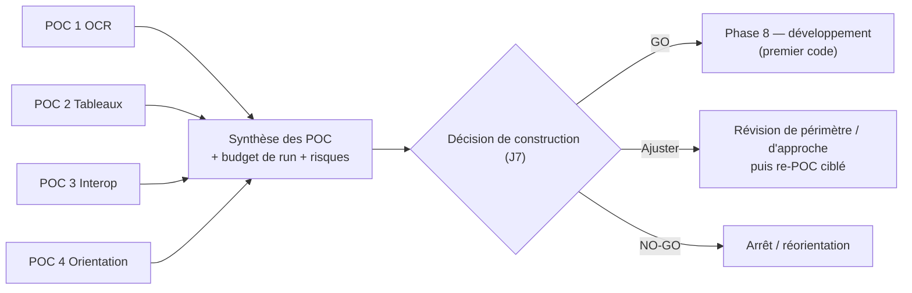

# M. Plans de Proof of Concept — BuildNote

> **Statut : En revue — Couche 7.** Date : 2026-09-08.
> Les POC sont exécutés en **Phase 6**, avant la décision de construction (**Phase 7 / J7**). Ce
> sont des prototypes **jetables** — leur code ne devient pas le produit. Chaque POC est un
> livrable = un rapport avec **résultats chiffrés vs critères de succès** et une **recommandation**
> (poursuivre / ajuster l'approche / renoncer à une brique).

## M.0 Cadre commun

| Élément | Règle |
|---|---|
| Données | **Données réelles anonymisées / pseudonymisées** fournies par le(s) établissement(s) pilote(s), sous accord et finalité déclarée. Aucune donnée identifiante hors environnement maîtrisé. |
| Environnement | Environnement POC **isolé** (voir [`../01-project-management/methodologie.md`](../01-project-management/methodologie.md) §8). |
| Mesure | Protocole de mesure défini **avant** l'exécution ; jeux de test figés ; mesures reproductibles (QA). |
| Décision | Chaque POC conclut : critères **atteints / partiellement / non atteints** + recommandation motivée. |
| Sortie | Alimente J7 et le choix des briques technologiques à risque (ADR). |

## M.1 POC 1 — OCR (reconnaissance)

| Rubrique | Contenu |
|---|---|
| **Objectif** | Mesurer la qualité de reconnaissance des **valeurs** (notes, noms, mentions) sur des fiches réelles, imprimées et manuscrites, photographiées en conditions de terrain. |
| **Hypothèses à valider** | H1 : sur fiches **imprimées**, l'exactitude cellule ≥ 90 % est atteignable. H2 : sur **manuscrit lisible**, ≥ 70 %. H3 : un fonctionnement **hors-ligne** au moins dégradé est possible. H4 : le coût au volume (si moteur managé) est soutenable. |
| **Protocole** | Constituer un jeu annoté de N fiches (cible ≥ 150) couvrant : imprimé / manuscrit, bonne / mauvaise photo, plusieurs établissements et gabarits, plusieurs barèmes. Passer chaque candidat moteur (≥ 2 : un managé, un open source) via l'**interface d'abstraction OCR**. Comparer aux annotations. |
| **Jeux de données** | `imprime_bon`, `imprime_degrade`, `manuscrit_lisible`, `manuscrit_difficile`, `mixte`. |
| **Critères de succès (chiffrés)** | Exactitude cellule imprimé ≥ 90 % ; manuscrit lisible ≥ 70 % ; CER en-têtes ≤ 5 % ; temps de traitement ≤ 20 s (serveur) ; faisabilité hors-ligne démontrée (même dégradée) ; coût projeté au volume documenté. |
| **Mesures** | Exactitude cellule, CER/WER, matrice de confusion des chiffres, temps, coût estimé, comportement hors-ligne. |
| **Risques couverts** | R1, R6. |
| **Recommandation attendue** | Choix d'orientation moteur(s) (managé / open source / mixte) pour la Phase 7 ; besoins d'entraînement/adaptation ; exigences de prise de vue. |

## M.2 POC 2 — Extraction de tableaux (structure & compréhension)

| Rubrique | Contenu |
|---|---|
| **Objectif** | Valider la **détection de structure** (lignes/colonnes/cellules, en-têtes, cellules fusionnées) et la **compréhension** (association ligne ↔ élève de la classe, colonne ↔ sémantique). |
| **Hypothèses à valider** | H1 : la structure est correctement reconstruite sur ≥ 85 % des fiches d'un jeu représentatif. H2 : le rapprochement élève automatique est correct ≥ 90 %. H3 : les **gabarits** améliorent significativement les cas difficiles. |
| **Protocole** | Jeu de fiches (≥ 150) avec vérité terrain sur la grille et l'association élève. Tester : sans gabarit / avec gabarit ; fiches à bordures / sans bordures ; ordres de colonnes variés. Mesurer aussi le repli manuel (temps quand la structure échoue). |
| **Critères de succès (chiffrés)** | Reconstruction de structure correcte ≥ 85 % ; rapprochement élève ≥ 90 % ; détection correcte du rôle des colonnes ≥ 90 % ; gain mesurable des gabarits sur `sans_bordure` et `ordre_inhabituel`. |
| **Mesures** | Taux de grille correcte, taux de rapprochement, taux de rôle de colonne correct, temps de repli manuel. |
| **Risques couverts** | R1. |
| **Recommandation attendue** | Approche de détection retenue ; rôle et format des gabarits ; ergonomie du repli. |

## M.3 POC 3 — Interopérabilité

| Rubrique | Contenu |
|---|---|
| **Objectif** | Prouver la chaîne `source externe → connecteur → mapping → normalisation → validation → modèle canonique`, la **gestion des conflits**, le **lineage** et la **réversibilité**, sur des systèmes réels. |
| **Hypothèses à valider** | H1 : un établissement type est intégrable **sans développement lourd** (connecteur générique + mapping déclaratif). H2 : le taux de quarantaine se stabilise sous un seuil acceptable après ajustement du mapping. H3 : l'export canonique complet est **réimportable** dans une instance vierge sans perte. H4 : le lineage permet de retrouver l'origine de toute donnée. |
| **Protocole** | Sélectionner **2–3 sources réelles** : (a) un SGBD (ex. MySQL/PostgreSQL d'une application de notes), (b) un export **CSV/Excel**, (c) si possible une **ancienne application** (via dump). Construire les mappings avec l'assistant. Importer l'historique (≥ 2–3 ans). Introduire volontairement des doublons et des incohérences pour tester conflits et quarantaine. Exporter puis réimporter dans une instance vierge. |
| **Critères de succès (chiffrés)** | Intégration d'un établissement type en ≤ E jours-homme (E à définir, cible basse) ; taux de quarantaine ≤ 5 % après stabilisation ; 100 % des données canoniques avec lineage ; export → réimport reconstituant les mêmes entités (écart = 0) ; règle « note validée jamais écrasée » vérifiée. |
| **Mesures** | Effort d'intégration, taux de quarantaine (avant/après ajustement), taux de conflit, complétude, réussite de la réversibilité, couverture par connecteurs génériques. |
| **Risques couverts** | R3, R12. |
| **Recommandation attendue** | Priorisation du catalogue de connecteurs ; format définitif du mapping ; politique de conflit par défaut ; besoins d'outillage de l'assistant. |

## M.4 POC 4 — Moteur d'orientation

| Rubrique | Contenu |
|---|---|
| **Objectif** | Valider la faisabilité et la **valeur perçue** d'un scoring **additif pondéré à 6 catégories** (profil, aspirations, avis parents, offre/faisabilité, débouchés, besoins nationaux) **avec explications**, sur des cas d'élèves réels anonymisés. |
| **Hypothèses à valider** | H1 : le moteur produit des scénarios jugés **pertinents** par des conseillers d'orientation. H2 : les **explications** (facteurs, poids, alternatives, incertitudes, répartition) sont **complètes et compréhensibles**. H3 : les résultats sont **stables** (petites variations d'entrée → variations proportionnées). H4 : une **version de référentiel national** peut être intégrée et son influence est **transparente**. H5 : aucune option n'est rendue « impossible » par le seul référentiel national. |
| **Protocole** | Jeu de ≥ 30 profils d'élèves réels anonymisés, avec (quand disponible) intérêts, aspirations, avis parents. Construire un référentiel offre/métiers/national minimal mais réel pour un territoire (ex. autour d'un établissement pilote). Générer les dossiers. **Évaluation par un panel de conseillers** (grille : pertinence, complétude de l'explication, clarté, utilité pour l'entretien). Tests de robustesse (perturbations d'entrée). Test d'équité préliminaire (profils comparables). |
| **Critères de succès (chiffrés)** | Pertinence jugée « bonne » ou « très bonne » sur ≥ 70 % des cas par le panel ; explications complètes (5 blocs présents) sur 100 % des scénarios ; clarté jugée suffisante sur ≥ 80 % ; stabilité (pas d'inversion de classement pour une perturbation < seuil) ; influence du référentiel national **isolable** dans la répartition du score ; 0 cas d'option « impossible » du fait du référentiel. |
| **Mesures** | Scores de la grille d'évaluation, complétude des explications, indicateurs de stabilité, écarts d'équité, temps de génération. |
| **Risques couverts** | R7, R8. |
| **Recommandation attendue** | Barème de scoring et pondérations par défaut ; format du dossier et des explications ; exigences de gouvernance du référentiel ; besoins de supervision humaine. |

## M.5 Synthèse et décision (J7)

Livrables de la Phase 6 : 4 rapports de POC, jeux de données de test constitués (conservés pour la
Phase 9), prototypes jetables documentés, note de synthèse et recommandation pour J7.
