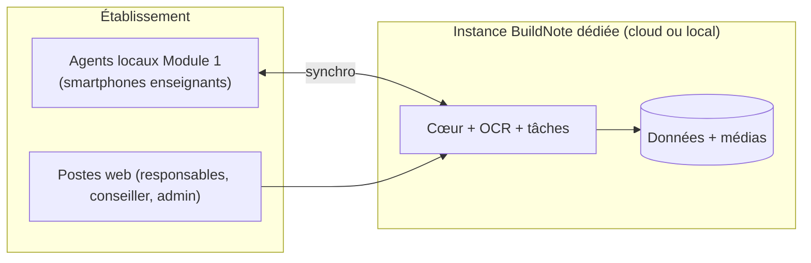
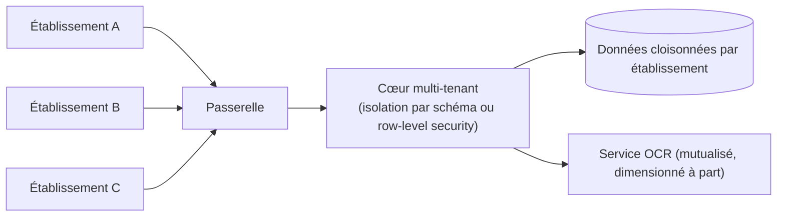
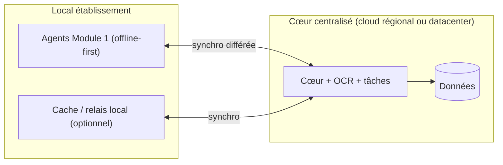
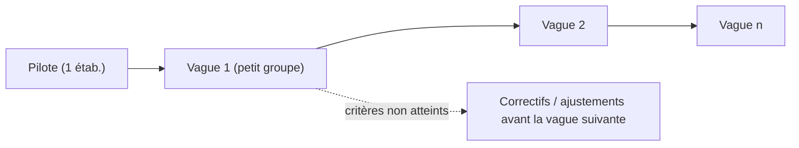

# P. Plan de déploiement — BuildNote

> **Statut : En revue — Couche 7.** Date : 2026-09-08.
> Cadré avant la Phase 8 ; exécuté à partir de la Phase 10 (pilote) puis 11 (généralisation).
> Dépend des décisions #1 (hébergement/souveraineté) et #8 (connectivité).

## P.1 Principes

1. **Pilote d'abord** : mise en service réelle dans **un établissement** avant toute généralisation
   (tient lieu de palier de dérisquage — cf. risque R2 / décision #7).
2. **Généralisation par vagues** : chaque vague atteint ses critères de stabilité avant la suivante.
3. **Artefacts immuables** : le même artefact est promu de la pré-production à la production (pas de
   recompilation).
4. **Déploiements réversibles** : tout déploiement a une procédure de retour arrière documentée.
5. **Agent local du Module 1** : déployable indépendamment, fonctionne hors-ligne, se synchronise
   quand il peut.
6. **Souveraineté** : la topologie retenue respecte la décision #1.

## P.2 Composants à déployer

| Composant | Notes de déploiement |
|---|---|
| Cœur BuildNote (socle + Module 1 services + Module 2 services + interopérabilité) | Selon scénario d'architecture C : cœur + workers/services isolés |
| Service OCR/CV | Dimensionné séparément ; managé, auto-hébergé, ou mixte (décision #3) |
| Exécuteurs de tâches (ETL d'import, calculs dashboard/orientation) | Mise à l'échelle indépendante |
| Bases de données (Normalized, Intelligence) + stockage média (Raw) | Chiffrement au repos ; sauvegardes cohérentes |
| Coffre à secrets | Selon décision #1 |
| Observabilité (logs, métriques, alertes) | En place dès le lot L0 |
| Agent local Module 1 (app mobile / PWA) | Distribution + mises à jour ; jeton d'appareil |
| Accès web (autres rôles) | Application web |

## P.3 Les six scénarios de déploiement

### P.3.1 Établissement unique

| | |
|---|---|
| **Cible** | Un établissement autonome, un seul tenant |
| **Prérequis** | Hébergement (cloud régional ou serveur local) ; comptes ; reprise des données (P.5) |
| **Avantages** | Simplicité, isolation naturelle, coûts prévisibles |
| **Points d'attention** | Sauvegardes et mises à jour à ne pas négliger ; compétences locales si on-premise |
| **Sauvegardes** | Quotidiennes + test mensuel ; copie hors-site |
| **MàJ** | Fenêtre planifiée, retour arrière préparé |

### P.3.2 Plusieurs établissements (plateforme multi-tenant)

| | |
|---|---|
| **Cible** | N établissements sur une plateforme partagée |
| **Prérequis** | Modèle multi-tenant tranché (#4) ; onboarding industrialisé ; tests d'isolation verts |
| **Avantages** | Exploitation mutualisée, coût marginal maîtrisé, mises à jour centralisées |
| **Points d'attention** | Isolation (tests à chaque release), montée en charge, gestion des fenêtres de maintenance communes |
| **Sauvegardes** | Restaurables **par établissement** sans exposer les autres |

### P.3.3 Cloud

| | |
|---|---|
| **Cible** | Hébergement chez un fournisseur (régional de préférence, cf. #1) |
| **Avantages** | Élasticité, services managés (stockage, sauvegarde, observabilité), pas de matériel à gérer |
| **Points d'attention** | **Souveraineté** et localisation des données ; coût de run au volume (OCR managé notamment) ; dépendance fournisseur → stratégie de sortie (artefacts portables, données exportables) ; nécessite une connectivité correcte au niveau plateforme |
| **Adapté à** | Multi-établissements, forte volumétrie, équipe d'exploitation réduite |

### P.3.4 Infrastructure locale (on-premise)

| | |
|---|---|
| **Cible** | Serveur(s) dans l'établissement ou un centre régional |
| **Avantages** | Souveraineté maximale, indépendance vis-à-vis de la connectivité externe, données au plus près |
| **Points d'attention** | Maintenance, sécurité physique, sauvegardes hors-site, compétences locales, montée de version plus lourde ; OCR : privilégier une option **auto-hébergée** (décision #3) |
| **Adapté à** | Établissement unique ou petit groupe avec exigence de souveraineté forte ou connectivité très faible |

### P.3.5 Environnement hybride

| | |
|---|---|
| **Cible** | Traitement et validation possibles **localement/hors-ligne** (Module 1), cœur et exploitation **centralisés** |
| **Avantages** | Concilie faible connectivité et exploitation mutualisée ; la saisie ne dépend pas du réseau |
| **Points d'attention** | Synchronisation et cohérence (idempotence, résolution de conflits) ; sécurité de l'agent local (chiffrement, jeton révocable) ; complexité de conception |
| **Recommandation** | Scénario **de référence** pour le contexte camerounais (cf. décision #1, recommandation provisoire « hybride ») |

### P.3.6 Faible connectivité (mode dégradé transverse)

Ce n'est pas une topologie séparée mais un **mode** applicable aux scénarios ci-dessus :

| Exigence | Mise en œuvre |
|---|---|
| Module 1 utilisable sans réseau plusieurs jours | File locale durable, aucune perte, synchro à la reprise (`ENF-CTX-03`) |
| Empreinte réseau minimale | Compression des images, synchro incrémentale, réglage qualité photo, indicateur de consommation |
| Reprise de synchronisation | Partielle, idempotente, résolution de conflit guidée |
| Module 2 | Consultation en cache des dossiers déjà générés ; génération et dashboard nécessitent la connexion (message explicite) |
| Tests | Campagne de performance en réseau dégradé (Phase 9, `O.3.7`) |

## P.4 Matrice de choix (aide à la décision, Phase 7)

| Critère \ Scénario | Étab. unique | Multi-étab. | Cloud | On-premise | Hybride |
|---|---|---|---|---|---|
| Souveraineté des données | ●●○ | ●●○ | ●○○ à ●●○ | ●●● | ●●○ |
| Aptitude faible connectivité | ●●○ | ●○○ | ●○○ | ●●● | ●●● |
| Simplicité d'exploitation | ●●● | ●●○ | ●●● | ●○○ | ●●○ |
| Coût de run à l'échelle | ●●○ | ●●● | ●●○ | ●○○ | ●●○ |
| Rapidité de mise en service | ●●● | ●●○ | ●●● | ●○○ | ●●○ |
| Montée en charge | ●○○ | ●●● | ●●● | ●○○ | ●●○ |

## P.5 Reprise des données (onboarding d'un établissement)

```mermaid
flowchart LR
    A["Cadrage : périmètre, années à reprendre"] --> B["Choix du/des connecteur(s)\n(P.2 interopérabilité)"]
    B --> C["Construction du mapping (assistant)"]
    C --> D["Import de test (échantillon)"]
    D --> E["Traitement quarantaine + conflits"]
    E --> F["Import complet par lots (reprise sur erreur)"]
    F --> G["Contrôle qualité (tableau de bord)"]
    G --> H["Bascule : BuildNote devient l'outil de référence"]
    H --> I["Synchro incrémentale planifiée (si SI conservé)"]
```

Sans SI existant : pas de reprise, l'établissement démarre en **saisie primaire** (Module 1).

## P.6 Procédure de mise en production (par release)

1. Validation en pré-production (tests système, performance, sécurité, recette).
2. Sauvegarde préalable (base + médias, point de reprise cohérent).
3. Application des migrations de schéma (réversibles ou sauvegardées).
4. Déploiement de l'artefact immuable (cœur, services, agent local).
5. Vérifications post-déploiement (santé, métriques clés, tests de fumée, test d'isolation).
6. Fenêtre d'observation renforcée.
7. En cas d'anomalie bloquante : **retour arrière** (artefact précédent + migration inverse ou
   restauration).

## P.7 Déploiement pilote (Phase 10)

| Élément | Contenu |
|---|---|
| Périmètre | 1 établissement, périmètre fonctionnel V1 (2 modules + interopérabilité) |
| Préparation | Environnement (scénario retenu), reprise des données (P.5), création des comptes, gabarits de fiches |
| Accompagnement | Formation FR/EN (enseignants, responsables, conseiller, admin SI), support rapproché, référents internes |
| Mesure | KPI produit (temps de saisie, taux d'erreur résiduel, compréhension des orientations), incidents, retours |
| Durée | 6–12 semaines (indicatif) |
| Sortie (J10) | Rapport d'évaluation ; décision : généraliser / prolonger / corriger |

## P.8 Généralisation par vagues (Phase 11)

| Élément | Contenu |
|---|---|
| Critères d'entrée d'une vague | Stabilité de la vague précédente ; onboarding outillé ; support dimensionné |
| Industrialisation | Assistant d'onboarding, catalogue de connecteurs étendu, gabarits partagés, formation standardisée |
| Exploitation | Supervision, sauvegardes, fenêtres de maintenance, gestion des versions |
| Support | N1 (établissement / éditeur), N2 (éditeur), N3 (équipe technique) ; SLA définis |
| Continuité | PCA/PRA testés ; plan d'incident majeur |
| Gouvernance du référentiel national | Rôle et processus actifs (décision #5) |
| Préparation multi-pays | Vérifier qu'aucun paramètre pays n'est câblé (référentiels, notation, cycles, langues) |

## P.9 Livrables (Phases 7, 10, 11)

Architecture de déploiement par scénario · runbooks (installation, sauvegarde/restauration, mise à
jour, retour arrière, incident) · plan de bascule et de reprise des données · plan de formation et
d'accompagnement (FR/EN) · plan de support et SLA · PCA/PRA · plan de déploiement par vagues ·
estimation des coûts de run par scénario.
