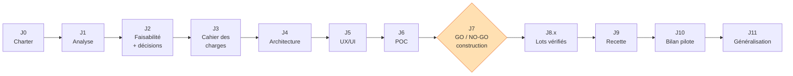

# Q. Livrables par phase — BuildNote

> **Statut : En revue — Couche 1.** Date : 2026-09-08.
> Pour **chaque phase** : objectif · activités · livrables · critères de validation · responsables ·
> dépendances · décision de passage à la phase suivante.
> Les **responsables** sont désignés par rôle (l'affectation nominative est faite en Phase 0).
> Ce document est **consolidé et affiné en Couche 7**.

---

## Phase 0 — Cadrage

| Rubrique | Contenu |
|---|---|
| **Objectif** | Décider si le projet démarre : pourquoi, pour qui, dans quel périmètre, avec quelle gouvernance et quel budget macro. |
| **Activités** | Formaliser la vision ; cartographier les parties prenantes ; définir périmètre in/out ; estimer le budget macro ; définir la gouvernance et la méthodologie ; ouvrir le registre des risques ; ouvrir le journal de décisions. |
| **Livrables** | Project Charter ; note de vision ([`00-vision/`](../00-vision/vision-produit.md)) ; cartographie des parties prenantes + plan d'engagement ; plan de gouvernance + RACI ; plan méthodologique ; budget macro ; plan de management des risques v0 ; plan de gestion documentaire. |
| **Critères de validation** | Charter signé par le porteur ; périmètre V1 explicite ; budget macro accepté ; gouvernance nommée ; risques majeurs identifiés. |
| **Responsables** | Directeur de projet (pilote) ; Product Manager ; porteur/sponsor (validation). |
| **Dépendances** | Aucune (phase initiale). |
| **Décision de passage (J0)** | Le comité de pilotage valide le Charter et engage le budget de la Phase 1. Sinon : abandon ou re-cadrage. |

---

## Phase 1 — Analyse & besoins

| Rubrique | Contenu |
|---|---|
| **Objectif** | Comprendre en profondeur le métier, les utilisateurs, les processus actuels et cibles ; produire un besoin partagé et non ambigu. |
| **Activités** | Entretiens (enseignants, responsables, conseillers, admins, familles) ; observation terrain ; modélisation des processus AS-IS et TO-BE ; rédaction des personas et parcours ; catalogue des cas d'usage ; première hiérarchisation des besoins (MoSCoW). |
| **Livrables** | Dossier d'analyse métier ([`02-analyse-metier/`](../02-analyse-metier/)) : problématique, besoins, processus AS-IS / TO-BE, personas, parcours utilisateurs, catalogue des cas d'usage, glossaire enrichi. |
| **Critères de validation** | Chaque besoin est rattaché à un persona et à un cas d'usage ; processus TO-BE validés par des utilisateurs représentatifs ; séparation des deux modules confirmée dans les processus. |
| **Responsables** | Business Analyst (pilote) ; Product Manager ; UX Designer ; experts systèmes éducatifs et orientation. |
| **Dépendances** | J0. Accès aux établissements pilotes pressentis. |
| **Décision de passage (J1)** | Le comité produit valide le dossier d'analyse. Sinon : compléments d'analyse. |

---

## Phase 2 — Faisabilité & arbitrages

| Rubrique | Contenu |
|---|---|
| **Objectif** | Vérifier que le projet est faisable (technique, juridique, organisationnel, financier) et **trancher les décisions structurantes**. |
| **Activités** | Étude de faisabilité technique (OCR, interopérabilité, offline, multi-tenant) ; analyse juridique (données de mineurs, loi N° 2010/012, consentement, souveraineté) ; **DPIA préliminaire** ; étude organisationnelle (adoption, support) ; étude financière (coûts de build et de run) ; instruction et arbitrage des [décisions préalables](../17-decisions/decisions-prealables.md). |
| **Livrables** | Étude de faisabilité ; DPIA préliminaire ; registre des décisions arbitrées (ADR) ; budget affiné ; plan de conformité. |
| **Critères de validation** | Aucune décision préalable bloquante non tranchée ; faisabilité juridique confirmée (base légale, hébergement) ; coûts de run soutenables ; risques R1–R12 avec plan de mitigation. |
| **Responsables** | Software Architect + Data Architect + expert interopérabilité + expert OCR/CV (faisabilité technique) ; Cybersecurity Architect + juriste (faisabilité juridique) ; Directeur de projet (arbitrages) ; sponsor (validation). |
| **Dépendances** | J1. |
| **Décision de passage (J2)** | Le comité de pilotage valide la faisabilité et les décisions. Sinon : re-cadrage du périmètre ou arrêt. |

---

## Phase 3 — Spécification (cahier des charges)

| Rubrique | Contenu |
|---|---|
| **Objectif** | Figer **ce que** le système doit faire et **à quel niveau de qualité**, de façon vérifiable. |
| **Activités** | Rédaction des exigences fonctionnelles (par module) et non fonctionnelles (performance, sécurité, disponibilité, portabilité, accessibilité, i18n, faible connectivité) ; définition des contraintes ; rédaction des critères d'acceptation ; définition des KPI et de leur mesure ; construction de la matrice de traçabilité besoins → exigences → tests. |
| **Livrables** | Cahier des charges ([`03-cahier-des-charges/`](../03-cahier-des-charges/)) : exigences F & NF, contraintes, critères d'acceptation, dictionnaire des KPI, matrice de traçabilité. |
| **Critères de validation** | Chaque exigence est atomique, testable, tracée ; les règles non négociables (validation humaine OCR, non-recalcul auto du Module 2, explicabilité, isolation des établissements, FR/EN) sont couvertes par des exigences explicites ; KPI mesurables. |
| **Responsables** | Business Analyst + Product Manager (pilotes) ; Software Architect (revue) ; QA Engineer (testabilité). |
| **Dépendances** | J2. |
| **Décision de passage (J3)** | Le comité produit + revue d'architecture valident le cahier des charges (baseline gelée, changements via processus de gestion des changements). |

---

## Phase 4 — Conception & architecture

| Rubrique | Contenu |
|---|---|
| **Objectif** | Concevoir **comment** le système sera construit, en comparant des options et en justifiant les choix. |
| **Activités** | Architecture fonctionnelle détaillée (2 modules + socle + contrats) ; **≥ 3 scénarios d'architecture technique comparés** (avantages / inconvénients / coûts / complexité / scalabilité) + recommandation ; architecture des données (MCD, MLD, MPD, dictionnaire, versioning schéma) ; architecture d'interopérabilité détaillée (canonique, connecteurs, mapping, conflits, lineage, qualité) ; architecture de sécurité (modèle de menaces, IAM, chiffrement, isolation multi-tenant, audit, sauvegardes) ; choix technologiques justifiés (différés jusqu'ici). |
| **Livrables** | Dossiers : [`04-architecture-fonctionnelle/`](../04-architecture-fonctionnelle/), [`05-architecture-technique/`](../05-architecture-technique/), [`06-architecture-donnees/`](../06-architecture-donnees/), [`07-interoperabilite/`](../07-interoperabilite/), [`10-securite/`](../10-securite/) ; ADR pour chaque choix majeur. |
| **Critères de validation** | Chaque exigence NF a une réponse architecturale ; les scénarios techniques sont comparés sur les 5 axes ; le choix est justifié et tracé en ADR ; la sécurité couvre l'isolation des établissements ; l'interopérabilité ne repose pas sur une « compat SQL universelle ». |
| **Responsables** | Software Architect (pilote) ; Data Architect ; expert interopérabilité ; Cybersecurity Architect ; AI/ML Engineer + expert OCR (volets IA/OCR). |
| **Dépendances** | J3 ; décisions de la Phase 2. |
| **Décision de passage (J4)** | La revue d'architecture valide les dossiers et les ADR. |

---

## Phase 5 — UX/UI

| Rubrique | Contenu |
|---|---|
| **Objectif** | Concevoir une expérience cohérente, sobre, bilingue, adaptée au terrain. |
| **Activités** | Architecture de l'information ; définition du **design system** (palette **bleu clair / orange / blanc**, typographie, composants) ; wireframes des parcours clés (capture + validation Module 1 ; dashboard + dossier d'orientation Module 2 ; import interopérabilité ; écran d'accueil avec **sélecteur de langue FR/EN**) ; prototypes ; tests d'utilisabilité ; spécification i18n ; spécification du **mode faible connectivité / hors-ligne**. |
| **Livrables** | [`11-ux-ui/`](../11-ux-ui/) : architecture UX, design system, bibliothèque de composants, wireframes, prototypes cliquables, rapport de tests d'utilisabilité, spécification i18n et offline. |
| **Critères de validation** | Parcours critiques testés avec des utilisateurs représentatifs ; palette et accessibilité respectées ; sélecteur de langue présent dès l'accueil ; parcours de validation OCR jugé rapide ; explications d'orientation jugées compréhensibles. |
| **Responsables** | UX/UI Designer (pilote) ; Product Manager ; Business Analyst ; utilisateurs pilotes. |
| **Dépendances** | J3 (exigences) ; peut démarrer en parallèle de J4. |
| **Décision de passage (J5)** | Le comité produit valide le design system et les prototypes. |

---

## Phase 6 — POC

| Rubrique | Contenu |
|---|---|
| **Objectif** | Réduire l'incertitude sur les points techniquement risqués **avant** de décider de construire. |
| **Activités** | Exécuter les 4 POC : (1) OCR, (2) extraction de tableaux, (3) interopérabilité, (4) moteur d'orientation — chacun avec objectif, protocole, jeux de données représentatifs, **critères de succès chiffrés**, mesure, analyse. |
| **Livrables** | [`12-poc/`](../12-poc/) : 4 rapports de POC (méthode, données, résultats vs critères, limites, recommandation), jeux de données de test constitués, prototypes jetables documentés. |
| **Critères de validation** | Chaque POC conclut clairement : critères atteints / partiellement / non atteints ; recommandation explicite (poursuivre / ajuster l'approche / renoncer à une brique). |
| **Responsables** | Expert OCR/CV + AI/ML Engineer (POC 1 & 2) ; expert interopérabilité + Data Architect (POC 3) ; AI/ML Engineer + experts orientation (POC 4) ; QA Engineer (protocoles de mesure). |
| **Dépendances** | J4 (architecture cible) ; J5 (parcours pour cadrer les POC) ; données réelles anonymisées des établissements pilotes. |
| **Décision de passage (J6)** | Les rapports de POC sont validés et transmis à la Phase 7. |

---

## Phase 7 — Décision de construction (GO / NO-GO)

| Rubrique | Contenu |
|---|---|
| **Objectif** | Décider formellement de construire, d'itérer, ou d'arrêter. |
| **Activités** | Synthèse des POC ; revue des risques et du budget de run ; choix définitif des briques technologiques à risque (ex. moteur OCR) ; plan de réalisation détaillé (lots L0–L5) ; plan de test ; plan de déploiement ; plan de conformité finalisé. |
| **Livrables** | Dossier de décision de construction ; plan de développement détaillé ; [`13-tests/`](../13-tests/) (plan de test) ; [`14-deploiement/`](../14-deploiement/) (plan de déploiement) ; ADR des choix technologiques. |
| **Critères de validation** | POC concluants (ou périmètre ajusté en conséquence) ; budget de build et de run confirmé ; risques résiduels acceptés par le sponsor ; équipe de réalisation constituée. |
| **Responsables** | Directeur de projet + Software Architect (dossier) ; sponsor / comité de pilotage (décision). |
| **Dépendances** | J6. |
| **Décision de passage (J7)** | **GO** → Phase 8. **NO-GO** → arrêt. **Itérer** → retour Phase 2/4/6 sur le périmètre concerné. **C'est la porte qui autorise le premier code.** |

---

## Phase 8 — Développement itératif

| Rubrique | Contenu |
|---|---|
| **Objectif** | Construire la solution de production (pas de MVP jetable), lot par lot, chaque incrément étant vérifié. |
| **Activités** | Mise en place de l'usine logicielle (CI/CD, environnements, observabilité) ; développement des lots L0 → L5 ; revues de code ; tests automatisés au fil de l'eau ; documentation technique ; démonstrations régulières aux parties prenantes. |
| **Livrables** | Incréments logiciels vérifiés (socle, Module 1, interopérabilité, Module 2, durcissement) ; documentation technique et d'exploitation ; suites de tests ; notes de version. |
| **Critères de validation** | Chaque lot satisfait sa *definition of done* (exigences couvertes, tests verts, revue faite, doc à jour) ; les règles non négociables sont vérifiées automatiquement quand c'est possible. |
| **Responsables** | Software Architect (garant technique) ; équipe de développement ; DevOps Engineer ; QA Engineer ; Product Manager (priorisation). |
| **Dépendances** | J7. |
| **Décision de passage (J8.x)** | Chaque lot fait l'objet d'une revue de fin de lot ; le passage à la recette globale suppose L0–L5 livrés. |

---

## Phase 9 — Vérification & recette

| Rubrique | Contenu |
|---|---|
| **Objectif** | Prouver que le système satisfait le cahier des charges, de façon reproductible. |
| **Activités** | Tests **unitaires**, **d'intégration**, **système**, **OCR** (jeux annotés, métriques CER/WER, exactitude cellule), **données** (qualité, migration, non-régression du canonique), **sécurité** (tests d'intrusion, revue, isolation multi-tenant), **performance** (charge, réseau dégradé), **utilisateurs** (recette métier), **interopérabilité** (connecteurs, mappings, conflits, réversibilité) ; correction des anomalies ; recette formelle. |
| **Livrables** | [`13-tests/`](../13-tests/) : stratégie et plans de test, jeux de données de test, rapports d'exécution par type, registre d'anomalies, **PV de recette**. |
| **Critères de validation** | Couverture des exigences par les tests = 100 % des exigences critiques ; aucune anomalie bloquante ouverte ; KPI mesurés conformes aux cibles de la Phase 3 ; tests de sécurité sans faille critique. |
| **Responsables** | QA Engineer (pilote) ; Cybersecurity Architect (tests sécurité) ; expert OCR (tests OCR) ; expert interopérabilité (tests interop) ; utilisateurs métier (recette). |
| **Dépendances** | Incréments de la Phase 8 (en continu) puis phase de recette dédiée. |
| **Décision de passage (J9)** | Le comité de pilotage prononce la recette et autorise le déploiement pilote. |

---

## Phase 10 — Déploiement pilote

| Rubrique | Contenu |
|---|---|
| **Objectif** | Mettre BuildNote en service réel dans **un établissement**, mesurer la valeur et les frictions, corriger avant généralisation. |
| **Activités** | Préparation de l'environnement (selon scénario retenu : cloud / local / hybride) ; reprise des données existantes via interopérabilité ; formation des utilisateurs ; accompagnement rapproché ; collecte des mesures (KPI, incidents, retours) ; ajustements. |
| **Livrables** | Environnement pilote opérationnel ; guide utilisateur FR/EN ; supports et sessions de formation ; runbook d'exploitation v1 ; rapport d'évaluation du pilote (KPI atteints, problèmes, décisions). |
| **Critères de validation** | KPI clés atteints sur le périmètre pilote (temps de saisie, taux d'erreur résiduel, compréhension des orientations) ; pas d'incident de sécurité ou de cloisonnement ; adhésion des enseignants mesurée positivement. |
| **Responsables** | Directeur de projet ; DevOps Engineer ; support ; référents de l'établissement pilote ; Product Manager. |
| **Dépendances** | J9. |
| **Décision de passage (J10)** | Le comité de pilotage décide de généraliser, de prolonger le pilote, ou de corriger avant d'aller plus loin. |

---

## Phase 11 — Généralisation & exploitation

| Rubrique | Contenu |
|---|---|
| **Objectif** | Déployer à l'échelle multi-établissements et exploiter durablement. |
| **Activités** | Déploiement **par vagues** ; industrialisation de l'onboarding (connecteurs, imports, formation) ; exploitation (supervision, sauvegardes, mises à jour) ; support N1/N2 ; gestion des évolutions (backlog, versions) ; gouvernance du référentiel stratégique national ; préparation de l'extension multi-pays. |
| **Livrables** | Plan de déploiement par vagues ; catalogue de connecteurs étendu ; runbooks d'exploitation ; plan de support et SLA ; plan de continuité et de reprise ; feuille de route produit. |
| **Critères de validation** | Chaque vague atteint ses critères d'onboarding et de stabilité avant la suivante ; indicateurs d'exploitation dans les seuils ; satisfaction utilisateurs suivie. |
| **Responsables** | Directeur de projet / responsable produit ; DevOps ; support ; gestionnaire du référentiel national. |
| **Dépendances** | J10. |
| **Décision de passage (J11)** | Revue périodique : poursuite du déploiement, ajustements, décision d'extension à un nouveau pays. |

---

## Récapitulatif des portes de décision

