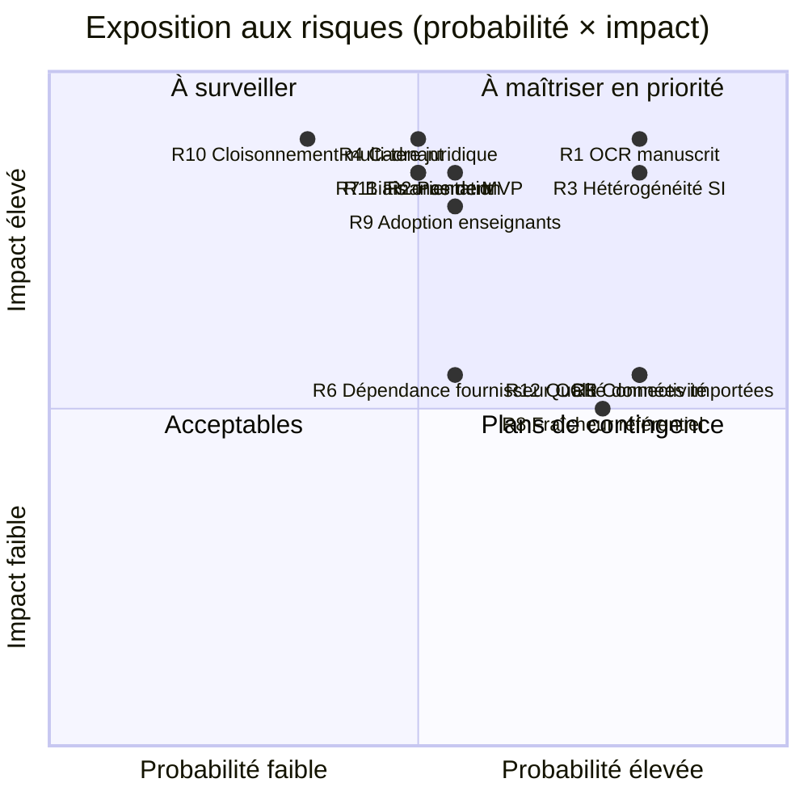

# Registre des risques — BuildNote

> **Statut : Vivant — ouvert en Couche 1.** Date : 2026-09-08.
> Échelles : Impact / Probabilité = Faible · Moyen · Élevé. Le registre est revu à **chaque jalon**
> (voir [`01-project-management/roadmap.md`](../01-project-management/roadmap.md) §B.6).

## Synthèse

## Détail

### R1 — Fiabilité OCR insuffisante (manuscrit, photos de mauvaise qualité, gabarits variés)
- **Impact** : Élevé — **Probabilité** : Élevée — **Catégorie** : Technique / Produit
- **Description** : Les fiches de notes sont souvent manuscrites, photographiées de travers, sous
  mauvais éclairage, avec des ratures. L'extraction automatique peut être médiocre.
- **Mitigations** :
  - **Vérification humaine obligatoire** par conception (l'OCR assiste, ne décide pas).
  - **POC OCR + POC extraction de tableaux** chiffrés avant tout engagement (Phase 6).
  - UX de correction rapide (score de confiance visible, image source zoomable, navigation clavier).
  - Gabarits de fiches paramétrables ; consignes de prise de vue ; recadrage assisté.
  - Objectifs différenciés imprimé vs manuscrit (voir [`00-vision/`](../00-vision/vision-produit.md) §A.4).
- **Indicateur d'alerte** : taux de correction post-OCR > 30 % sur imprimé au POC.
- **Contingence** : réduire le périmètre à la saisie assistée (pré-remplissage partiel) sans
  ambition d'extraction complète.

### R2 — « Pas de MVP » : tunnel long, risque de livrer à côté du besoin
- **Impact** : Élevé — **Probabilité** : Moyenne — **Catégorie** : Gestion de projet
- **Description** : Développer directement la solution de production sans palier intermédiaire
  augmente le risque d'effet tunnel et d'écart au besoin réel.
- **Mitigations** :
  - **Déploiement pilote progressif** (Phase 10) : 1 établissement, mesure, ajustement, avant
    généralisation — sans renoncer à l'objectif « solution de production ».
  - **POC dérisquants** (Phase 6) et **portes de validation** à chaque jalon.
  - Démonstrations régulières aux utilisateurs pendant la Phase 8.
  - Développement **par lots livrables et vérifiables** (L0–L5).
- **Décision associée** : [`17-decisions/decisions-prealables.md`](../17-decisions/decisions-prealables.md) #7.

### R3 — Hétérogénéité extrême des SI scolaires, voire absence de SI
- **Impact** : Élevé — **Probabilité** : Élevée — **Catégorie** : Interopérabilité
- **Mitigations** :
  - Architecture **modèle canonique + connecteurs** (jamais « compat SQL universelle »).
  - Mode **« BuildNote système de saisie primaire »** quand il n'y a pas de SI (Module 1 seul).
  - Import **CSV/Excel** de secours avec gabarits fournis.
  - **POC interopérabilité** sur 2–3 systèmes réels représentatifs (Phase 6).
  - **Réversibilité** : export complet du patrimoine au format canonique documenté.
- **Indicateur d'alerte** : > 40 % des établissements pilotes nécessitent un connecteur sur mesure.

### R4 — Cadre juridique (données de mineurs, consentement parental, souveraineté)
- **Impact** : Élevé — **Probabilité** : Moyenne — **Catégorie** : Juridique / Conformité
- **Mitigations** :
  - **DPIA** dès la Phase 2 ; base légale explicite du traitement.
  - **Minimisation** des données (surtout Module 2 : intérêts, avis parents).
  - Conformité à la **loi camerounaise N° 2010/012** ; anticipation d'un socle type RGPD pour le
    multi-pays.
  - Consentement de l'élève et des parents pour le Module 2 ; durées de conservation justifiées.
  - Décision **hébergement & souveraineté** tranchée en Phase 2 (#1).
- **Contingence** : restreindre le périmètre du Module 2 aux données strictement académiques tant
  que le cadre n'est pas sécurisé.

### R5 — Connectivité faible ou intermittente
- **Impact** : Moyen — **Probabilité** : Élevée — **Catégorie** : Technique / Contexte
- **Mitigations** :
  - **Module 1 offline-first** : capture + validation locales, synchronisation différée.
  - Empreinte réseau minimale ; compression des médias ; reprise de synchronisation.
  - Tests de **performance en réseau dégradé** (Phase 9).
- **Décision associée** : #8 (cible de connectivité, exigence hors-ligne).

### R6 — Dépendance à un fournisseur OCR/IA cloud (coût récurrent, souveraineté, disponibilité)
- **Impact** : Moyen — **Probabilité** : Moyenne — **Catégorie** : Technique / Économique
- **Mitigations** :
  - **Abstraction du moteur OCR** (interface interne stable, fournisseur remplaçable).
  - Évaluation d'options **open source** (auto-hébergeables) au POC.
  - **Benchmark multi-fournisseurs** (qualité, coût, latence, souveraineté) en Phase 6.
  - Choix définitif seulement en Phase 7.
- **Décision associée** : #3 (stratégie OCR).

### R7 — Biais et contestabilité des recommandations d'orientation
- **Impact** : Élevé — **Probabilité** : Moyenne — **Catégorie** : Éthique / Produit
- **Mitigations** :
  - **Explicabilité obligatoire** (facteurs, poids, alternatives, incertitudes, répartition du score).
  - Modèle **interprétable par conception** (règles + scoring additif) plutôt que boîte noire.
  - **Supervision humaine** (conseiller d'orientation) systématique.
  - **Audit régulier** des recommandations par profil ; pas de critères sensibles interdits.
  - Pondérations **transparentes et paramétrables**, valeurs par défaut publiées.
  - Droit de **contestation** et de rectification.

### R8 — Gouvernance et fraîcheur du référentiel stratégique national
- **Impact** : Moyen — **Probabilité** : Élevée — **Catégorie** : Données / Gouvernance
- **Mitigations** :
  - Chaque entrée **sourcée, datée, versionnée**.
  - Rôle **gestionnaire du référentiel** ; processus proposition → validation → publication.
  - Affichage explicite de l'**ancienneté** d'une donnée ; revue périodique.
  - Le référentiel **informe** le score, il ne **verrouille** aucune option.
- **Décision associée** : #5 (sources et gouvernance).

### R9 — Adoption par les enseignants (charge perçue, confiance dans l'outil)
- **Impact** : Élevé — **Probabilité** : Moyenne — **Catégorie** : Conduite du changement
- **Mitigations** :
  - **Co-conception** avec des enseignants (Phases 1 et 5).
  - UX de validation **plus rapide que la saisie manuelle** (objectif mesuré).
  - **Formation** et accompagnement au pilote ; démonstration du gain de temps.
  - Boucle de retour et itérations pendant le pilote.

### R10 — Sécurité / cloisonnement entre établissements (multi-tenant)
- **Impact** : Élevé — **Probabilité** : Faible à Moyenne — **Catégorie** : Sécurité
- **Mitigations** :
  - **Isolation par conception** (stockage + accès), stratégie multi-tenant tranchée en Phase 2/4.
  - **RBAC/ABAC**, chiffrement au repos et en transit.
  - **Tests d'intrusion** et tests d'isolation dédiés (Phase 9).
  - **Audit** et journalisation de tous les accès.
- **Décision associée** : #4 (modèle multi-tenant).

### R11 — Financement et pérennité (initiative privée)
- **Impact** : Élevé — **Probabilité** : Moyenne — **Catégorie** : Économique
- **Mitigations** :
  - **Modèle économique** explicité en Phase 0 (qui finance le build, qui finance le run).
  - Jalons de financement **alignés sur les portes** (chaque phase engage le budget de la suivante).
  - Coûts de **run** estimés dès la Phase 2 (hébergement, OCR, support).
- **Décision associée** : #9 (modèle économique et structure porteuse).

### R12 — Qualité des données importées (doublons, incohérences historiques)
- **Impact** : Moyen — **Probabilité** : Élevée — **Catégorie** : Données
- **Mitigations** :
  - Pipeline de **validation** + **quarantaine** (pas de rejet silencieux).
  - **Tableau de bord qualité** (complétude, fraîcheur, conflits, corrections).
  - **Règles de conflit** par entité/champ ; **dédoublonnage** des personnes avec revue.
  - Import **idempotent** (clés de rapprochement stables).

## Risques secondaires à suivre

| # | Risque | Impact | Prob. | Note |
|---|--------|--------|-------|------|
| R13 | Indisponibilité des jeux de données réels pour les POC | Moyen | Moyen | Anticiper des accords d'accès + anonymisation dès la Phase 1 |
| R14 | Sur-ingénierie de l'interopérabilité (trop de connecteurs trop tôt) | Moyen | Moyen | Prioriser 2–3 connecteurs au POC, étendre au fil des vagues |
| R15 | Dérive du périmètre (« gestion de scolarité complète ») | Moyen | Moyen | Non-objectifs figés en Phase 0 ; gestion des changements |
| R16 | Rotation de l'équipe / dépendance à des compétences rares (OCR, data) | Moyen | Moyen | Documentation, revues croisées, formation |
| R17 | Matériel des établissements insuffisant (smartphones, postes) | Moyen | Moyen | Spécifier une config minimale ; tester sur matériel bas de gamme |
| R18 | Traduction/i18n incomplète (explications d'orientation, exports) | Faible | Moyen | i18n de bout en bout dans la définition of done |
| R19 | Résistance institutionnelle lors d'une future adoption MINESEC/MINESUP | Moyen | Faible | Documentation de conformité prête ; architecture compatible |
