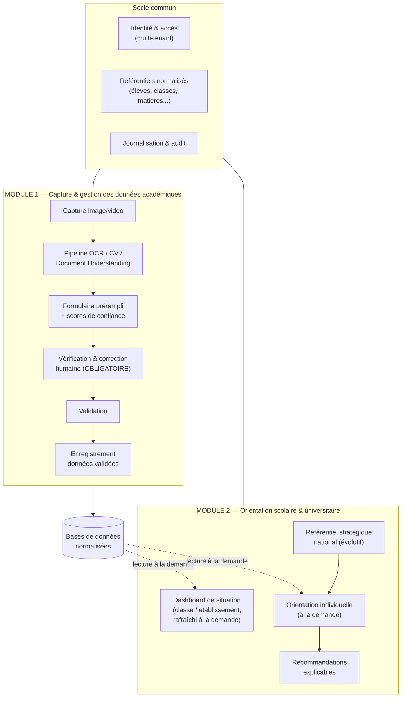
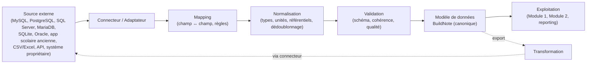
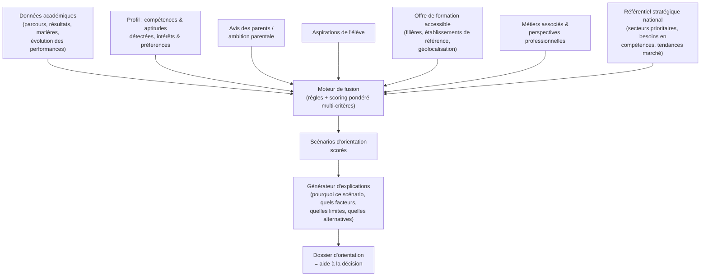
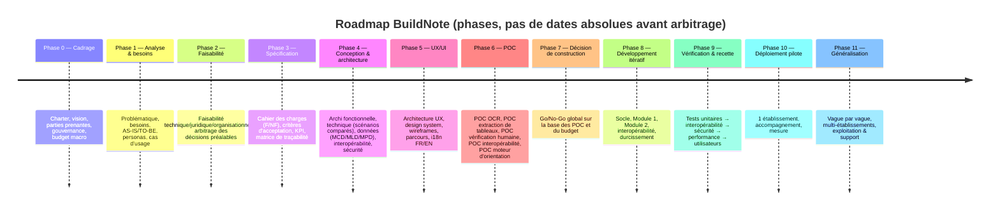

# BuildNote — Documentation de structuration du projet

> **Statut : Couche 1 — Vision d'ensemble & cadre directeur (à valider).**
> Aucune ligne de code n'est produite tant que les livrables de cadrage → conception → POC
> ne sont pas validés.

Ce dépôt `docs/` contient le corpus documentaire d'ingénierie de BuildNote, produit **par couches**
avec une porte de validation entre chacune (voir [roadmap](01-project-management/roadmap.md)).

| # | Dossier | Contenu | Couche |
|---|---------|---------|--------|
| A | [`00-vision/`](00-vision/vision-produit.md) | Vision produit | **1** |
| B | [`01-project-management/`](01-project-management/roadmap.md) | Charter, gouvernance, méthodo, roadmap, jalons, gestion risques/changements/versions/doc | 1 (roadmap) → 2 |
| C | [`02-analyse-metier/`](02-analyse-metier/) | Problématique, besoins, AS-IS / TO-BE, personas, parcours, cas d'usage | 2 |
| D | [`03-cahier-des-charges/`](03-cahier-des-charges/) | Exigences F / NF, contraintes, critères d'acceptation, KPI | 3 |
| E | [`04-architecture-fonctionnelle/`](04-architecture-fonctionnelle/architecture-fonctionnelle.md) | Les deux modules, clairement séparés | **1** |
| F | [`05-architecture-technique/`](05-architecture-technique/) | Scénarios d'architecture comparés | 3 |
| G | [`06-architecture-donnees/`](06-architecture-donnees/vue-ensemble.md) | Modèles conceptuel / logique / physique ; Raw / Normalized / Intelligence | **1** (vue) → 4 |
| H | [`07-interoperabilite/`](07-interoperabilite/vue-ensemble.md) | Modèle canonique, connecteurs, mapping, ETL, conflits, lineage, versioning schéma, qualité | **1** (vue) → 4 |
| I | [`08-ocr-computer-vision/`](08-ocr-computer-vision/) | Pipeline capture → … → validation humaine → stockage | 5 |
| J | [`09-moteur-orientation/`](09-moteur-orientation/) | Fusion multi-sources, accès aux données à la demande, explicabilité, dimension stratégique nationale, gabarits de présentation FR/EN | **1** (vue) → 5 |
| K | [`10-securite/`](10-securite/) | Authn, authz, chiffrement, journalisation, sauvegardes, isolation établissements, audit | 6 |
| L | [`11-ux-ui/`](11-ux-ui/) | Architecture UX, design system (bleu clair / orange / blanc), i18n FR/EN | 6 |
| M | [`12-poc/`](12-poc/) | POC OCR, extraction de tableaux, interopérabilité, moteur d'orientation, écran de vérification humaine ; dossier d'exécution [`acquisition/`](12-poc/acquisition/README.md) | 7 |
| O | [`13-tests/`](13-tests/) | Stratégie et plans de test par type | 7 |
| P | [`14-deploiement/`](14-deploiement/) | 6 scénarios de déploiement | 7 |
| Q | [`15-livrables-par-phase/`](15-livrables-par-phase/livrables.md) | Pour chaque phase : objectif / activités / livrables / critères / responsables / dépendances / go-no-go | **1** → consolidé 7 |
| — | [`16-risques/`](16-risques/risques.md) | Registre des risques majeurs + mitigations | **1** (vivant) |
| — | [`17-decisions/`](17-decisions/decisions-prealables.md) | ADR + décisions préalables au développement | **1** (vivant) |
| — | [`glossaire.md`](glossaire.md) | Terminologie FR (+ équivalents EN) | **1** (vivant) |

> **N (MVP)** : le porteur ne souhaite pas de MVP mais la solution de production directe. Ce choix
> est documenté et challengé dans [`16-risques/`](16-risques/risques.md) et
> [`17-decisions/`](17-decisions/decisions-prealables.md) — recommandation : un **déploiement pilote
> progressif** tenant lieu de palier de dérisquage, sans renoncer à l'objectif « utilisable en
> production ».

---

# Synthèse exécutive

*(Réponse aux 10 points du format demandé. Chaque point renvoie au document détaillé.)*

## 1. Vision globale de BuildNote

BuildNote est une **plateforme d'aide à la décision éducative** pour les établissements du primaire,
du secondaire (collèges et lycées) et de l'enseignement supérieur. Elle poursuit deux finalités
distinctes, portées par **deux modules fonctionnellement séparés** :

- **Fiabiliser et structurer la donnée académique** aujourd'hui piégée sur des fiches papier, des
  cahiers de notes et des tableurs hétérogènes — en la capturant par photo/vidéo, en la
  reconnaissant automatiquement, mais en **exigeant toujours une vérification humaine** avant
  enregistrement.
- **Éclairer l'orientation** des élèves et étudiants en croisant leur parcours réel, leurs
  aspirations, l'avis de leurs parents, l'offre de formation accessible, les perspectives
  professionnelles et les **besoins stratégiques de développement du Cameroun** — pour produire des
  recommandations **explicables**, jamais imposées.

BuildNote est conçu pour les **réalités africaines et camerounaises** : établissements aux systèmes
d'information hétérogènes ou inexistants, connectivité faible ou intermittente, matériel modeste,
pluralité linguistique (interface **FR/EN** avec sélecteur dès l'écran d'accueil). L'architecture est
**modulaire, interopérable et multi-tenant**, pensée pour une extension future à d'autres pays.

→ Détail : [`00-vision/vision-produit.md`](00-vision/vision-produit.md)

## 2. Architecture fonctionnelle

Deux modules **indépendants** partageant uniquement le socle (identité, référentiels normalisés,
sécurité, journalisation) et communiquant par **contrats d'API explicites** — jamais par couplage
direct.

**Règles d'architecture non négociables :**

1. Le Module 2 **ne recalcule rien automatiquement** à l'enregistrement d'une note. Le dashboard et
   l'orientation lisent les bases **à la demande**.
2. Le Module 1 ne fait **jamais** confiance à l'OCR au point d'enregistrer sans revue humaine.
3. Les recommandations d'orientation sont **explicables et justifiables**, et l'outil reste une
   **aide à la décision** — il n'impose aucune carrière.

→ Détail : [`04-architecture-fonctionnelle/architecture-fonctionnelle.md`](04-architecture-fonctionnelle/architecture-fonctionnelle.md)

## 3. Modules

| | Module 1 — Capture & gestion des données académiques | Module 2 — Orientation |
|---|---|---|
| **But** | Transformer une fiche physique en données structurées vérifiées | Éclairer les choix d'orientation et la lecture de la performance |
| **Déclencheur** | Un enseignant importe une photo/vidéo de fiche | Une demande explicite (orientation d'un élève ; ou consultation du dashboard) |
| **Cœur technique** | OCR / Computer Vision / Document Understanding + workflow de validation humaine | Moteur de règles + scoring multi-critères + génération d'explications |
| **Sortie** | Notes / résultats validés, écrits en base normalisée | Dashboard de situation ; dossier d'orientation explicable |
| **Couplage** | Écrit dans la base normalisée | Lit la base normalisée + le référentiel stratégique, **à la demande** |
| **Indépendance** | Fonctionne sans le Module 2 | Fonctionne sans le Module 1 (sur données déjà présentes ou importées via interopérabilité) |

→ Détail : [`04-architecture-fonctionnelle/architecture-fonctionnelle.md`](04-architecture-fonctionnelle/architecture-fonctionnelle.md)

## 4. Architecture de données

Trois strates, séparées physiquement et logiquement :

```mermaid
flowchart LR
    subgraph RAW["RAW DATA (immuable)"]
        R1["Images / vidéos de fiches"]
        R2["Documents importés"]
        R3["Extractions brutes de systèmes externes"]
        R4["Payloads OCR bruts + scores"]
    end
    subgraph NORM["NORMALIZED DATA (vérité métier)"]
        N1["Établissements, classes, années scolaires"]
        N2["Élèves / étudiants, enseignants, parents"]
        N3["Matières, examens, évaluations"]
        N4["Notes / résultats VALIDÉS"]
    end
    subgraph INTEL["INTELLIGENCE DATA (dérivée, recalculable)"]
        I1["Profil académique, tendances de performance"]
        I2["Compétences & aptitudes détectées"]
        I3["Profil d'orientation, recommandations"]
        I4["Adéquation formations / stratégie nationale"]
        I5["Indicateurs analytiques & classements"]
    end
    RAW -->|extraction + validation humaine| NORM
    NORM -->|calcul à la demande| INTEL
```

- **Raw** : jamais modifié, conservé pour audit, ré-extraction et amélioration des modèles.
- **Normalized** : le modèle **canonique BuildNote**, seule source de vérité métier ; alimenté par
  le Module 1 (après validation) et par l'interopérabilité (après normalisation).
- **Intelligence** : entièrement **dérivable** des strates inférieures, recalculée à la demande,
  jamais considérée comme une donnée d'entrée.

→ Détail : [`06-architecture-donnees/vue-ensemble.md`](06-architecture-donnees/vue-ensemble.md)

## 5. Architecture d'interopérabilité

Principe : **ne pas** rendre une base « compatible avec toutes les bases SQL ». On interpose un
**modèle canonique** et une **couche d'abstraction** ; chaque système source est relié par un
**connecteur** dédié.

Composants : catalogue de connecteurs, moteur de mapping déclaratif, pipeline de transformation,
règles de validation, **gestion des conflits** (règles de préséance, revue manuelle),
**traçabilité / lineage** de chaque transformation, **versioning du schéma canonique**, **tableau de
bord qualité des données**, imports/exports batch et API temps réel quand disponible, ETL lorsque
nécessaire.

→ Détail : [`07-interoperabilite/vue-ensemble.md`](07-interoperabilite/vue-ensemble.md)

## 6. Moteur d'orientation

Le moteur combine, **à la demande** :

**Explicabilité** : chaque recommandation expose (a) les facteurs qui l'ont fait remonter et leur
poids, (b) les données utilisées et leur fraîcheur/fiabilité, (c) les scénarios alternatifs écartés
et pourquoi, (d) les zones d'incertitude, (e) la part « profil élève » vs « aspirations » vs
« besoins nationaux » dans le score. Le référentiel stratégique est **évolutif, sourcé et daté**
(chaque entrée cite sa source et sa date). Aucune carrière n'est imposée ; l'élève, la famille et le
conseiller gardent la décision.

→ Détail : [`09-moteur-orientation/`](09-moteur-orientation/) — vue d'ensemble, architecture détaillée (accès aux données, scoring, dashboard), gabarits de présentation FR/EN

## 7. Roadmap complète

Chaque phase se termine par une **décision de passage** documentée. Les phases 0 → 6 sont
**sans code**. Le code ne commence qu'à la Phase 8, après le Go/No-Go de la Phase 7.

→ Détail : [`01-project-management/roadmap.md`](01-project-management/roadmap.md)

## 8. Liste exhaustive des livrables par phase

Le tableau complet — pour chaque phase : **objectif, activités, livrables, critères de validation,
responsables, dépendances, décision de passage à la phase suivante** — est maintenu dans
[`15-livrables-par-phase/livrables.md`](15-livrables-par-phase/livrables.md).

Extrait (livrables principaux) :

| Phase | Livrables clés |
|---|---|
| 0 — Cadrage | Project Charter, note de vision, cartographie des parties prenantes, plan de gouvernance, budget macro, plan de management des risques v0 |
| 1 — Analyse | Dossier d'analyse métier, personas, parcours utilisateurs, catalogue des cas d'usage, processus AS-IS / TO-BE |
| 2 — Faisabilité | Étude de faisabilité (technique / juridique / organisationnelle / financière), registre des décisions arbitrées, DPIA préliminaire |
| 3 — Spécification | Cahier des charges (exigences F & NF), critères d'acceptation, dictionnaire des KPI, matrice de traçabilité des exigences |
| 4 — Conception | Dossiers d'architecture fonctionnelle / technique (scénarios comparés + choix) / données (MCD, MLD, MPD) / interopérabilité / sécurité (modèle de menaces) |
| 5 — UX/UI | Architecture de l'information, design system (palette bleu clair / orange / blanc), wireframes, prototypes de parcours, spécification i18n FR/EN |
| 6 — POC | 4 rapports de POC + rapport POC-VH (écran de vérification humaine), résultats chiffrés vs critères de succès, recommandation de poursuite ; dossier d'exécution de la chaîne d'acquisition ([`12-poc/acquisition/`](12-poc/acquisition/README.md)) |
| 7 — Décision | Dossier de décision de construction, plan de développement détaillé, plan de test, plan de déploiement |
| 8 — Développement | Incréments logiciels vérifiés (socle, Module 1, Module 2, interopérabilité), documentation technique, jeux de tests |
| 9 — Recette | Rapports de tests (unitaires, intégration, système, OCR, données, sécurité, performance, utilisateurs, interopérabilité), PV de recette |
| 10 — Pilote | Environnement pilote, guide utilisateur & formation, rapport d'évaluation du pilote |
| 11 — Généralisation | Plan de déploiement par vagues, runbooks d'exploitation, plan de support, plan de continuité |

## 9. Risques majeurs

| # | Risque | Impact | Probabilité | Mitigation (résumé) |
|---|--------|--------|-------------|---------------------|
| R1 | Fiabilité OCR insuffisante sur fiches manuscrites / photos de mauvaise qualité | Élevé | Élevée | Validation humaine obligatoire ; POC OCR chiffré ; assistance à la saisie plutôt qu'automatisation totale |
| R2 | « Pas de MVP » → tunnel long, risque de livrer à côté du besoin | Élevé | Moyenne | Déploiement **pilote progressif** ; POC dérisquants ; portes de validation |
| R3 | Hétérogénéité extrême des SI scolaires / absence de SI | Élevé | Élevée | Modèle canonique + connecteurs ; mode « BuildNote source unique » possible ; import CSV/Excel de secours |
| R4 | Cadre juridique (données de mineurs, consentement parental, souveraineté) | Élevé | Moyenne | DPIA dès la Phase 2 ; minimisation ; hébergement à arbitrer ; base légale explicite |
| R5 | Connectivité faible / coupures | Moyen | Élevée | Conception offline-first pour le Module 1 ; synchronisation différée ; empreinte réseau minimale |
| R6 | Dépendance à un fournisseur OCR/IA cloud (coût, souveraineté, disponibilité) | Moyen | Moyenne | Abstraction du moteur OCR ; option open source ; benchmark multi-fournisseurs au POC |
| R7 | Biais et contestabilité des recommandations d'orientation | Élevé | Moyenne | Explicabilité obligatoire ; garde-fous éthiques ; supervision humaine ; audit du référentiel |
| R8 | Gouvernance et fraîcheur du référentiel stratégique national | Moyen | Élevée | Sources officielles datées ; processus de mise à jour ; versioning ; mention explicite de l'obsolescence |
| R9 | Adoption par les enseignants (charge perçue, confiance) | Élevé | Moyenne | UX de correction rapide ; co-conception ; formation ; gain de temps démontré au pilote |
| R10 | Sécurité / cloisonnement entre établissements (multi-tenant) | Élevé | Faible-Moyenne | Isolation par conception ; tests d'intrusion ; RBAC/ABAC ; chiffrement ; audit |
| R11 | Financement et pérennité (initiative privée) | Élevé | Moyenne | Modèle économique explicité en Phase 0 ; jalons de financement alignés sur les portes |
| R12 | Qualité des données importées (doublons, incohérences historiques) | Moyen | Élevée | Pipeline de validation ; tableau de bord qualité ; règles de conflit ; quarantaine des données douteuses |

→ Registre vivant : [`16-risques/risques.md`](16-risques/risques.md)

## 10. Décisions à prendre avant le développement

Ces points doivent être **arbitrés (Phase 2)** avant tout code. Détail, options et recommandations
dans [`17-decisions/decisions-prealables.md`](17-decisions/decisions-prealables.md).

1. **Hébergement & souveraineté** des données : on-premise établissement / cloud régional / hybride.
2. **Cadre juridique** : base légale du traitement, consentement parental, durées de conservation,
   conformité à la loi camerounaise N° 2010/012 et anticipation multi-pays.
3. **Stratégie OCR** : services managés vs open source vs mixte ; support du manuscrit ; implication
   souveraineté et coût récurrent.
4. **Modèle multi-tenant** : base par établissement / schéma par établissement / base partagée
   cloisonnée.
5. **Gouvernance du référentiel stratégique national** : sources officielles retenues, responsable
   de la mise à jour, fréquence, processus de validation.
6. **Périmètre V1** : niveaux couverts (primaire ? secondaire ? supérieur ?), nombre d'établissements
   pilotes, périmètre fonctionnel minimal exploitable.
7. **« Pas de MVP » vs pilote progressif** : arbitrage explicite du porteur.
8. **Cible de connectivité** et niveau d'exigence hors-ligne.
9. **Modèle économique & structure porteuse** : qui finance, qui exploite, qui possède la donnée.
10. **Stack technologique** : à ne fixer qu'après la faisabilité et les POC, avec justification.
11. **Politique linguistique** : FR/EN confirmés ; anticiper d'autres langues (portée multi-pays).
12. **Propriété intellectuelle & modèle de licence** du logiciel.

---

## Conventions de la documentation

- Langue : **français** (le produit reste bilingue FR/EN).
- Format : Markdown, diagrammes **Mermaid** intégrés.
- Chaque document porte un en-tête `Statut` (Brouillon / En revue / Validé) et une date.
- Les décisions d'architecture sont tracées en **ADR** dans [`17-decisions/`](17-decisions/).
- Terminologie : voir [`glossaire.md`](glossaire.md).
